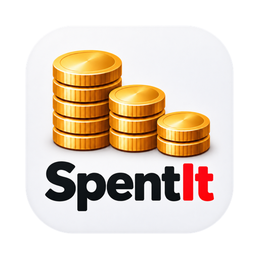

# SpentIt

I developed SpentIt so I could get an answer to this one simple question: "Where did my money go?"

It is a desktop program for one person. You bring your transactions together, sort them into categories that mean something to you, and look at where the money actually went.

There is no budget to keep, no tax preparation, and no investment tracking. SpentIt does not connect to your bank. When you want new transactions, you save a statement from your bank or card and bring that file in, or you simply type the transaction yourself.

Your data stays on your own computer. If you would like the file to stay private, give it a password and SpentIt encrypts it for you. 

SpentIt was developed with the aid of AI.  It has been tested on macOS, Windows and Linux.

## What you can do

- Bring in a statement you downloaded (QIF, OFX, QFX, QBO, or ASO), or type a transaction yourself.
- Keep your bank, cash, and credit-card accounts together.
- Sort spending into categories, and let rules fill in the ones that come around again.
- Review possible duplicates and transfers before you rely on them.
- Accept transactions when you are happy with them.
- Open a report and see the transactions behind a total spent.
- Use a report to compare one period of spending with others.
- Search for something you half remember.
- Undo a recent change.
- Keep a backup of your file.

## The manual

These pages contain extra markup so they can be compiled into the application's Help, but reading them here gives a good overview of what SpentIt looks like and how it works.

- [Understand your spending](manual/index.md)
- [Create or open your file](manual/create-open-file.md)
- [Set up your accounts](manual/accounts.md)
- [Bring in transactions](manual/import-transactions.md)
- [Find your way around transactions](manual/find-transactions.md)
- [Review duplicates and link transfers](manual/review-duplicates-transfers.md)
- [Add and correct transactions](manual/add-correct-transactions.md)
- [Organize spending with categories](manual/categories.md)
- [Use rules for repeated categorization](manual/rules.md)
- [Accept transactions — now or later](manual/accept-transactions.md)
- [Answer questions with reports](manual/reports.md)
- [Look after your work and resolve remaining problems](manual/backup-recovery.md)
- [Where do I find…?](manual/where-to-find.md)
- [Keyboard and mouse](manual/keyboard-mouse.md)
- [Search examples](manual/search-examples.md)
- [Words used in SpentIt](manual/words.md)
- [Messages and problems](manual/messages-problems.md)

## How to build it

The build steps are in [Building](doc/building.md).

## License

Use SpentIt if you want to. I do not promise that it is correct, complete, or safe to rely on. Keep your own copies of your records. If you trust SpentIt and it lets you down, that rests with you. If you are not comfortable with that, do not use it.

SpentIt is released under the Unlicense. See [LICENSE](LICENSE). Third-party components have their own licenses, which are shown in the [LICENSE](LICENSE) file and in the application's About dialog.
