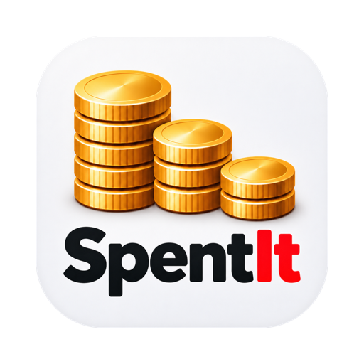

# SpentIt

I developed SpentIt so I could get an answer to this one simple question: "Where did my money go?"

SpentIt is a single-user desktop program. It brings your transactions together, sorts them into categories that mean something to you, and shows where the money actually went.

There is no budget to keep, no tax preparation, and no investment tracking. SpentIt does not connect to your bank. When you want to add transactions, you save a statement from your bank or card and bring that file in, or you simply type the transaction yourself.

Your data stays on your own computer. If you would like the file to stay private, give it a password and SpentIt encrypts it for you. 

SpentIt was developed with the aid of AI.  It has been tested on macOS, Windows and Linux.  
[Download SpentIt now](https://github.com/iBuiltIt/SpentIt/releases)

[Watch SpentIt in action - 40 seconds](https://youtu.be/tC_EH4smn28)  

## What you can do

- Bring in a statement you downloaded (QIF, OFX, QFX, QBO, or ASO), or type a transaction yourself.
- Keep your bank, cash, and credit-card accounts together.
- Sort spending into categories, and let rules categorize recurring transactions automatically.
- Review possible duplicates and transfers before you rely on them.
- Accept transactions when you are happy with them.
- Open a report and see the transactions behind a total spent.
- Use a report to compare one period of spending with others.
- Search for something you half remember.
- Undo a recent change.

## But the bank does this already

SpentIt is still worth having for these reasons.

- **Your history stays.** What did the new roof cost 10 years ago? If you brought it in, you can still look it up.
- **Your categories.** You decide how to sort the spending. Want Amazon as its own category? You can.
- **Compare periods.** Want to see how this year compares with last year? Add another period to a report.
- **The file is yours.** Not happy with your bank? Leave, but keep your imported transactions.

This may not be for everyone. It is for me, and I hope it is for you. I started keeping these records in Microsoft Money in the '90s, and I still do - now in an application that works for me, and is free forever.

## The manual

These pages contain extra markup so they can be compiled into the application's Help, but reading them here gives a good overview of what SpentIt looks like and how it works.

- [Understand your spending](manual/index.md)
- [Create or open your file](manual/create-open-file.md)
- [Set up your accounts](manual/accounts.md)
- [Bring in transactions](manual/import-transactions.md)
- [Find your way around transactions](manual/find-transactions.md)
- [Review duplicates and link transfers](manual/review-duplicates-transfers.md)
- [Add and correct transactions](manual/add-correct-transactions.md)
- [Organize spending with categories](manual/categories.md)
- [Use rules for repeated categorization](manual/rules.md)
- [Accept transactions — now or later](manual/accept-transactions.md)
- [Answer questions with reports](manual/reports.md)
- [Look after your work and resolve remaining problems](manual/backup-recovery.md)
- [Where do I find…?](manual/where-to-find.md)
- [Keyboard and mouse](manual/keyboard-mouse.md)
- [Search examples](manual/search-examples.md)
- [Words used in SpentIt](manual/words.md)
- [Messages and problems](manual/messages-problems.md)

## How to build it

The build steps are in [Building](doc/building.md).

## License

SpentIt is released under the Unlicense. See [LICENSE](LICENSE). Third-party components have their own licenses, which are shown in the [LICENSE](LICENSE) file and in the application's About dialog.

SpentIt is provided as-is, without warranties of any kind. Although I have tested it, I cannot guarantee that it is free from errors. Please keep backups of your financial records and verify important results.

Stefan Wessels  
swessels@email.com  
First Release: November 2026  