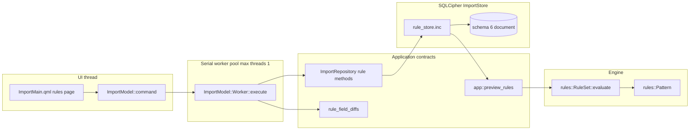
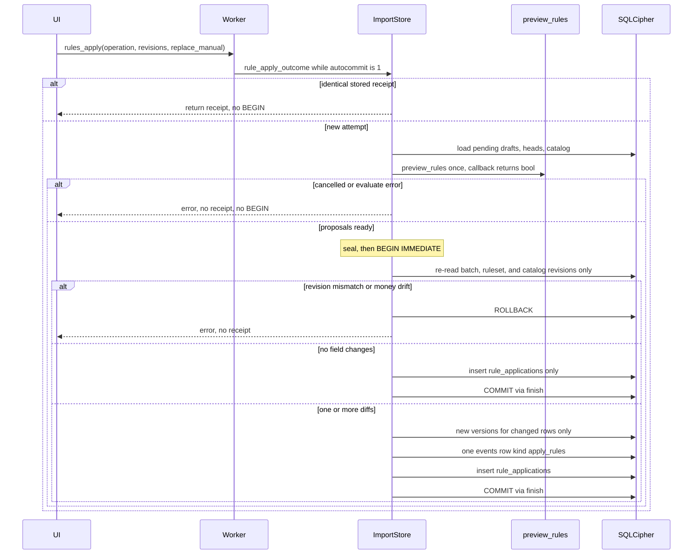

# Durable rules integration

The [category-gated rules contract](../features/004-rules-and-explanations.md#next-implementation-category-gated-rules-and-imported-categories--2026-11-02)
is implemented in formats 42/41. It supersedes per-field winners, inherited
categories, manual replacement and isolated selected-rule evaluation below.
Split rules categorize first; transaction rules fill only remaining Uncategorized
allocations. Selected Apply uses saved surrounding rule order and writes only the
selected rule. Imported missing categories require a durable import-wide decision
before automatic rules or acceptance. See [status](status.md) for verification.

The [single rules workspace](../features/004-rules-and-explanations.md#single-rules-workspace-and-independent-edits--owner-go-2026-11-01)
supersedes the focused/all-rules switch and UI save scope described below. Selected
Save/Apply excludes unrelated drafts; preview is optional. Leaving uses a nonmodal
Save all / Discard all / Stay bar and retains atomic definition validation.

The [account-scope Apply contract](../features/004-rules-and-explanations.md#rule-scope-and-account-apply--owner-go-2026-11-01)
supersedes the separate preview/Apply/Reapply UI described below. New and committed
transactions can now be updated and undone together in the selected account.

The [match-list and non-reverting Apply follow-up](../features/004-rules-and-explanations.md#match-list-preview-and-non-reverting-apply--owner-go-2026-11-01)
supersedes earlier removal/recomputation and whole-scope preview limits below.
Only enabled matches appear in the compact preview; disabled or nonmatching rules
no longer cause earlier values to be reset by Apply or accepted-account reapply.

The [transaction rule editor follow-up](../features/004-rules-and-explanations.md#transaction-rule-editor--owner-go-2026-11-01)
supersedes the original editor layout below. It adds attribution-based Create/Edit,
current-category prefill, focused read-only single-rule testing, and moves transfer
suggestion controls to Review. Full-ruleset Save/Apply contracts remain unchanged.
See [status](status.md) for verification and limits.

| | |
|---|---|
| Author | SpentIt contributor (placeholder) |
| Date | 2026-10-25 |
| Status | Schema-6/rules-sheet baseline verified in Release and ASan/UBSan on 2026-10-26; current schema 42 retains bulk receipts and scopes Apply to an account. |
| Package | Roadmap package 5, rules half only |
| Schema | Current rules-enabled documents **40**; the historical schema-6 design below is retained as implementation rationale. No pre-release migration obligation. |

## Current follow-up — 2026-10-26

[Account-scoped workspaces](accounts.md) retain document-wide saved rules and limit Apply to the selected account. Earlier experimental layouts are rejected without migration. Current documents are schema 40 with rules and 39 without. Schema 20 is rejected without migration. Selected-account committed reapplication is in [feature 004](../features/004-rules-and-explanations.md#accepted-committed-reapplication--2026-10-27). The schema-6 design below is an earlier contract; the table above identifies the current format.

The earlier verification gap is closed: the rules-enabled `3f94fe6` baseline passed all 72 tests in Release and ASan/UBSan. [Search/ledger work](search-ledger.md) now adds combined search, multiselection, and schema-7 bulk receipts. The owner clarified that pre-release formats need no migration or compatibility commitment until an announced release. The historical design and checkpoint below are retained; their Debug-only and search-not-done statements do not describe current status. See [project status](status.md) for evidence and limitations.

## Historical implementation status — 2026-10-25

Schema 6 Save, Preview, and Apply are in the rules-enabled import store (`9b7cf40`), with the `rulestore.*` Debug results recorded in [project status](status.md). The rules sheet is `147a5be`. Debug `import.rules_ui` passed, as recorded in project status. The design below remains the contract that implementation followed. Sentences that say the sheet or the store is missing describe the repository before that work. Release, ASan/UBSan, search, committed reapplication, other platforms, PCRE2 sanitizer coverage, and physical power loss are not done. The next package is search and ledger completion.

## Overview

The bounded rules evaluator and the pure application preview adapter are implemented and verified. Schema 6 adds the document-scoped ruleset, Save, and atomic pending Apply. The sheet editor is `147a5be`: list, reorder, enable, edit, explicit Save and Discard, and Preview separate from Apply. It is verified in Debug only. Search, committed reapplication, Release, and ASan/UBSan remain undone.

This design adds that integration inside the existing one-account QIF experiment. New experimental documents use schema 6 and keep every schema-5 category and committed-change capability. Schemas 1–5 open unchanged and reject rule commands. Apply calls the existing `app::preview_rules` / `rules::RuleSet::evaluate` path. It does not introduce a second pattern language, and it does not modify committed rows, money, dates, split structure, or transfer relationships.

Rule definitions are immutable versions addressed by a stable identity and a monotonic per-rule version. The live ordered list is a mutable head. Draft and committed snapshots gain field marks pointing at those versions. Later edits and deletions do not rewrite old marks, so an explanation can still name the rule version that wrote a field.

## Background and motivation

This section records the repository as found when the design was written. The implementation status above is the current state.

`features/004-rules-and-explanations.md` and `doc/rules-engine.md` record the accepted evaluation policy and the engineering contracts. `rules::RuleSet::evaluate` (`src/engine/rules.cpp`) already implements transaction-then-split phases, per-field first assignment, manual protection, source-allocation identity, and the explanation effects `applied`, `compatible`, `competing`, `manual_protected`, and `missing_parent`. `app::preview_rules` (`src/app/rule_preview.cpp`) rebuilds a `DraftRow` from that result without changing amounts, dates, allocation identities, or source ordinals. Its header states the integration obligation directly: the adapter performs no repository write, and durable Apply must check revisions again.

Persistence stops short of that obligation:

- `FieldOwnership::rule` exists in `src/engine/include/spentit/category.hpp`, but `validate_owner` and `ImportStore::canonical_draft` in `src/storage/category_store.inc` reject it (`"Rule provenance is not supported yet"`).
- `DraftRow` and `Allocation` store owners but not the rule identity and version that `rules::Contribution` carries. `RuleInput::provenance` is a parallel vector that is not loaded from SQL.
- `PRAGMA user_version` for a new `ImportStore::create` is **5** (`schema` in `src/storage/import_store.cpp`). There is no rule table.
- The durable UI (`src/ui/import_model.cpp`, `src/ui/ImportMain.qml`) has category Save / Discard / Stay and a serial worker. It has no rules page, no rule commands, and `command()` seals every action except open, unlock, import, and resume, so a long evaluation could not be cancelled.

`doc/roadmap.md` ("Owner-requested stopping point — 2026-10-25") says the next implementation package is this integration, before search and ledger completion. Bulk committed reapplication stays deferred. Precedence, manual protection, and document-global rule Save are already accepted and are not reopened here.

## Goals and non-goals

### Goals

- Persist a document-wide ruleset: identity, monotonic definition version, enabled flag, ordered position, scope, input field, PCRE2 expression, and the existing action fields.
- Keep every definition version and every applied field mark after later reorder, disable, edit, or delete.
- Load that ruleset into `rules::Rule` / `rules::RuleSet` with no second matcher.
- Preview and Apply as separate commands. Apply writes the whole chosen pending scope in one SQLite transaction or writes nothing.
- Preserve field provenance and the previous draft revision. Reapplication recomputes rule-owned fields from immutable source facts, keeps manual fields (including deliberate blanks) unless replacement was explicit, and shows removals of obsolete derived results as well as new assignments.
- Sheet editor: list, reorder, enable, edit, explicit Save and Discard, and create/edit entry points from the already open transaction that do not require the search package.
- Show the evaluator's existing overlap effects. Do not claim exhaustive PCRE2 overlap detection.
- Run evaluation and writes on the existing serial import worker.
- Schema-6 documents still support categories and committed changes. Schemas 1–5 remain readable and reject rule commands. No silent or destructive migration.
- Failure behavior matches `category_tests.cpp` / `committed_tests.cpp`: injected `SQLITE_FULL` and `SQLITE_IOERR_WRITE`, abrupt exits, and `ImportPhase::before_commit` / `after_commit`.

### Non-goals

- Search, combined text/date/source query grammar, multiselection, subset Apply, transfers, reports, further import formats, password change, password reset, distribution, and license selection.
- Bulk reapplication to committed records, and any automatic change of an existing committed row when rules are saved or edited.
- A new cryptography scheme. Rules live in the existing SQLCipher document.
- Changing `rules::RegexLimits`, `rules::EvaluationLimits`, template syntax (`$$`, `${0}` through `${32}`), phase order, or capture semantics. Those contracts are already specified in `doc/rules-engine.md` and `src/engine/rule_regex.cpp`.
- Chunking a pending batch that exceeds the evaluator's 4,096-record or 16,384-allocation scope. The command fails visibly and writes nothing.
- Finding every historical row a pattern might match. That is search. Entry points below use only the open row.
- Measuring representative-workload responsiveness, Linux, Windows, or physical power loss.

## Proposed design

### Boundaries



`doc/project-layout.md` says storage implements persistence contracts and uses engine types, and that `spentit_rule_preview` is an application target with no SQL. `src/storage/CMakeLists.txt` today links `spentit_import_store` only to `SpentIt::engine` and SQLCipher. The private link below is a new exception, not an edge that document already allows. PR 4 records it in `doc/project-layout.md`.

- `SpentIt::engine` does not include PCRE2, Qt, or SQL. `SpentIt::rules` (`src/engine/CMakeLists.txt`) privately links PCRE2 and publicly links the engine. PCRE2 stays off `SpentIt::engine`.
- `spentit_rule_preview` calls the evaluator and does not open a database.
- When `SPENTIT_RULES=ON`, `spentit_import_store` privately links `SpentIt::rules` and `spentit_rule_preview`. That is deliberate: the repository implementation re-runs the one application matcher before its write transaction and re-checks revisions inside it. The store does not grow a second matcher and it does not include Qt. The UI still must not construct `rules::RuleSet` or execute SQL.
- `spentit_import_model` submits repository commands and formats already-computed diffs. It does not construct `rules::RuleSet`, execute SQL, or calculate money. `spentit_import_experiment` already links the store; that is where PCRE2 enters the UI process.
- A build with `SPENTIT_IMPORT_WORKFLOW=ON` and `SPENTIT_RULES=OFF` keeps creating schema 5 and refuses `user_version` 6. The rules package's import-UI configuration turns rules on. CMake adds `SPENTIT_RULES_STORAGE` to the import-store target only in that combined configuration.

`DocumentGateway` stays a lifecycle/backup boundary. New operations are `ImportRepository` methods, same as categories and committed changes.

### Persistence model

Schema 6 is the current `schema` string in `src/storage/import_store.cpp` (today `PRAGMA user_version=5`, category tables, committed-change tables) plus the objects below. Existing tables keep their columns. Provenance is new tables, not extra columns on `draft_fields` / `entry_fields`, so the schema-5 insert statements stay valid on schema 6 when `categories_format` is true for versions 5 and 6.

`categories_format` today is `user_version=="5"` (`import_store.cpp` line 264). It must become true for versions 5 and 6. `rules_format` is version 6 only. `committed_changes_supported()` (`committed_store.inc` line 19) remains "version 4, or `categories_supported()`", which then covers 4, 5, and 6. That pair is necessary and not sufficient. A schema-6 document that failed `categories_format` would silently lose categories, and a binary that updates only this pair still cannot import, resume, or duplicate-review. The inventory below is required. A category assign-and-commit that uses no duplicate does not prove it.

#### user_version inventory

Rules-enabled `connect` adds `"6"` to the allow-list at `import_store.cpp` line 321. A rules-disabled binary keeps the current list and rejects version 6 with the existing `"Unsupported document schema; no migration was attempted"`, before `PRAGMA journal_mode` and before any rule command. `prototype_store.cpp` is a different database (`application_id` 1397770576, `user_version` 1) and is not part of this change.

Treat version 6 like the current non-legacy branch at every site in this table. Skipping one creates a file the same binary cannot import or duplicate-review:

| Site | Today | Schema 6 requirement |
|---|---|---|
| `batch()` line 217 | Reads `materialized_revision IS NULL` only when `user_version` is 3, 4, or 5. Any other version uses a select that substitutes `0`, so `processing_incomplete` is always false. | Use the `materialized_revision` select. |
| `version()` line 242 | Writes `review_stamps` only for versions 4 and 5, and only when `decision.duplicate_of` is set. | Write the stamp the same way, including `fresh_review=false`. Schema 6 is categories-capable, so `load_row` (line 414) requires a stamp whenever `committed_changes_supported()` and `duplicate_of` are set and fails `SQLITE_CORRUPT` if it is missing. Materialize, ordinary `save` (`version(..., fresh_review=false)` at line 595), and Apply all go through `version()`. |
| `ImportStore::ingest` line 444 | Eight-column `INSERT INTO batches` (including `materialized_revision`) only for versions 3, 4, or 5. Otherwise seven columns. | Use the eight-column insert. The seven-column form does not match schema 6. |
| `ingest_controlled` line 452 | If the version is not 3, 4, or 5, it seals the operation and calls legacy `ingest`, which skips capture and the cancellable evidence path. | Take the schema-3+ capture branch. That branch's batch `INSERT` (line 470, state captured, `materialized_revision` NULL) is the second insert. The version-gated insert at line 444 is the first. Version 6 uses both of those eight-column forms and never the seven-column form. |
| `resume` line 496 | Fails closed with `"Resuming evidence requires a new experimental dataset"` unless the version is 3, 4, or 5. | Allow version 6. Otherwise import and resume disagree. |
| `verify` line 728 | Capture and materialize history checks run only for versions 3–5. | Run those checks for version 6. Leaving version 6 out drops them with no error. |
| Shape, lines 328–330 | `(format!="5" && category_tables!="0")` rejects a file that contains the nine category tables unless the version is exactly 5, before `PRAGMA journal_mode`. The retained-column and seven-committed-table arm applies only to versions 4 and 5. | Versions 5 and 6 both require exactly nine category tables. Any other version still rejects a category table. Version 6 also requires the retained column, seven committed tables, the eleven rule tables, and `history_order.rule_operation` / `rule_application`. Mismatch stays `"Document structure does not match its format version; no reinterpretation was attempted"` or the existing category-structure sentence, still before journal-mode writes. |

`verify_committed` (line 115) allows a carried review stamp, where `review_revision` is an earlier origin than this version's revision, only when that version's event kind is exactly `"save"`. Apply of a duplicate-disposition row calls `version(..., fresh_review=false)` and `advance(..., "apply_rules")`. On schema 6 the carried-stamp check must accept `"apply_rules"` beside `"save"`, with the same previous-stamp equality: target revision, target active, origin, and duplicate identity. The origin kind stays `"ingest"`, `"materialize"`, or `"decide"`. `apply_rules` is stamp carry, not a fresh review and not a new duplicate decision. Ordinary save of a duplicate still uses kind `"save"`.

These sites already follow `categories_format`, `categories_supported`, or `committed_changes_supported`. Do not add a `user_version=="5"` exclusion to them. Once `categories_format` includes 6, they cover schema 6:

- `load_row` stamp read, line 414
- `populate` duplicate-versus-removed, line 565
- commit publication copies, lines 647, 662, and 669
- balance reads, lines 689, 701, and 704–705
- `verify_categories` / `verify_committed` dispatch, lines 798–799
- `append_financial`'s ledger `INSERT` column list (`committed_store.inc` line 15) and the catalog-epoch check in `verify_committed` (line 123)

Lines 394, 576, and 760 (`user_version=="1"` repairable) stay unchanged. Schema 6 is not a version-1 repair document.

The schema-5 commit collision query (line 629, `ledger_operations.kind!=0` before `outcome()`) stays byte-for-byte on schema 5. It is not a "treat 6 like 5" site. Schema 6 commit uses the outcome-first order under Operation identity.

Required test, in `rulestore.application`: on schema 6, import a duplicate of a committed row, save that draft, reload it, and commit it. The review stamp is unchanged across the save and the commit. A non-duplicate category assign-and-commit stays in `rulestore.definitions` and does not stand in for this test.

#### What is immutable

| Object | Mutable? | Meaning |
|---|---|---|
| `rule_definitions` row | No. Update and delete triggers abort. | One published definition version. |
| `rule_operations`, `rule_operation_requests`, `rule_snapshots`, `rule_applications` | No. | Save and Apply receipts. |
| Provenance rows | No. A new draft or entry revision inserts new rows. | Marks for that revision only. |
| `rule_heads`, `rule_state` | Yes, inside the save transaction. | Current ordered ruleset. |
| `draft_fields.payee_owner` and the other owner integers | Insert-only, as today. | `FieldOwnership` integer: untracked 0, source 1, manual 2, rule 3. |

#### Identity, version, order, enabled

- Rule identity uses the existing storage `identifier()` alphabet and 128-byte cap (`src/storage/import_store.cpp`). The engine allows 256 bytes; storage is tighter and is the persisted limit. The UI mints a UUID with `QUuid::WithoutBraces`, the same `identity()` helper the category worker uses. Identities are never reused, including after deletion.
- Definition version starts at 0 on create, matching category revisions. It increases by exactly one when label, scope, input, expression, or actions change. Enable, disable, and reorder do not change the definition version. `rules::Contribution::version` stores this integer.
- Document ruleset revision lives in `rule_state.revision`, starting at 0 (no saves). Each changing Save sets it to `old+1` and refuses `INT64_MAX` with `SQLITE_FULL` ("Ruleset revision capacity exhausted").
- Position is the evaluation order, 0-based, contiguous, unique among non-deleted heads. `rules::RuleSet` receives heads in that order. Disabled rules stay in the order and are passed with `Rule::enabled == false`. The constructor already compiles disabled rules and `evaluate` skips them.
- The live set, including disabled rules, is at most `rules::EvaluationLimits::rules` (128). Deleted heads do not count and are not passed to `RuleSet`.

#### Definition row

`rule_definitions` stores the engine fields plus a label the evaluator never reads:

- `id`, `version` primary key
- `label` — 0 to 256 bytes. Empty is allowed; the UI then shows the identity. Colons are allowed. The C++ validator, not a SQL `CHECK`, decodes UTF-8 and then rejects Unicode code points U+0000–U+001F, U+007F, and U+0080–U+009F. TAB is U+0009 and is rejected. NUL is U+0000 and is rejected. Do not reject raw bytes 0x80–0x9F: those values are continuation bytes in ordinary multibyte UTF-8 (U+00C0 is `C3 80`), and C1 controls are the code points U+0080–U+009F, encoded as `C2 80`–`C2 9F`. Invalid or overlong UTF-8 fails before the code-point test. Do not run `validate_category_name` or `safe_text` on labels. `safe_text` (`import_store.cpp` line 92) allows TAB, rejects other bytes below 32 and DEL, and does not decode C1 code points. It is a different rule, not a drop-in. SQL `CHECK` can cap `length(label)` at 256 and cannot see code points. `rulestore.definitions` includes one accepted non-ASCII label and one rejected TAB label.
- `scope` — `rules::Scope`: transaction 0, split 1
- `input_field` — `rules::InputField`: payee 0, memo 1, category 2
- `expression` — the exact string passed to `rules::Pattern`. No flags column. Case-insensitive UTF-8 search with `PCRE2_CASELESS` is the compiler default. Case-sensitive matching is an inline PCRE2 flag in that string, already accepted by `Pattern::Pattern`.
- `payee_template`, `memo_template` — NULL if absent. Syntax is the existing contract: literal text, `$$`, `${0}`…`${32}`.
- `category_id` — NULL if absent. When set, it is a category identity, foreign key to `category_heads(id)`.
- `inherit_parent` — 0 or 1

```sql
CREATE TABLE rule_definitions (
  id TEXT NOT NULL,
  version INTEGER NOT NULL CHECK(version >= 0),
  label TEXT NOT NULL CHECK(length(label) <= 256),
  scope INTEGER NOT NULL CHECK(scope IN (0,1)),
  input_field INTEGER NOT NULL CHECK(input_field IN (0,1,2)),
  expression TEXT NOT NULL CHECK(length(expression) <= 4096),
  payee_template TEXT CHECK(payee_template IS NULL OR length(payee_template) <= 65536),
  memo_template TEXT CHECK(memo_template IS NULL OR length(memo_template) <= 65536),
  category_id TEXT CHECK(category_id IS NULL OR (length(category_id) BETWEEN 1 AND 256)),
  inherit_parent INTEGER NOT NULL CHECK(inherit_parent IN (0,1)),
  PRIMARY KEY(id, version),
  FOREIGN KEY(category_id) REFERENCES category_heads(id),
  CHECK((payee_template IS NOT NULL) OR (memo_template IS NOT NULL)
     OR (category_id IS NOT NULL) OR (inherit_parent = 1)),
  CHECK(inherit_parent = 0 OR (scope = 1 AND category_id IS NULL AND payee_template IS NULL)),
  CHECK(scope <> 1 OR payee_template IS NULL)
) STRICT;
CREATE TRIGGER rule_definitions_immutable BEFORE UPDATE ON rule_definitions BEGIN SELECT RAISE(ABORT,'immutable'); END;
CREATE TRIGGER rule_definitions_keep BEFORE DELETE ON rule_definitions BEGIN SELECT RAISE(ABORT,'immutable'); END;
```

Those `CHECK`s are the action shape only, matching the rejections in `RuleSet::RuleSet` (`rules.cpp`): at least one action; `inherit_parent` only for split scope and not together with a category; split scope cannot carry a payee template; a present category id is non-empty. The same action-shape `CHECK`s are repeated on `rule_operation_requests` so a stored request cannot diverge from a definition the constructor would accept. `rule_heads` has no action columns. Its foreign key to `rule_definitions` is the published shape; do not invent action `CHECK`s on the head.

`Pattern::Pattern` accepts an empty expression. It rejects only a pattern longer than `RegexLimits::pattern_bytes` (4096) or invalid UTF-8 (`rule_regex.cpp`). Do not add `length(expression) > 0`. The SQL `length()` caps are character ceilings (pattern 4096, template 65536, label 256). SQLite `length()` on `TEXT` counts characters, not bytes. Save's C++ checks remain the byte caps: `expression.size()`, template `size()`, and `label.size() <= 256`. A multibyte string can pass the character ceiling and still fail the constructor or the label validator. That is fail closed. The ceilings are not a second limit policy. Capture count, nest limit, compiled size, template syntax, and label code points are not SQL. Save constructs a `rules::RuleSet` and persists only if that constructor accepts the set. The constructor remains the authority. The numbers stay `RegexLimits` and the compile context in `rule_regex.cpp` (4 KiB pattern, 64 KiB subject/output, 32 captures, 64 nested parentheses, 1 MiB compiled code, 8 MiB compile allocator, 16 MiB compiled ruleset).

#### Heads and deletion

```sql
CREATE TABLE rule_heads (
  id TEXT PRIMARY KEY,
  version INTEGER NOT NULL,
  position INTEGER,
  enabled INTEGER NOT NULL CHECK(enabled IN (0,1)),
  deleted INTEGER NOT NULL CHECK(deleted IN (0,1)),
  FOREIGN KEY(id, version) REFERENCES rule_definitions(id, version),
  CHECK((deleted=1 AND position IS NULL AND enabled=0)
     OR (deleted=0 AND position IS NOT NULL AND position>=0))
) STRICT;
CREATE UNIQUE INDEX rule_head_position ON rule_heads(position) WHERE deleted=0;
```

There is no `DELETE` from `rule_heads`. Deletion is `deleted=1`, `position=NULL`, `enabled=0`, version unchanged. Undelete would make old marks ambiguous; it is not supported. The editor copies a deleted definition into a new identity if the user wants the behavior back.

```sql
CREATE TRIGGER rule_heads_update BEFORE UPDATE ON rule_heads
WHEN NEW.id <> OLD.id
  OR OLD.deleted = 1
  OR NEW.version <> OLD.version AND NEW.version <> OLD.version + 1
BEGIN SELECT RAISE(ABORT,'immutable'); END;
CREATE TRIGGER rule_heads_keep BEFORE DELETE ON rule_heads BEGIN SELECT RAISE(ABORT,'immutable'); END;
```

The update trigger aborts any update of a deleted head, any identity change, and any version change other than equal or `+1`. Because a deleted head cannot be updated, it cannot return to live. Position and `enabled` may change on a live head. SQLite operator precedence binds `AND` tighter than `OR`; the version clause is the last `OR` arm and already has that meaning. Do not parenthesize it into the deleted-head arm.

`category_state` is seeded with `INSERT INTO category_state VALUES(1,0)` in the schema string (`import_store.cpp` line 187). `rule_state` needs the same seed. Without that row the first Save has nothing to bump, and a revision read fails `SQLITE_CORRUPT` the way `catalog_sequence` does when `category_state` is empty.

```sql
CREATE TABLE rule_state (
  singleton INTEGER PRIMARY KEY CHECK(singleton = 1),
  revision INTEGER NOT NULL CHECK(revision >= 0)
) STRICT;
INSERT INTO rule_state VALUES(1,0);
CREATE TRIGGER rule_state_step BEFORE UPDATE ON rule_state
WHEN NEW.singleton <> 1 OR NEW.revision <> OLD.revision + 1
BEGIN SELECT RAISE(ABORT,'invalid ruleset revision'); END;
CREATE TRIGGER rule_state_keep BEFORE DELETE ON rule_state BEGIN SELECT RAISE(ABORT,'immutable'); END;
```

The only legal update is `revision = old+1` on the singleton row. Revision 0 means no Save has run. Do not insert a dummy `rule_operations` row to parent revision 0.

#### One Save is one ruleset revision

Save is the whole ordered image, not a per-rule command. That matches the sheet's explicit Save and keeps one atomic history step.

```sql
CREATE TABLE rule_operations (
  id TEXT PRIMARY KEY,
  ruleset_before INTEGER NOT NULL,
  ruleset_after INTEGER NOT NULL UNIQUE,
  CHECK(ruleset_after = ruleset_before + 1)
) STRICT;

CREATE TABLE rule_operation_requests (
  operation TEXT NOT NULL REFERENCES rule_operations(id),
  position INTEGER NOT NULL,
  rule TEXT NOT NULL,
  label TEXT NOT NULL CHECK(length(label) <= 256),
  scope INTEGER NOT NULL CHECK(scope IN (0,1)),
  input_field INTEGER NOT NULL CHECK(input_field IN (0,1,2)),
  expression TEXT NOT NULL CHECK(length(expression) <= 4096),
  payee_template TEXT CHECK(payee_template IS NULL OR length(payee_template) <= 65536),
  memo_template TEXT CHECK(memo_template IS NULL OR length(memo_template) <= 65536),
  category_id TEXT CHECK(category_id IS NULL OR (length(category_id) BETWEEN 1 AND 256)),
  inherit_parent INTEGER NOT NULL CHECK(inherit_parent IN (0,1)),
  enabled INTEGER NOT NULL CHECK(enabled IN (0,1)),
  PRIMARY KEY(operation, position),
  UNIQUE(operation, rule),
  CHECK((payee_template IS NOT NULL) OR (memo_template IS NOT NULL)
     OR (category_id IS NOT NULL) OR (inherit_parent = 1)),
  CHECK(inherit_parent = 0 OR (scope = 1 AND category_id IS NULL AND payee_template IS NULL)),
  CHECK(scope <> 1 OR payee_template IS NULL)
) STRICT;
CREATE TRIGGER rule_operations_immutable BEFORE UPDATE ON rule_operations BEGIN SELECT RAISE(ABORT,'immutable'); END;
CREATE TRIGGER rule_operations_keep BEFORE DELETE ON rule_operations BEGIN SELECT RAISE(ABORT,'immutable'); END;
CREATE TRIGGER rule_operation_requests_immutable BEFORE UPDATE ON rule_operation_requests BEGIN SELECT RAISE(ABORT,'immutable'); END;
CREATE TRIGGER rule_operation_requests_keep BEFORE DELETE ON rule_operation_requests BEGIN SELECT RAISE(ABORT,'immutable'); END;

CREATE TABLE rule_snapshots (
  ruleset_revision INTEGER NOT NULL REFERENCES rule_operations(ruleset_after),
  position INTEGER NOT NULL,
  rule TEXT NOT NULL,
  version INTEGER NOT NULL,
  enabled INTEGER NOT NULL CHECK(enabled IN (0,1)),
  PRIMARY KEY(ruleset_revision, position),
  UNIQUE(ruleset_revision, rule),
  FOREIGN KEY(rule, version) REFERENCES rule_definitions(id, version)
) STRICT;
CREATE TRIGGER rule_snapshots_immutable BEFORE UPDATE ON rule_snapshots BEGIN SELECT RAISE(ABORT,'immutable'); END;
CREATE TRIGGER rule_snapshots_keep BEFORE DELETE ON rule_snapshots BEGIN SELECT RAISE(ABORT,'immutable'); END;
```

`rule_operation_requests` is the idempotency image: the ordered definitions and enabled bits the caller submitted. `rule_snapshots` is the published head at `ruleset_after`, including the version the server assigned. Request text is duplicated on purpose. After a later Save, the pre-image is gone, so retry cannot be recomputed from the live heads. Equality is structural, field by field, in position order. No hash.

Replay, used by `verify` and by tests:

1. Start at revision 0 and an empty head map.
2. For each `rule_operations` row in `ruleset_after` order, require `before == current` and `after == current+1`.
3. Require the operation's history-order sequence to be strictly increasing, same idea as `verify_categories`.
4. For each request member, compare it to the snapshot member at that position. New identities have version 0. An existing live identity keeps its version when content is unchanged, or moves to `old+1` when label, scope, input, expression, or actions differ. The new `rule_definitions` row must equal the request. A missing identity is deleted and must not return. A deleted identity in the request fails verification.
5. After the last operation, `rule_state`, `rule_heads`, and the last snapshot agree. Every current definition compiles through `rules::RuleSet` under the cancellation checkpoints. Every historical definition version is reconstructed the same way, one checkpoint per version. Do not repair a mismatch.

Enabled rules in a published snapshot must target a leaf that was assignable at that ruleset revision's position in history: not deleted, not a group, and not archived itself or through an archived parent, using the catalog revision current at that history sequence (the same epoch query `verify_categories` already uses for assignments). A disabled rule may name an archived but non-deleted leaf. A category action never names a group.

#### How reorder, disable, edit, and delete look later

| User action | Definition version | Head | Old field marks |
|---|---|---|---|
| Reorder | Unchanged | Positions replaced | Still resolve; winner may differ on the next Apply |
| Disable / enable | Unchanged | `enabled` bit | Still resolve |
| Edit pattern, template, category, scope, input, or label | `+1`, new immutable row | Head points at the new version | Old marks still point at the old row |
| Delete | Unchanged | `deleted=1`, position NULL | Old marks still point at the last version |

Historical explanation lookup is `(rule id, version)` in `rule_definitions`, not the live head. The label, pattern, input, and action shown for an old field are that version's, even if the head was edited or deleted.

#### Provenance tables

```sql
CREATE TABLE draft_rule_fields (
  batch TEXT NOT NULL,
  ordinal INTEGER NOT NULL,
  revision INTEGER NOT NULL,
  payee_rule TEXT,
  payee_version INTEGER,
  memo_rule TEXT,
  memo_version INTEGER,
  ruleset_revision INTEGER NOT NULL CHECK(ruleset_revision >= 1),
  PRIMARY KEY(batch, ordinal, revision),
  FOREIGN KEY(batch, ordinal, revision)
    REFERENCES draft_fields(batch, ordinal, revision),
  FOREIGN KEY(payee_rule, payee_version)
    REFERENCES rule_definitions(id, version),
  FOREIGN KEY(memo_rule, memo_version)
    REFERENCES rule_definitions(id, version),
  FOREIGN KEY(ruleset_revision)
    REFERENCES rule_operations(ruleset_after),
  CHECK((payee_rule IS NULL) = (payee_version IS NULL)
    AND (memo_rule IS NULL) = (memo_version IS NULL)
    AND (payee_version IS NULL OR payee_version >= 0)
    AND (memo_version IS NULL OR memo_version >= 0))
) STRICT;
CREATE TRIGGER draft_rule_fields_immutable BEFORE UPDATE ON draft_rule_fields BEGIN SELECT RAISE(ABORT,'immutable'); END;
CREATE TRIGGER draft_rule_fields_keep BEFORE DELETE ON draft_rule_fields BEGIN SELECT RAISE(ABORT,'immutable'); END;

CREATE TABLE draft_rule_allocations (
  batch TEXT NOT NULL,
  ordinal INTEGER NOT NULL,
  revision INTEGER NOT NULL,
  position INTEGER NOT NULL,
  category_rule TEXT,
  category_version INTEGER,
  memo_rule TEXT,
  memo_version INTEGER,
  PRIMARY KEY(batch, ordinal, revision, position),
  FOREIGN KEY(batch, ordinal, revision, position)
    REFERENCES draft_allocation_meta(batch, ordinal, revision, position),
  FOREIGN KEY(category_rule, category_version)
    REFERENCES rule_definitions(id, version),
  FOREIGN KEY(memo_rule, memo_version)
    REFERENCES rule_definitions(id, version),
  CHECK((category_rule IS NULL) = (category_version IS NULL)
    AND (memo_rule IS NULL) = (memo_version IS NULL)
    AND (category_version IS NULL OR category_version >= 0)
    AND (memo_version IS NULL OR memo_version >= 0)
    AND (category_rule IS NOT NULL OR memo_rule IS NOT NULL))
) STRICT;
CREATE TRIGGER draft_rule_allocations_immutable BEFORE UPDATE ON draft_rule_allocations BEGIN SELECT RAISE(ABORT,'immutable'); END;
CREATE TRIGGER draft_rule_allocations_keep BEFORE DELETE ON draft_rule_allocations BEGIN SELECT RAISE(ABORT,'immutable'); END;

CREATE TABLE entry_rule_fields (
  batch TEXT NOT NULL,
  ordinal INTEGER NOT NULL,
  revision INTEGER NOT NULL,
  payee_rule TEXT,
  payee_version INTEGER,
  memo_rule TEXT,
  memo_version INTEGER,
  ruleset_revision INTEGER NOT NULL CHECK(ruleset_revision >= 1),
  PRIMARY KEY(batch, ordinal, revision),
  FOREIGN KEY(batch, ordinal, revision)
    REFERENCES entry_fields(batch, ordinal, revision),
  FOREIGN KEY(payee_rule, payee_version)
    REFERENCES rule_definitions(id, version),
  FOREIGN KEY(memo_rule, memo_version)
    REFERENCES rule_definitions(id, version),
  FOREIGN KEY(ruleset_revision)
    REFERENCES rule_operations(ruleset_after),
  CHECK((payee_rule IS NULL) = (payee_version IS NULL)
    AND (memo_rule IS NULL) = (memo_version IS NULL)
    AND (payee_version IS NULL OR payee_version >= 0)
    AND (memo_version IS NULL OR memo_version >= 0))
) STRICT;
CREATE TRIGGER entry_rule_fields_immutable BEFORE UPDATE ON entry_rule_fields BEGIN SELECT RAISE(ABORT,'immutable'); END;
CREATE TRIGGER entry_rule_fields_keep BEFORE DELETE ON entry_rule_fields BEGIN SELECT RAISE(ABORT,'immutable'); END;

CREATE TABLE entry_rule_allocations (
  batch TEXT NOT NULL,
  ordinal INTEGER NOT NULL,
  revision INTEGER NOT NULL,
  position INTEGER NOT NULL,
  category_rule TEXT,
  category_version INTEGER,
  memo_rule TEXT,
  memo_version INTEGER,
  PRIMARY KEY(batch, ordinal, revision, position),
  FOREIGN KEY(batch, ordinal, revision, position)
    REFERENCES entry_allocation_meta(batch, ordinal, revision, position),
  FOREIGN KEY(category_rule, category_version)
    REFERENCES rule_definitions(id, version),
  FOREIGN KEY(memo_rule, memo_version)
    REFERENCES rule_definitions(id, version),
  CHECK((category_rule IS NULL) = (category_version IS NULL)
    AND (memo_rule IS NULL) = (memo_version IS NULL)
    AND (category_version IS NULL OR category_version >= 0)
    AND (memo_version IS NULL OR memo_version >= 0)
    AND (category_rule IS NOT NULL OR memo_rule IS NOT NULL))
) STRICT;
CREATE TRIGGER entry_rule_allocations_immutable BEFORE UPDATE ON entry_rule_allocations BEGIN SELECT RAISE(ABORT,'immutable'); END;
CREATE TRIGGER entry_rule_allocations_keep BEFORE DELETE ON entry_rule_allocations BEGIN SELECT RAISE(ABORT,'immutable'); END;
```

`ruleset_revision` lives only on `draft_rule_fields` and `entry_rule_fields`. It is not a column on the allocation provenance tables. The field row is inserted when any field on that revision is rule-owned, including when only an allocation is rule-owned and both transaction mark columns are NULL. The allocation row is inserted only for a position that has at least one rule mark. Omit the field row and every allocation row when nothing is rule-owned.

Owner integers stay in the existing metadata columns. The cross-table invariant, enforced in `save_metadata`, `load_metadata`, and again in `verify`, is: `payee_owner == rule` if and only if `payee_rule` is non-NULL, and likewise for memo, allocation memo, and allocation category. `ruleset_revision` is the saved ruleset that produced those marks. It is always at least 1, so the foreign key to `rule_operations.ruleset_after` holds. It is not a previous-value column. Apply at ruleset revision 0 only clears marks, so it does not insert these rows.

Previous values are the previous immutable `versions` / `entry_revisions` row and its provenance row. Apply inserts a new revision. It never updates the old one. Do not add a second stored "previous text" column; it would be able to drift from the revision `version()` already keeps.

`ruleset_revision` is what makes a later explanation replay possible: the winner mark names the rule version, and the ruleset revision names the ordered snapshot that was current. The first UI must show the winner. It does not have to re-simulate shadowed rules for an old revision; Preview of the current ruleset already shows shadowing for the pending scope.

#### Category deletion

On schema 6, `category_referenced` also matches `rule_definitions.category_id`. Any definition version, including a disabled or deleted rule's last version, is a retained reference. Erase keeps failing with the existing "archive it instead" constraint. Archive stays allowed. An enabled rule that points at a category which is later archived is not silently disabled. The next Preview or Apply fails with the evaluator's existing invalid-input error (`"Enabled rule targets an unavailable category"`) until the user disables the rule or unarchives the category.

#### Operation identity

`operation_registry.domain` on schema 6 allows 0 ledger, 1 category, 2 rule Save, 3 rule Apply. Schema 5 files keep `CHECK(domain IN (0,1))` because they are not rewritten.

| Command | Registry domain | Table |
|---|---|---|
| Import commit | not registered today | `operations` |
| Committed change | 0 | `ledger_operations` |
| Category change | 1 | `category_operations` |
| Rule Save | 2 | `rule_operations` |
| Rule Apply | 3 | `rule_applications` |

Triggers register domains 2 and 3 the way `register_category` registers domain 1. `register_financial` inserts a successful commit's id into domain 0. That publication row is this commit, not a foreign domain.

Outcome lookup matches `category_change_outcome` (`category_store.inc` lines 59–60) and `committed_change_outcome` (`committed_store.inc` lines 43–47). The order is mandatory for commit, category apply, committed-change apply, rule Save, and rule Apply on schema 6:

1. Call the outcome method only while `sqlite3_get_autocommit` is 1. If a transaction is already open, throw `OperationOutcomeUnknown`. This check is before `BEGIN IMMEDIATE`. It is not a check of the transaction this command is about to start.
2. Look up this command's own receipt first. When the stored request matches, including the expected revision, return that receipt. Do not write again.
3. Only when this command has no receipt, reject an id found in `operation_registry` under a different domain, or in `operations` when the command is not that import commit. The wording stays `"Operation identity belongs to another command"`.

Do not treat any `operation_registry` hit as a conflict before step 2. A successful commit retry finds its own domain-0 publication row. Rejecting that row first makes every schema-6 commit retry fail. Rule Save and rule Apply have the same hazard if `rule_save_outcome` or `rule_apply_outcome` runs only after a registry rejection. A `ledger_operations` row with `kind == 0` (`ChangeKind::publication`) for this same commit id is the publication and falls through to `outcome()`.

Commit and committed changes share domain 0. `register_financial` (`import_store.cpp` line 196) inserts that domain for every `ledger_operations` row, including `correct`, `remove`, and `undo` (`kind != 0`). Step 3's different-domain check does not see those rows, and they are not in `operations`. On schema 6, after `outcome()` misses and before `BEGIN IMMEDIATE`, commit rejects a `ledger_operations` row for this id whose `kind != 0`, with `"Operation identity belongs to another command"`. Kind 0 is not that rejection: a matching `operations` receipt still returns before `BEGIN`. If `outcome()` misses and a kind-0 row is present, the publication has no receipt; fail `SQLITE_CORRUPT` and do not insert. Do not wait for the `operation_registry` primary key inside the write transaction. `Atomic` would roll that back, but the failure would no longer be the pre-`BEGIN` constraint this section requires.

Schema 5 commit behavior is not changed. The collision query in `commit` (line 629) stays inside its existing `Atomic`, before `outcome()`, and still ignores `kind == 0`. Schema 6 does not copy that placement: its `outcome()` lookup and its `kind != 0` rejection both run while autocommit is 1. `rulestore.application` retries a successful schema-6 commit and expects the stored receipt, and it reuses a committed-change id and expects the constraint before any write. A category-id collision does not cover the same-domain case. A category assign-and-commit is not the retry.

Ids use `identifier()`. Conflicting reuse is `SQLITE_CONSTRAINT` with the existing wording `"Operation identity belongs to another command"` or `"Operation identity was reused with different content"`, matching category and commit.

#### History order

Schema 6 adds nullable `rule_operation` and `rule_application` columns to `history_order`, each `UNIQUE` and foreign-keyed, and extends the existing XOR check with two more arms. The three existing arms must also require the new columns NULL. Current triggers insert named columns, so they keep working. New triggers:

- `BEFORE INSERT ON rule_operations` → `operation_registry` domain 2
- `AFTER INSERT ON rule_operations` → `history_order(rule_operation)`
- the same pair for `rule_applications` with domain 3

`apply_rules` is also a batch event, so a changing Apply occupies both an `events` row and a `rule_applications` row. That is intentional: the event is what draft revisions hang off, and the application row is the idempotency receipt. `committed_store.inc` reconstructs batch state from event kinds `capture`, `ingest`, `materialize`, `commit`, and `discard`. Do not add `apply_rules` to that list. It is a draft-content event, like `save` and `decide`, not a batch state transition.

#### Shared-revision position update

SQLite checks the partial unique position index per row. Reorder must not assign a final position that another live head still holds. Inside the save transaction, first set every live head that will remain to `position + 100000` (still `>= 0` and unique), then assign contiguous final positions `0..n-1`. A crash rolls the transaction back. Deleted heads stay at NULL position.

### Loading a saved ruleset into the evaluator

```sql
SELECT h.id, h.version, h.enabled, d.scope, d.input_field, d.expression,
       d.payee_template, d.memo_template, d.category_id, d.inherit_parent
FROM rule_heads h
JOIN rule_definitions d ON d.id = h.id AND d.version = h.version
WHERE h.deleted = 0
ORDER BY h.position;
```

Map integers to `rules::Scope` and `rules::InputField`. Build `rules::Actions` with `std::optional` templates and category, and `inherit_parent`. Pass the vector to `rules::RuleSet`. The label is not an evaluator field. Do not wrap the expression, add flags, or rewrite templates at this boundary. Editor assistance rewrites the expression only before Save, and the saved text is what `Pattern` compiles.

Unsaved Preview constructs the same `rules::Rule` vector from the editor image. New unsaved rows use version 0 only as a preview placeholder; they are not written. Apply never uses that vector. Apply loads the persisted heads at the requested `ruleset_revision`.

### Field marks on draft values

`rules::Contribution` stays inside the rules library. The engine grows a storage-neutral mark next to `FieldOwnership` in `category.hpp`:

```cpp
struct RuleMark {
    std::string identity;
    std::int64_t version = 0;
    bool operator==(const RuleMark&) const = default;
};
```

Append, with defaults, so existing aggregate initialization keeps compiling:

- `DraftRow`: `std::optional<RuleMark> payee_rule, memo_rule`
- `Allocation`: `std::optional<RuleMark> category_rule, memo_rule`

`app::preview_rules` keeps its signature, including the parallel `RuleInput::provenance` vector the current tests use. It additionally writes the same winner onto `RuleProposal::after` marks: a mark is present if and only if the resulting owner is `FieldOwnership::rule`, and it equals that field's `rules::Contribution`. Callers that still pass the parallel vector keep working. Storage builds that vector from the loaded marks and persists `proposal.after` marks without a second interpretation.

`same_draft` in `src/storage/committed_store.inc` (lines 2–6) compares owners and text and does not mention marks, because marks do not exist yet. Appending `std::optional<RuleMark>` with a default does not break that function's compilation. The comparison itself is required in PR 1, not a compile-only follow-up. It compares `payee_rule`, `memo_rule`, and each allocation's `category_rule` and `memo_rule` beside the owners it already compares. Undo restores `original->before_entry.draft` through `store_entry` and then checks `same_draft`. If the comparison ignores marks, Undo reports success while dropping provenance. Publication verify compares the entry-0 snapshot with the draft head through the same function (line 130). Removal already requires `same_draft` (line 141); once marks are included, a removal that drops them fails verify.

#### Reading marks back

`validate_owner` (`category_store.inc` line 9) rejects every owner other than source and manual with `"Unknown or unverified field ownership"`. Both `save_metadata` and `load_metadata` call it before a row is usable. `load_row` (line 410) always calls `load_metadata`. Schema 6 changes both directions. Writing owner 3 without teaching `load_metadata` to return it makes the next read throw, and `preview_rules` then throws `"Rule-owned field lacks retained provenance"` if the owner is rule and `RuleInput::provenance` was not rebuilt.

On schema 6, `load_metadata`:

- Reads the existing owner integers, then the provenance rows when `rules_format` is true.
- Accepts owner 3 only together with a matching mark: the provenance column pair is non-NULL and the `(id, version)` foreign key holds. It fills `DraftRow::payee_rule` / `memo_rule` and `Allocation::category_rule` / `memo_rule` before returning.
- Rejects owner 3 with no mark, and rejects a mark whose owner is not rule, as `SQLITE_CORRUPT` (`"Rule provenance does not match its ownership"`). That row is already stored and inconsistent. `save_metadata` rejects the same mismatch with `SQLITE_CONSTRAINT` before insert.
- Runs before anyone builds `RuleInput::provenance`. Storage builds that parallel vector from the marks just filled. Source and manual owners have no mark.

`rulestore.application` saves an untouched rule-owned payee and an untouched rule-owned allocation category, reloads the draft, and reads the same marks back.

There is no transaction-level category field. A transaction-scope category action is the engine's temporary parent classification. For an unsplit record, `evaluate` copies it onto the single source allocation (`rules.cpp`, the `!row.source.split && parent.ownership==rule` loop). The persisted mark is that allocation's `category_rule`. For a real split, parent classification is not stored; a split receives a category only from its own category action or from `inherit_parent`. Parent classification never inserts an allocation. The -29.31 regression in `tests/app/rule_preview_tests.cpp` remains the financial fixture: derived payee `TfL`, fee and transport category identities, amounts -14 and -2917, total unchanged.

### Preview and Apply contracts

Both commands are repository methods. Default implementations throw the same kind of "new dataset" error as `category_catalog`. Schema 6 overrides them in `src/storage/rule_store.inc`, included from `import_store.cpp` the way `category_store.inc` is.

#### Chosen scope

The experiment has one account and `CREATE UNIQUE INDEX single_pending` allows one pending or captured batch. The bounded UI does not have multiselection. Chosen scope is therefore **every materialized draft row of the current pending batch**, not a user-picked subset and not committed rows.

A materialized draft is a `records` row in a batch with `batches.state = 0` (`BatchState::pending`) whose latest `versions` row exists. That includes dispositions include, duplicate, and unresolved. Apply copies each row's current decision and, for duplicates, the existing review stamp (`version(..., fresh_review=false)`), the same carry `save` uses. It does not clear `blocked` and does not confirm the opening balance.

Excluded, with the whole command refused if a caller names them anyway:

- Committed batches and committed entry heads. Error text: `"Committed records are not changed by rules"`. No `entry_revisions` insert on Apply. That sentence is only for those committed targets.
- Captured batches (`state = 3`), including captured-but-not-materialized. Error text: `"Rules apply only to materialized pending drafts"`. A captured batch is not committed. Do not use the committed-records sentence for it.
- Diagnostic records that have no `versions` row yet. They are not drafts. Rule Apply must not invent the first repair interpretation. The editor says those rows join the scope after an ordinary save.
- Any explicit occurrence list that is not exactly the pending batch's materialized drafts. The repository request does not take an occurrence list. The UI cannot narrow the scope.

Why the whole pending batch: "complete chosen pending-record scope" was accepted, and a subset would be the deferred selection package. Rules that do not match simply leave those rows' text and owners unchanged, and unchanged rows are not rewritten.

Empty scope is a successful read with `evaluated == 0` and no write transaction:

- no pending batch, or
- a pending batch whose materialized draft count is zero

Apply of that result does not insert `rule_applications` and does not bump a revision. There is nothing to make durable. A missing batch id on a direct Apply call is `SQLITE_NOTFOUND`, not an empty success.

If the pending batch has drafts but every recomputed field is unchanged, Apply still stores a `rule_applications` receipt so the operation id is consumed, and it does **not** bump `batches.revision` or insert `events`. Unchanged rows are not rewritten.

Over-limit scope (more than 4,096 records, 4,096 allocations on a record, 16,384 source or current allocations in the scope, or the other `EvaluationLimits` / `RegexLimits` failures) is `rules::RegexFailure::resource_limit` for the whole command. No chunking, no partial preview vector, no partial write. The UI shows the engine message and the contracted limits. A 200,000-row import can legally exist and still be outside this command; that is a bounded-experiment limit, not a cue to raise the constant.

#### Preview request and result

```cpp
struct RuleDefinitionImage {
    std::string identity;
    std::string label;
    bool enabled = true;
    rules::Scope scope = rules::Scope::transaction;
    rules::InputField input = rules::InputField::payee;
    std::string expression;
    rules::Actions actions;
};

struct RulePreviewRequest {
    std::string batch;                 // pending batch id; empty means "current pending"
    std::int64_t batch_revision = -1;  // freshness; -1 only when the caller asked to resolve current
    std::optional<std::vector<RuleDefinitionImage>> editor; // set = unsaved image
    bool replace_manual = false;
};

struct RuleFieldDiff {
    app::RuleField field;
    std::string allocation; // empty for transaction payee and memo
    std::string before_text;
    std::string after_text;
    FieldOwnership before_owner;
    FieldOwnership after_owner;
    std::optional<RuleMark> before_mark;
    std::optional<RuleMark> after_mark;
    bool removed = false;  // before mark present, after mark absent or different
    bool assigned = false; // after owner is rule and mark, owner, or text differs
};

struct RulePreviewRecord {
    imports::Occurrence identity;
    imports::DraftRow before;
    app::RuleProposal proposal;        // after, provenance, explanations
    std::vector<RuleFieldDiff> diffs;
};

struct RulePreviewResult {
    std::string batch;
    std::int64_t batch_revision;
    std::int64_t ruleset_revision;     // -1 when editor is set
    std::int64_t catalog_revision;
    bool replace_manual;
    bool unsaved_rules;
    std::size_t evaluated;
    std::size_t changed;
    std::vector<RulePreviewRecord> records;
};
```

Preview is `const` on the repository. It does not call `BEGIN IMMEDIATE`. It reads source records, latest drafts, marks, the category catalog, and either the saved heads or the supplied editor image. It builds `std::vector<app::RuleInput>` and calls `app::preview_rules`. That function already calls `imports::validate_draft` before and after, preserves amounts, and refuses a rule-owned field with no mark (`"Rule-owned field lacks retained provenance"`).

`rule_field_diffs(before, proposal)` lives next to `preview_rules` and is the only removal policy:

- Compare payee, memo, and each allocation memo and category by stable allocation identity, not by display index.
- `removed` when the before-field has a `RuleMark` and the after-field mark is absent or different. Text may be equal. Restoring the source string is still a removal of a derived result.
- `assigned` when the after-field owner is `rule` and the mark, owner, or text differs from before.
- A contribution change is both: the old derived result is removed and the new one is assigned.
- A manual field that stays manual is neither, including a deliberate blank. Explanations may still carry `manual_protected`.
- `replace_manual` makes a matched manual field become rule. That diff is `assigned`, not `removed`. Unmatched manual fields stay, which `evaluate` already guarantees (`replace` does not clear an unmatched manual field; `rules_tests.cpp` covers that).

`changed` counts records with any diff where text, owner, or mark differs. Explanation-only rows (`compatible`, `competing`, `manual_protected`, `missing_parent` with no field change) stay in `proposal.explanations` and do not increment `changed`.

#### Apply request and receipt

```cpp
struct RuleApplyRequest {
    std::string batch;
    std::int64_t batch_revision;
    std::int64_t ruleset_revision;     // persisted revision, >= 0
    std::int64_t catalog_revision;
    bool replace_manual;
};

struct RuleApplyReceipt {
    std::string operation;
    std::string batch;
    std::int64_t batch_before;
    std::int64_t batch_after;          // equal to before when nothing changed
    std::int64_t ruleset_revision;
    std::int64_t catalog_revision;
    bool replace_manual;
    std::size_t evaluated;
    std::size_t changed;
};
```

```sql
CREATE TABLE rule_applications (
  id TEXT PRIMARY KEY,
  batch TEXT NOT NULL REFERENCES batches(id),
  batch_before INTEGER NOT NULL,
  batch_after INTEGER NOT NULL,
  ruleset_revision INTEGER NOT NULL CHECK(ruleset_revision >= 0),
  catalog_revision INTEGER NOT NULL CHECK(catalog_revision >= 0),
  replace_manual INTEGER NOT NULL CHECK(replace_manual IN (0,1)),
  evaluated INTEGER NOT NULL CHECK(evaluated >= 0),
  changed_count INTEGER NOT NULL CHECK(changed_count >= 0 AND changed_count <= evaluated),
  CHECK((changed_count = 0 AND batch_after = batch_before)
     OR (changed_count > 0 AND batch_after = batch_before + 1))
) STRICT;
CREATE TRIGGER rule_applications_immutable BEFORE UPDATE ON rule_applications BEGIN SELECT RAISE(ABORT,'immutable'); END;
CREATE TRIGGER rule_applications_keep BEFORE DELETE ON rule_applications BEGIN SELECT RAISE(ABORT,'immutable'); END;
```

An empty saved ruleset is `rule_state.revision` 0 and has no `rule_operations` row. Apply at revision 0 is still a legal command: it recomputes the pending scope and removes obsolete derived results. `ruleset_revision` therefore has no foreign key, and Save must not insert a dummy operation just to parent that value. A trigger aborts the application insert when `ruleset_revision > 0` and no `rule_operations.ruleset_after` equals it, and when `ruleset_revision = 0` while `rule_state.revision` is not 0. Verify treats revision 0 as the empty snapshot.

#### Apply algorithm



There is no cancellation branch after `BEGIN IMMEDIATE`. `seal()` has already run, and `OperationContext::request` does not move `sealed` back to `requested`.

The order matches `apply_category_change` and `apply_committed_change`. `rule_apply_outcome` runs only while autocommit is set. `Atomic` starts only for a new attempt.

1. `identifier(operation)`.
2. Call `rule_apply_outcome` while `sqlite3_get_autocommit` is 1. If a transaction is already open, throw `OperationOutcomeUnknown`. Do not run that check after the `BEGIN IMMEDIATE` this function starts. After `BEGIN IMMEDIATE`, autocommit is 0, so the check would throw on every Apply, including the first. `category_change_outcome` (`category_store.inc` line 59) runs it before `Atomic`.
3. If a receipt exists, require every request field to match, including `batch_before`, `ruleset_revision`, `catalog_revision`, and `replace_manual`. Return it before any `BEGIN`. Do not write again. If any field differs, `SQLITE_CONSTRAINT`. This own-receipt lookup happens before a foreign-domain rejection. Returning the receipt from inside an open transaction, without `ROLLBACK`, would leave the connection in a transaction and make the next outcome read throw `OperationOutcomeUnknown`. `ImportStore::Impl::finish` remains the only commit path, and this return does not call it.
4. Load pending materialized drafts, saved heads at `ruleset_revision`, and the catalog. Build inputs from the marks `load_metadata` filled. Call `app::preview_rules` once, before `seal()` and before `BEGIN`. The cancellation callback returns `bool` and returns true only when state is `requested`. It must not throw. `RuleSet::evaluate` catches callback exceptions and reports `RegexFailure::internal` (`rules.cpp`, the `check_cancel` lambda). `preview_rules` has the same catch. Do not call throwing `checkpoint()` from the callback. Map `RegexFailure::cancelled` to `OperationCancelled`: no receipt and no `BEGIN`. Storage checkpoints around the load use a fixed phase string and may throw only while the context is still unsealed.
5. `seal()` only after that pass succeeds. Do not poll `requested` after `seal()`. The locked section is not a second evaluation and is not cancellable.
6. Start `Atomic` / `BEGIN IMMEDIATE` only for this new attempt. Inside the transaction, re-read `batches.revision`, `rule_state.revision`, and `category_state.revision`. Do not call `preview_rules` again. Exclusive `flock` (`LOCK_EX|LOCK_NB`) and the one-thread worker serialize writers. That is the same reason `apply_committed_change` previews before `BEGIN` and re-checks tokens inside the transaction (`committed_store.inc` lines 74–79). If any of the three revisions differ from the request, `Atomic` rolls back with `"Rules, categories, or the import changed; refresh before applying"`. That failure is not `OperationOutcomeUnknown`.
7. For every proposal from step 4, refuse the transaction if date, effective total, original imported amount, allocation count, allocation identity, `source_ordinal`, amount units, or decision differ from the current head. Refuse a new allocation or a dropped one. Category bindings must use that catalog revision and an assignable leaf path, which `preview_rules` already computed. The proposals remain the ones to write because step 6 saw the same revisions. Do not trust a proposal vector posted by the UI.

Writes, only if step 4 produced a diff:

- For each changed ordinal, `version()` at `expected+1` with the decision copied and `fresh_review=false`. The `DraftRow` is the proposal's `after`, including owners and marks.
- `save_metadata` on schema 6 accepts owner 3 together with the mark and inserts provenance. `load_metadata` reads that pair back, as specified under Reading marks back. This path does not call `canonical_draft`. `canonical_draft` remains the ordinary save/correct path and must not be the function that introduces rule ownership.
- `advance(db, batch, expected, "apply_rules")` once. Schema 6 extends the `events.kind` check with `'apply_rules'`. One event revision, many `versions` rows sharing that revision. The primary key `(batch, ordinal, revision)` already allows that. Unchanged ordinals keep their older head, which is how `save` already leaves siblings behind. A carried duplicate stamp on this event is accepted by `verify_committed` beside `"save"`, as specified in the user_version inventory. It is not a fresh review.
- Insert `rule_applications`, then `impl_->finish`: observer `before_commit`, `COMMIT`, observer `after_commit`.

If step 4 produced no diff, insert only `rule_applications` with `batch_after == batch_before` and `changed_count == 0`, then finish. No `advance`.

#### Error classes

| Condition | Result | Writes |
|---|---|---|
| Opening version 6 with a rules-disabled binary | `SQLITE_SCHEMA`, `"Unsupported document schema; no migration was attempted"`, at the `connect` allow-list, before journal-mode writes and before any rule command | None |
| Rule command on an already-open schema 1–5 file | `SQLITE_SCHEMA`, `"Rules require a new experimental dataset"` | None |
| Bad identifier | `SQLITE_MISUSE` from `identifier()` | None |
| Operation id reused with different content, another domain, or, on schema-6 commit, a `ledger_operations` row with `kind != 0`, after the own-receipt lookup and before `BEGIN` | `SQLITE_CONSTRAINT`, `"Operation identity belongs to another command"` | None |
| Identical Apply, Save, or schema-6 commit retry | Stored receipt, returned before `BEGIN` | None |
| Stale batch, ruleset, or catalog revision inside the transaction | `SQLITE_CONSTRAINT`, refresh wording above | Rollback |
| Committed batch or committed entry head | `SQLITE_CONSTRAINT`, `"Committed records are not changed by rules"` | None |
| Captured batch (`state` 3), including one that is not materialized | `SQLITE_CONSTRAINT`, `"Rules apply only to materialized pending drafts"` | None |
| Invalid pattern, template, UTF-8/NUL, unavailable enabled category | `rules::RegexError` with the existing `RegexFailure`. Save reports a constructor failure before `BEGIN` | None |
| Resource limit, including over-size scope | `RegexFailure::resource_limit` | None |
| Cancellation during the pre-transaction pass | `OperationCancelled`. Message states saved work is unchanged. No `BEGIN` | None |
| Callback throws | `RegexFailure::internal`. Do not use throwing callbacks, and do not call `checkpoint()` from the evaluator callback | None. The pass is before `Atomic` |
| `SQLITE_FULL`, `SQLITE_IOERR_WRITE`, other `ImportError` before commit | That error. Outcome row absent | Rollback via `Atomic` |
| Exit or lost connection after commit | Outcome row present. If the read cannot prove autocommit, `OperationOutcomeUnknown` | Durable |
| Money, date, structure, or decision drift detected after evaluate | `SQLITE_CONSTRAINT`. Treat as a programming failure, not a partial apply | Rollback |
| Empty scope | Success, `evaluated == 0` | None |

No error returns a shortened `std::vector` of successes. `preview_rules` and `evaluate` already throw instead of returning a partial scope; Apply must not catch per row and continue.

`replace_manual` defaults to false on both commands. The UI checkbox is off. Apply's flag must equal the preview the user is confirming. Toggling the checkbox clears the preview. The engine's behavior is unchanged: replacement affects only fields that receive a matching action on this run; other manual fields, including blanks, stay manual.

#### Ordinary save must not strip or forge marks

`canonical_draft` today maps every non-source owner toward manual and rejects `FieldOwnership::rule` (`category_store.inc` line 75, `"Rule provenance is not supported yet"`). The schema-6 path returns the owner and sets or clears the matching `RuleMark`. It does not leave owner `rule` with a default-empty mark. On schema 6, per field:

- Not touched, baseline owner rule, submitted value equal to baseline, submitted mark equal to baseline mark: keep rule and the mark. Touch is decided in the worker from the loaded baseline, not from a QML-supplied rule id. The worker copies baseline marks when the field is untouched and clears them when it is touched.
- Touched: force manual and clear the mark, including a deliberate blank. Ignore any rule id in the QML payload.
- Submitted owner rule without a baseline mark, or with a different mark or value: `SQLITE_CONSTRAINT`. Ordinary save cannot introduce rule ownership.
- Submitted source while the baseline is rule: `SQLITE_CONSTRAINT`. Do not silently downgrade a rule field to source because the derived text happens to equal the source text.
- Manual baseline cannot become source or rule through ordinary save. The existing manual protection stays.
- Schema 5 keeps the current lambda, including the rule rejection.

`editedDraft` in `import_model.cpp` has two copy sites. The allocation loop (`for(const auto& value:splits)`, lines 69–87) rebuilds each `Allocation` from category, memo, and amount, then copies `identity`, `source_ordinal`, `category_binding`, `category_owner`, and `memo_owner` from the prior allocation. It does not know about marks. Extend that loop: copy `category_rule` and `memo_rule` with those owners; when `categoryChanged` forces `category_owner` to manual, clear `category_rule`; when `memoTouched` or the memo text differs, clear `memo_rule`. An untouched rule-owned split category keeps `category_owner == rule` and the baseline mark. The payee and memo block near the return (lines 91–96) copies `payee_owner` / `memo_owner` unless `payeeTouched` / `memoTouched` or the text changed. Extend that block the same way for `payee_rule` and `memo_rule`. Copying only the payee block leaves the allocation mark empty, and `canonical_draft` then rejects the rule owner. Do not trust mark strings from QML.

Verify distinguishes event kinds and `ChangeKind`:

- On an `apply_rules` revision, rule ownership may appear, change contribution, or return to source when the recomputed mark is absent. Manual-to-rule is legal only on that kind and only when the stored `rule_applications.replace_manual` is 1 for a field whose previous owner was manual. If `replace_manual` is 0, a manual field that became rule fails verify.
- On a `save` revision, rule marks may be carried or replaced by manual. They may not be introduced, and a manual field may not become rule or source.
- `ChangeKind::correct` calls `canonical_draft` (`committed_store.inc` line 55) and inserts a new entry revision. `verify_committed` today checks active flags only for that kind (line 140). Text may change, so the rule is not `same_draft` equality. The transitions match `save`: a rule mark may be carried when the field is untouched, or replaced by manual when the field is touched and the mark is cleared; a rule mark may not be introduced; a manual field may not become rule or source; source may not become rule. `verify_committed` checks those transitions for `correct`. The existing `!undo` exemptions in `verify_categories` stay.
- Publication copies the draft into entry revision 0 through `store_entry` → `save_metadata`. Schema 6 writes `entry_rule_*` from the marks on that draft. Commit does not evaluate rules. `verify_committed` compares that entry-0 snapshot with the draft head through `same_draft` (line 130). Mark-aware `same_draft` is what makes the entry-0 marks equal the committed draft head. `rulestore.application` asserts that equality.
- Removal already requires `same_draft(before, after)` (line 141). No separate removal transition: dropping a mark fails that comparison.
- Undo copies the prior entry draft, marks included, and the existing `!undo` exemptions in `verify_categories` remain. `same_draft` includes marks so the restored snapshot cannot quietly differ (line 142).

`rulestore.application` also corrects a committed row: an untouched rule field keeps its mark, and a touched field becomes manual with the mark cleared.

#### Rule Save contract

```cpp
struct RuleSaveRequest {
    std::vector<RuleDefinitionImage> ordered; // evaluation order, deleted rules omitted
};

struct RuleSaveReceipt {
    std::string operation;             // empty when unchanged
    std::int64_t ruleset_before = 0;
    std::int64_t ruleset_after = 0;
    bool unchanged = false;
    std::vector<std::pair<std::string, std::int64_t>> versions; // id, assigned version
};
```

Save algorithm. These numbered steps are the only order. Do not open the write transaction before `RuleSet::RuleSet` returns.

1. `identifier(operation)` unless the implementation short-circuits an unchanged image before using the id. An unchanged image does not insert a row and does not consume the id. That short-circuit is a read. Retry of a changing save uses the stored request.
2. While autocommit is 1, if the operation exists, the ordered request must equal `rule_operation_requests` and `ruleset_before` must equal the stored before-revision. Return that receipt before any `BEGIN`. Otherwise conflict. This is the outcome-first lookup.
3. Check cancellation. Then construct `rules::RuleSet` from the ordered image, still before `seal()` and before `BEGIN IMMEDIATE`. The constructor compiles every pattern, including disabled rules (`rules.cpp`). `Pattern::Pattern` has no cancel callback, so Save does not interrupt mid-compile and must not claim that it does. A constructor failure happens with no transaction open. The same pre-transaction pass rejects more than 128 non-deleted rules, duplicate ids, a deleted id, a group or missing or deleted category, and an enabled rule whose leaf is not currently assignable. Disabled plus archived leaf is allowed. `inherit_parent` and category stay mutually exclusive because the constructor already rejects that shape. The client does not assign versions. `RuleDefinitionImage` has no version field, and Save does not read one. Idempotency remains the structural compare in step 2. Versions are assigned by the store and returned on `RuleSaveReceipt`.
4. After the constructor returns, check cancellation again. If the context is `requested`, throw `OperationCancelled`, with no receipt and no `BEGIN`. Then `seal()`.
5. `BEGIN IMMEDIATE` only after that `seal()`. Re-read `rule_state`. If it does not equal the expected revision the UI loaded, roll back with the refresh error. Do not construct another `RuleSet` inside this transaction.
6. If the ordered image matches the live non-deleted heads in content, order, and enabled bits, roll back and return `unchanged`.
7. Insert new `rule_definitions` rows, move positions through the temporary high range, update heads, insert the operation, request rows, and snapshot, bump `rule_state`, `finish`.

There is no cancellation branch after `BEGIN IMMEDIATE`. `request()` does not stick once the context is `sealed`.

Discarding an import calls the existing `discard` path only. It must not mention rule tables. A test saves rules, ingests, discards, and reads the same ruleset back. Commit of a batch also leaves the ruleset in place.

Save does not evaluate drafts and does not bump a batch revision. Apply does not publish definition versions. If the editor is dirty, the UI disables Apply. Storage Apply cannot see the dirty image; it can only load `ruleset_revision`. A preview with `unsaved_rules` has `ruleset_revision == -1` and no Apply operation id.

### Editor

The sheet is a new page in `ImportMain.qml`, not a ledger redesign. Sidebar button `rulesNavigation` sits next to `categoryNavigation` and is visible only when `state.rulesSupported`. Page object name `rulesPage`, `currentPage === "rules"`. Navigation uses the existing `navigate` / `guard` path. `guard` (`ImportMain.qml` line 102) is one if/else if: a dirty draft, else `categoryDirty`, else the action. Keep that order and add `rulesDirty` as the third arm, opening `rulesUnsavedDialog` with Save, Discard, and Stay. Save in that dialog calls rule Save, not draft save.

One `guard` call does not chain. Today the continuations invoke `pendingAction` directly: category apply (line 178), draft save (lines 182–185), draft Discard (line 205), and category Discard (line 253). Close is `guard(function(){ workflow.command("close") })`. A dirty draft consumes that call. After save or discard, `next()` runs close, and `!s.active` (line 153) then clears `dirty` and `categoryDirty`. Unsaved rule edits would disappear with no `rulesUnsavedDialog`. The prompt would appear only when the draft and category flags were already clean.

After each dialog resolves with Save or Discard, call `guard` again with the same continuation. Do not call `next()` directly. Stay still clears `pendingAction` and does not continue. The rules-save success handler does the same re-entry once the worker reports success; it does not run the continuation before that. Discard of the rules page clears `rulesDirty`, reloads heads, then re-enters `guard`. Do not clear `rulesDirty` in the `!s.active` handler. Clear it only when the rules dialog was answered or the rules page was discarded. `import.rules_ui` dirties a draft and the rules page, then closes or leaves, and expects `rulesUnsavedDialog` after the draft dialog.

Local rule edits stay in the QML page until Save or Preview, the way category fields stay local until `preview_category`. The worker is authoritative at Save and Preview. The page holds at most 128 rows.

List columns: position, enabled checkbox, label (or identity), scope, input, expression, action summary. Buttons: move up, move down, enable shown as the row checkbox, edit, delete from the live list, new rule. Move up/down swaps adjacent vector entries. No drag-and-drop. Deleted rows leave the live list immediately in the local model and are omitted from the Save image. A "Show removed" toggle lists tombstones read-only. `rule_tombstones()` joins deleted `rule_heads` to `rule_definitions` and returns each tombstone's identity, version, label, scope, input, expression, and actions. "Copy into new rule" mints a new UUID and copies those fields from that `RuleTombstone` into the dirty list. It does not call `rule_image()`, which returns live heads only, and it does not keep the deleted identity.

Edit form:

- Label, scope, input, expression. Expression is authoritative.
- When scope is split, the payee input is labeled "Parent payee". The stored enum is still `InputField::payee`. The engine already matches split rules with that input against `row.source.payee` (`rules.cpp`).
- Actions: payee template (hidden for split), memo template, category, inherit-parent. Category uses the existing active-leaf picker and stores `category_id`, never the rendered path. Inherit is available only for split scope and clears the category action. The form explains `${0}`…`${n}` and `$$` in placeholder text. It does not invent a template dialect.
- Assistance checkboxes, not persisted columns:
  - "Case sensitive" is recognized when the expression begins with `(?-i)`. Turning it on prepends `(?-i)` if absent. Turning it off removes only that recognized prefix. If the user has some other case flag, turning the checkbox off does not rewrite the expression and the page says to edit the expression.
  - "Whole field" is recognized when the body is wrapped as `^(?:` … `)$`, optionally after a leading `(?-i)`. Turning it on wraps the current expression. Turning it off removes only that recognized wrapper.
  - After a manual edit, the checkboxes follow only the recognized form. The expression text is what Save compiles.
- Create-from-transaction does not save. "Create rule from source payee" on the open row calls a worker command that returns a dirty row: new UUID, transaction scope, payee input, label empty, actions empty, expression a quoted literal of the **source** payee (not the display payee). Quoting is `\Q...\E` inside `^(?:` … `)$`, and a source that itself contains `\E` closes the quote, emits `\\E`, and reopens `\Q`. Empty source becomes `^(?:)$`. The helper is C++ in the app/store test surface, not QML. "Create rule from this split memo" uses split scope, memo input, and the source memo of that allocation's `source_ordinal`. If `source_ordinal` is absent, the button is disabled: `"Manual splits are not rule sources"`.
- Save is refused by the engine constructor until the row has an action. The dirty page may hold an incomplete row; Save surfaces the constructor error and leaves the previous ruleset untouched.

Entry points that do not wait for search:

- Inspect already runs on the worker. When rules are supported, it also evaluates the **saved** ruleset against that single open row (draft or committed snapshot plus source). One record is inside every limit. Explanations identify matching rules (`applied`, `compatible`, `competing`, `manual_protected`, `missing_parent`). The open draft row shows "Edit rule…" for those identities, or "Create rule…" when there are none. Several identities open a menu of their labels; that menu is the row's own explanation list, not a corpus query.
- The same inspect attaches persisted winner marks as plain text (`Assigned by <label> vN`), loaded from `rule_definitions` at the mark's version. If the head has since changed, the text still describes the stored version. It must not be presented as a pending committed change.
- Committed rows may open the editor or copy a definition, because Save is document-global and does not write the row. They do not show an Apply button. The panel says committed records are not changed by Apply. A failure to compile or evaluate the saved ruleset during inspect is stored on `selected.ruleMatchError` and does not fail source inspection. Preview and Apply of the pending scope still fail closed.

Deferred on purpose: "which other transactions would this pattern hit" across the ledger, and any create/edit flow that needs a query grammar. Those wait for the search package.

Collision display uses only `rules::Explanation::effect` on the evaluated scope, plus `rule_field_diffs` for removals. There is no pairwise PCRE2 inclusion test.

| Effect | UI wording |
|---|---|
| `applied` | This rule will assign the field |
| `compatible` | Also matches and agrees; shadowed by the earlier field winner |
| `competing` | Also matches and disagrees; shadowed by the earlier field winner |
| `manual_protected` | Matches; the manual value, including a blank, is kept |
| `missing_parent` | Inheritance was not applied because parent classification is missing |
| diff `removed` | Derived value will be cleared and the source value restored, or the previous rule mark replaced |
| diff `assigned` | New rule assignment |

The header comment on `rules::Explanation` already says compatible and competing assignments are shadowed. The UI keeps them distinct and does not add a third detector. Preview text states that overlap results are only for the records just evaluated, not for every string the patterns could accept.

Preview and Apply controls: `previewRules`, `applyRules`, `replaceManualFields`, `saveRules`, `discardRules`. Preview may use the dirty image and must be labeled "Unsaved rules" or "Saved ruleset revision N". Apply is enabled only when the latest preview used the saved ruleset, `rulesDirty` is false, and the preview's batch, ruleset, and catalog revisions still equal `state`. The worker mints the Apply operation id when that saved preview is built, and reuses it for Apply and for an uncertain retry, same as `categoryOperation`. A definite pre-commit failure may mint a new id on the next preview. An unknown outcome must not mint a new id; the session closes.

The page footer prints the actual constants from `rules::RegexLimits` and `rules::EvaluationLimits` (128 rules, 4 KiB pattern, 64 KiB field and template, 4,096 records, 16,384 allocations, and the other published bounds). It does not paraphrase them into different numbers.

Discard reloads heads with a read command and clears `rulesDirty`. It does not write. Cancelling the unsaved dialog stays on the page.

### UI thread

`ImportModel` already sets `pool_.setMaxThreadCount(1)`. Every new action goes through `command()`, which rejects re-entry while `busy_`. Actions: `rules_load`, `rules_save`, `rules_discard` (worker reload), `rules_preview`, `rules_apply`, `rules_prefill`, and the inspect extension. None of these run on the GUI thread.

`command()` currently seals every action except `open`, `unlock`, `import`, and `resume`. `rules_preview`, `rules_apply`, and `rules_save` must join the unsealed set. They poll cancellation during load and during the pre-transaction evaluation. `rules_apply` calls `OperationContext::seal()` only after `preview_rules` returns and immediately before `BEGIN IMMEDIATE`. `rules_save` follows the numbered Save steps and no other order: check cancellation, construct `RuleSet`, check cancellation again, `seal()`, then `BEGIN IMMEDIATE`. `Pattern::Pattern` has no cancel callback, so a compile in progress is not cancellable. The write transaction is not open while the constructor runs. A request that arrives before seal aborts with no write, which is the contract on `OperationContext`. After `seal()`, `request()` does not stick, so the locked section does not poll `requested` and does not call `checkpoint()` from the evaluator callback. After commit, cancellation does not roll back. Phase strings are fixed: `"Loading rules"`, `"Evaluating rules"`, `"Saving rules"`, `"Applying rules"`. They contain no payee text, expression text, or paths.

If Apply's commit succeeds and the following snapshot fails, follow the category branch in `ImportModel::command`: keep the receipt, close the session, and tell the user the application was saved and must not be repeated blindly. Operation text: `"Rule application <id> was saved durably, but the refreshed view could not be loaded. Reopen and inspect the pending drafts; do not apply it again."` Save gets the same treatment with rule history. A definite failure before commit leaves the dirty editor in place.

QML renders diff strings and explanation labels the worker already built. It does not call PCRE2, format authoritative money, or decide ownership.

### Schema compatibility and rollback

| user_version | Open | Categories | Committed changes | Rule commands | Create path |
|---|---|---|---|---|---|
| 1–3 | Yes | No | No | No | Not created by current code |
| 4 | Yes | No | Yes | No | Not created |
| 5 | Yes | Yes | Yes | No | Rules-disabled import store |
| 6 | Yes, rules-enabled store only | Yes | Yes | Yes | Rules-enabled `ImportStore::create` |
| other | `SQLITE_SCHEMA`, no migration | | | | |

Shape checks stay before the `PRAGMA journal_mode` writes in `ImportStore::connect`. The user_version inventory names the existing `(format!="5" && category_tables!="0")` clause that must be narrowed. Counts:

- Version 5: today's seven committed tables, nine category tables, zero of the eleven rule tables listed below, and `history_order` without `rule_operation`.
- Version 6: those same seven and nine, plus exactly these eleven tables: `rule_state`, `rule_definitions`, `rule_heads`, `rule_operations`, `rule_operation_requests`, `rule_snapshots`, `rule_applications`, `draft_rule_fields`, `draft_rule_allocations`, `entry_rule_fields`, `entry_rule_allocations`. `history_order` includes `rule_operation` and `rule_application`.
- A version-5 file that contains a rule table, or a version-6 file missing one, is `"Document structure does not match its format version; no reinterpretation was attempted"`.

There is no `ALTER` of a version-5 file and no tool that rewrites version 5 into version 6. `verify_categories`'s registry-count equality must add rule Save and rule Apply rows on schema 6 only. Leaving the schema-5 equality in place would reject every schema-6 file that had saved a rule.

New-document creation keeps `exclusive_file` (`O_CREAT|O_EXCL|O_NOFOLLOW`) and writes the schema SQL inside `Atomic`. A failed schema write does not replace any other file. A sibling schema-5 document is not opened, truncated, or backed up over. The incomplete new path is not published. Retry uses a new path; the implementation does not auto-delete the failed file and does not overwrite it. Opening the failed path fails closed on authentication, integrity, or shape. A fault test injects I/O on create and checks a pre-existing schema-5 file's bytes are unchanged.

Rollback of a bad schema-6 binary is "stop using that binary." An older rules-disabled binary rejects version 6 at the allow-list and does not write. It cannot downgrade the file. Recovery of a good schema-6 file is the existing backup API (`backup_to`): the encrypted backup copies the whole database, including rule tables and provenance, and is reopened and verified before exclusive publication. Backups are not a migration.

`verify` on schema 6 also replays rule operations as specified above, checks provenance iff-owners, checks `apply_rules` revisions against `rule_applications`, and checks that ordinary `save` revisions did not introduce rule ownership. Checkpoints stay cooperative. Large rule-version history is unmeasured, as large category replay already is.

## API and interface changes

Repository additions, with throwing defaults in `import_repository.hpp` and schema-6 overrides on `ImportStore`:

- `bool rules_supported() const`
- `RuleImage rule_image() const` — live ordered heads and `rule_state.revision` only
- `std::vector<RuleTombstone> rule_tombstones() const` — deleted heads, not an argument of `rule_image`
- `RuleSaveReceipt save_rules(std::string_view operation, const RuleSaveRequest&, std::int64_t expected_revision, const OperationContext&)`
- `std::optional<RuleSaveReceipt> rule_save_outcome(std::string_view operation) const`
- `RulePreviewResult preview_pending_rules(const RulePreviewRequest&, const OperationContext&) const`
- `RuleApplyReceipt apply_pending_rules(std::string_view operation, const RuleApplyRequest&, const OperationContext&)`
- `std::optional<RuleApplyReceipt> rule_apply_outcome(std::string_view operation) const`
- `RuleMatch match_saved_rules(const imports::Occurrence&, const OperationContext&) const` — single-row inspect helper

```cpp
struct RuleImage {
    std::int64_t revision = 0;
    std::vector<RuleDefinitionImage> ordered; // live heads only, evaluation order
};
struct RuleTombstone {
    std::string identity;
    std::int64_t version;
    std::string label;
    rules::Scope scope = rules::Scope::transaction;
    rules::InputField input = rules::InputField::payee;
    std::string expression;
    rules::Actions actions;
};
struct RuleMatch {
    std::vector<rules::Explanation> explanations;
    std::vector<std::string> winner_lines; // "Assigned by <label> vN"
    std::string error; // empty on success; non-fatal; does not fail source inspect
};
```

`RuleFieldDiff` is defined with `RulePreviewRecord` above. A contribution change sets both `removed` and `assigned`. One enum value cannot represent that pair. `rule_image()` has no tombstone flag and returns live heads only. The editor's "Show removed" toggle calls `rule_tombstones()`. "Copy into new rule" uses that struct's scope, input, expression, and actions; label, identity, and version are not enough to fill the dirty row. `match_saved_rules` returns `RuleMatch`. The worker copies `winner_lines` and `explanations` into the inspect model. A non-empty `error` is `selected.ruleMatchError`. It does not fail source inspect. Preview and Apply of the full pending scope still fail closed.

`RuleFieldDiff`, `RuleImage`, `RuleTombstone`, `RuleMatch`, receipts, and requests live in `src/app/include/spentit/rule_commands.hpp`. That header includes `rule_preview.hpp` for `RuleProposal`, `RuleField`, and `RuleProvenance`, and it uses `rules::Scope`, `rules::Actions`, and `rules::Explanation`. It does not include SQLite or Qt. `rule_preview.hpp` does not include `rule_commands.hpp`. `rule_field_diffs` is declared in `rule_commands.hpp` and returns `std::vector<RuleFieldDiff>`, so the preview header does not need the command types. The removal policy above is the body of that function.

`ImportModel::Worker::execute` gains the actions listed above. `state.rulesSupported`, `state.rules`, `state.ruleRevision`, `state.rulePreview`, and `state.ruleReceipt` follow the category state fields. Draft maps gain mark fields that the worker fills from the baseline and strips when touched.

No change to `rules::RuleSet::evaluate`, `rules::Pattern`, or template expansion.

## Data model changes

Schema 6 only. Summary of new persisted state:

- Ruleset revision counter and immutable definition versions.
- Live heads: position, enabled, deleted.
- Save receipts: request image, assigned-version snapshot, history-order row, registry domain 2.
- Apply receipts: batch revisions, ruleset revision, catalog revision, `replace_manual`, counts, history-order row, registry domain 3.
- Optional provenance rows for draft and entry revisions, plus the ruleset revision used.
- One new event kind, `apply_rules`.
- Owner integer 3 stored in the existing owner columns when, and only when, a mark row agrees.

Migration strategy: none. Old files stay at their version. New files from the rules-enabled store are version 6 from the first `CREATE`. Category behavior on version 6 is the schema-5 behavior plus the extra erase reference and the provenance-aware owner checks. Money tables are unchanged.

Opening a schema-6 document still runs `PRAGMA cipher_integrity_check`, foreign-key check, and the existing import replay before the new rule replay. A mismatch aborts the open. It is not repaired.

## Alternatives considered

### Per-rule Save operations, category-style

Each edit, reorder, or disable would be its own `category_operations`-like command. Retry and verify would be familiar, and history would be finer. It fights the accepted sheet model: the user edits several rows and then Save or Discard once. A crash between per-rule commands would publish a ruleset the user never confirmed, and Apply would have no single ruleset revision that matches the preview. Whole-image Save costs a duplicated request blob per save (bounded by 128 rules and the existing pattern/template caps) and makes idempotency a structural compare. The whole-image command is the one specified.

### Store only the live ruleset and overwrite it

One table, `UPDATE` in place, no versions. Smaller and easier to edit. It makes historical marks dangle as soon as the user edits or deletes a rule, which fails the acceptance criterion that explanations remain valid after change or deletion. Immutable definition rows plus tombstone heads cost little at this bound and match category versions.

### Let storage trust a proposal vector from the UI

The UI would run `preview_rules` and post the resulting drafts. That keeps PCRE2 out of the store, but the durable boundary would accept any text labeled as rule-owned. The next honest reapply would correct it, which is too late for a review screen. The store already includes application headers. Linking `SpentIt::rules` and `spentit_rule_preview` privately is still a new CMake edge: `src/storage/CMakeLists.txt` links only the engine and SQLCipher today, and `doc/project-layout.md` does not allow it yet. The repository calls `preview_rules` once before `BEGIN IMMEDIATE` and re-checks batch, ruleset, and catalog revisions inside the transaction. It does not run a second PCRE2 pass under the lock, and it does not accept a UI proposal. PCRE2 stays off `SpentIt::engine`. The UI process already links the store in `spentit_import_experiment`. PR 4 names the link as an exception in the layout document.

### Subset Apply and automatic committed reapply

Both were rejected without being redesign options. Subset Apply needs selection, which is the next package. Automatic committed reapply was explicitly deferred and would change posted history.

## Security and privacy

Rules are untrusted input. Patterns and templates go through `rules::Pattern` and `validate_template` with the existing memory, depth, match-step, and callout caps. JIT stays off. `\C` stays forbidden. SQL uses bound parameters, as the rest of `ImportStore` does. Expressions are never concatenated into SQL.

The threat model is local and single-user. There is no new authentication step. The document lock, SQLCipher key, and no-password public key are unchanged. Rule rows sit in the same database as drafts. Password-protected documents encrypt them at rest with the existing SQLCipher settings. No-password mode is an accepted confidentiality waiver for the whole document; rule text in that mode is not confidential and must not be described as protected. This design does not add a cipher, a key hierarchy, or a password reset.

Cancellation and resource failures are visible errors. They are not non-matches and they are not permission to commit a partly classified batch.

Logging and progress strings must not contain passwords, keys, full records, source payees, memos, or rule expressions. Expressions are often copied from payee text. Engine errors already report pattern byte offsets and PCRE2 codes without the subject; keep it that way. Tests use synthetic QIF only, in the style of `tests/app/rule_preview_tests.cpp`. No private sample paths.

Ordinary save ignores client-supplied rule ids and copies marks from the loaded baseline. Apply writes marks only from `preview_rules`. That prevents a QML payload from forging provenance.

Category identities in actions are assignable leaves. A rule cannot create a category, cannot target a group, and cannot create an allocation or a transfer.

## Observability

There is no remote metrics or alerting pipeline, and this package must not add one. Observability is the in-process behavior the durable UI already has:

- Fixed worker phase strings, surfaced through `ImportModel::phase`.
- `RegexError::kind()` preserved up to the worker. The UI shows `what()` and does not relabel a limit failure as "no match".
- Operation receipts in `rule_operations` and `rule_applications`, inspected after an uncertain acknowledgement by reopening and calling the outcome methods.
- Fault tests print the injected position count, as `category_tests.cpp` does, so a sweep that arms zero SQLite writes fails.
- `verify` failures are `SQLITE_CORRUPT` with a fixed reason. They do not rewrite the file.

Do not log the preview record vector. A failed command reports the error class and leaves the previous document state in place.

## Rollout

There is no remote feature flag. The gates are compile-time `SPENTIT_RULES` and `user_version`.

1. Land the engine mark and diff helper behind the existing rules tests. No document changes.
2. Land schema 6 in the rules-enabled import store. New documents from that binary are version 6. Old documents keep working and refuse rule commands.
3. Land the QML sheet behind `rulesSupported`, which is false on schemas 1–5, so the button does not appear for current files.
4. Update status only after the verification commands below have actually been run. This design does not claim those runs.

Rollback before a schema-6 file exists is reverting the binary. After a schema-6 file exists, roll back by opening it only with a rules-enabled binary. Do not write a downgrade. A bad new file that failed during `create` is abandoned and replaced by creating at a new path. The last known-good schema-5 file is untouched because create uses `O_EXCL` on the new path only.

Backup publication stays the existing verified-copy path. Restoring a backup produces another schema-6 file, not a migration.

## Verification

Required configurations, matching prior packages: macOS Debug, Release, and ASan/UBSan (`SPENTIT_SANITIZERS=ON`) for the financial and storage paths. The import-UI build used for this package passes `-DSPENTIT_RULES=ON` together with the existing import-UI flags in `doc/building.md`. PCRE2 is the system/pkg-config library. SpentIt's sanitizer flags are not applied to PCRE2 itself. Sanitizer results cover SpentIt translation units only. Do not report PCRE2 as instrumented.

Extend `rules.preview` (`tests/app/rule_preview_tests.cpp`) for mark round-trip and `rule_field_diffs`: obsolete removal when the text equals the source, manual blank retained, explicit replace, contribution change counted as removal plus assignment, money unchanged on the existing Wise-shaped synthetic record.

New executable `spentit_rule_store_tests`, patterned on `spentit_category_tests` and `fault_vfs.hpp`:

| CTest name | What it must show |
|---|---|
| `rulestore.definitions` | Create, edit version `+1`, reorder and disable without a version bump, delete tombstone, identity reuse rejected, history replay, unchanged Save writes nothing, conflicting operation id, discard-import leaves rules, one accepted non-ASCII label and one rejected TAB label, schema-6 category assign and commit still work. That category commit uses no duplicate and is not the stamp test |
| `rulestore.application` | Preview writes nothing; Apply is one transaction and does not call `preview_rules` after `BEGIN IMMEDIATE`; provenance and prior revision retained; an untouched rule-owned payee and allocation category reload with the same marks; obsolete rule results restored to source; manual blank kept; `replace_manual` changes only matched manual fields; committed batch refused with the committed-records sentence; a captured batch is refused with `"Rules apply only to materialized pending drafts"`; empty scope writes nothing; unchanged Apply does not bump the batch; identical retry returns before `BEGIN`; stale revision rolls back; operation id collision with category Save and with import commit, checked only after the own-receipt lookup; a successful schema-6 commit retry returns the stored receipt before `BEGIN`; reusing a committed-change id (`ledger_operations.kind != 0`) is `"Operation identity belongs to another command"` before any write; a schema-6 duplicate of a committed row is imported, saved, reloaded, and committed with the review stamp unchanged, and `verify` accepts an `apply_rules` carried stamp; decisions and amounts unchanged; publication entry-0 marks equal the draft head through `same_draft`; Undo restores marks; a committed correction keeps an untouched rule mark and clears the mark when the field is touched |
| `rulestore.schema` | Open schema 1–4 fixtures already used by `category_tests.cpp` `legacy()`, plus a captured schema-5 fixture taken from today's `schema` SQL (`tests/storage/import_schema4_fixture.hpp` is the pattern). Rule commands fail. `user_version` unchanged. Schema-5 category commands still work. A version/shape mismatch is rejected before journal-mode changes. Create failure does not modify a sibling schema-5 file |
| `rulestore.validation` | Invalid pattern, bad template, empty expression still reaches the constructor, disabled archived category allowed, enabled archived category rejected, group rejected, over 128 rules, scope over 4,096 records, forged source ordinal, QML-style ordinary save cannot invent a mark, ordinary save of an untouched rule-owned split category carries the mark |
| `rulestore.backup` | `backup_to`, reopen, rules and provenance match, discarded import on the original does not change the backup's rules |
| `rulestore.io` | `fault_vfs` sweep of every seen write/sync position for Save and for Apply, alternating `SQLITE_FULL` and `SQLITE_IOERR_WRITE`. Each armed fault fires. Outcome absent. `verify` passes. Retry with the same id then succeeds once |
| `rulestore.crashes` | Abrupt `_exit` at each armed position, plus `ImportObserver` exits at `before_commit` and `after_commit` for Save and Apply. Before-commit outcome absent; after-commit outcome present and equal to a retry |

`rulestore.schema` must use a checked-in schema-5 fixture. Calling `ImportStore::create` on the rules-enabled binary creates version 6 and cannot stand in for a version-5 document.

UI CTest `import.rules_ui` (`tests/ui/rule_ui_tests.cpp`), offscreen `QT_QPA_PLATFORM=offscreen`, same link pattern as `import.category_ui`:

- Schema-6 synthetic document shows `rulesNavigation`. A schema-5 fixture does not.
- Save / Discard / Stay via `rulesUnsavedDialog`. Discard leaves the stored ruleset and clears the dirty form. A dirty draft and a dirty rules page, then close or leave, shows the draft dialog and then `rulesUnsavedDialog`. The close does not clear `rulesDirty` before that second dialog.
- Preview of an unsaved reorder shows `competing` or `compatible` on the synthetic Wise-shaped pending draft and does not change the database. Apply stays disabled until Save.
- After Save, Preview then Apply changes the pending payee/category labels, leaves amounts, and survives a model reload.
- `replaceManualFields` off keeps a blank manual payee. The removal of an obsolete derived payee is visible in the preview model.
- Committed row does not offer Apply. Create-from-source-payee fills a dirty expression and does not write until Save.
- Busy worker: a second `command()` is ignored while the first runs. Cancel during preview leaves rules and drafts unchanged.
- Known-saved Apply whose refresh fails closes with the durable-receipt wording and does not claim rollback.

`import.qml` smoke only needs to keep launching. Do not extend it into a second walkthrough unless the existing smoke harness already walks named buttons; `import.rules_ui` owns the rules behavior.

Honest limits, to be copied into `doc/status.md` only after the runs exist: Linux and Windows were not run; the storage target is POSIX-only and fails configuration on Windows. Physical power loss was not run; fault injection and process exit are the evidence. PCRE2 was not built with SpentIt's sanitizers. No responsiveness claim for a 4,096-row scope or a large definition history. No private financial files. Passing these tests is not a claim that feature 004's full product surface (search-linked editing, committed reapplication, reports) is done.

## Risks

| Severity | Risk | Mitigation |
|---|---|---|
| High | Updating only `categories_format` leaves schema 6 on the legacy import, stamp, resume, and verify paths | The user_version inventory is required, including `batch()`, `version()` stamps, both batch inserts, `ingest_controlled`, `resume`, `verify` line 728, and the shape clause. Duplicate-stamp test is required. A category commit without a duplicate is not that test |
| High | Apply implemented as a loop of `save()` commits a prefix and then fails | One `BEGIN IMMEDIATE`, one `finish`, fault sweeps on both sides of commit, assert sibling rows unchanged when the outcome is absent |
| High | `canonical_draft` turns rule owners into manual on the next payee edit, or an ordinary save forges marks | Carry-forward rules above. Worker copies baseline marks only when untouched. Tests for both directions |
| High | Commit or Undo drops marks because `store_entry` / `same_draft` ignore the new fields | Schema-6 `save_metadata` writes `entry_rule_*`. `same_draft` compares marks in PR 1. Appending an optional with a default does not force that edit. Publication, Undo, and correction tests |
| Medium | A schema-6 registry check before `outcome()` rejects every successful commit retry, or a different-domain check misses a same-domain committed change | Own receipt first. Then reject another domain, and, for commit, a `ledger_operations` row with `kind != 0`, both before `BEGIN`. Kind 0 stays the publication. Schema-5 query at line 629 stays inside its existing transaction. Tests cover the successful retry and a committed-change id |
| Medium | Dirty editor applied by accident | Apply loads a persisted revision only. UI disables Apply while `rulesDirty` or `unsaved_rules` |
| Medium | Pending import larger than 4,096 drafts cannot be ruled | Visible `resource_limit`. No silent chunking. Footer shows the cap |
| Medium | `verify` cost grows with definition versions and draft revisions | Cooperative checkpoints, same as categories. No responsiveness claim |
| Medium | Enabling `apply_rules` in the committed batch-state kind query would corrupt state replay | Leave that `IN (...)` list unchanged. Call it out in review |
| Low | Users cannot erase a category named only by an old rule version | Accepted retained-reference rule. Archive still works. The error is the existing one |
| Low | No-password documents described as if rules were secret | Copy uses the document's existing waiver. No new protection claim |
| Low | PCRE2 defects invisible to ASan/UBSan | Stated in the verification record. SpentIt units are still sanitized |
| Low | Position swap hits the unique index | Temporary `position + 100000` then final positions, inside one transaction |

## Key decisions

1. **Schema 6, no migration.** New rules-enabled documents are `user_version` 6. Versions 1–5 stay readable and reject rule commands. Shape is checked before journal-mode writes. This is the category/committed-change pattern, not a new recovery policy.
2. **Categories remain supported on schema 6, and every literal version gate that still means "current schema" includes 6.** `categories_format` includes versions 5 and 6, which makes `committed_changes_supported()` cover 6. That pair is not the whole change. `batch()`, `version()`'s review-stamp write, both batch `INSERT`s, `ingest_controlled`, `resume`, the verify block at line 728, and the shape clause that allows category tables only at version 5 must treat 6 like the current branch. `verify_committed` accepts `apply_rules` as a carried stamp beside `save`. Provenance is new tables so existing category inserts keep their column lists.
3. **Whole-image Save, separate from Apply.** One Save publishes one ruleset revision and does not touch drafts. Discarding an import does not delete rules. Apply reads only a saved revision, so an unsaved editor cannot become provenance.
4. **Definition versions are immutable; heads move.** Edit bumps the per-rule version. Reorder and enable do not. Delete is a tombstone flag, not a SQL delete, and the identity cannot return. Field marks store `(identity, version)` plus the ruleset revision. Previous text stays in the previous draft revision.
5. **The matcher is `app::preview_rules`.** Storage builds `rules::Rule` from rows and calls that function once before `BEGIN IMMEDIATE`, then re-checks batch, ruleset, and catalog revisions inside the transaction. It does not run a second PCRE2 pass under the lock. No flags column, no second template syntax, no UI-trusted proposal. The store's private link to `spentit_rule_preview` is a new layout exception. PCRE2 stays off the engine.
6. **Chosen scope is the current pending batch's materialized drafts.** One account, one pending batch, no multiselection yet. Committed rows are refused. Unchanged rows are not rewritten. Empty scope writes nothing. A no-diff Apply records the operation and does not bump the batch.
7. **`replace_manual` defaults off** and is part of the preview identity. Manual blanks stay unless that flag was previewed and applied. Replacement still touches only fields a matching action writes.
8. **Operation domains 2 and 3** follow `operation_registry`. The own receipt is looked up first, while autocommit is set, and returned before `BEGIN`. Only then does schema 6 reject another domain or `operations`. Commit and committed changes share domain 0, so schema-6 commit also rejects a `ledger_operations` row with `kind != 0` after `outcome()` misses and before `BEGIN`. A kind-0 row is that commit's publication, not a collision. Schema 5's query at line 629 stays inside its existing `Atomic` and still ignores kind 0.
9. **Editor layout is fixed here** so it is not an open product question: sidebar page, up/down reorder, expression-authoritative case and anchor checkboxes, existing category picker, Save / Discard / Stay, Preview distinct from Apply. Create and edit start from the open row's source fields and that row's own explanations.
10. **Cancellation callbacks return bool and do not throw,** because `evaluate` classifies callback exceptions as internal errors. The pre-transaction pass observes `requested`. `seal()` runs after that pass and immediately before `BEGIN IMMEDIATE`. The locked section does not poll cancellation and does not call `checkpoint()` from the evaluator callback. Save uses the numbered steps only: construct `RuleSet`, check cancellation, `seal()`, then `BEGIN IMMEDIATE`. It does not claim cancellation inside `Pattern::Pattern`, and it does not compile patterns under the write transaction.
11. **Rules-off import binaries keep creating schema 5** and do not accept version 6. The rules package turns `SPENTIT_RULES` on for the import store and the import UI.

## Open questions

None remain for this package. Implementing the decisions above does not change money, history, privacy, or commit semantics beyond the accepted bounded policy.

Already settled, and intentionally not asked again: category taxonomy and lifecycle, transaction-then-split phases, per-field first assignment, manual protection including blanks, document-global rule Save independent of import discard, no automatic committed reclassification, and deferred bulk committed reapplication. Capture syntax and resource numbers are the contracts in `doc/rules-engine.md`, not options. Editor layout, table names, and operation-domain numbers are decided in the previous section. Search grammar, transfers, reports, licensing, and password reset are outside this package rather than unanswered questions inside it.

## References

- `features/004-rules-and-explanations.md` — accepted bounded evaluation policy, 2026-10-25
- `features/010-categories-and-selection.md` — stable category identities, assignable leaves, erase versus archive
- `doc/rules-engine.md` — PCRE2 limits, templates, phases, provenance, error classes
- `doc/roadmap.md` — package 5 and the 2026-10-25 stopping point
- `doc/project-layout.md` — engine, storage, application, and UI boundaries
- `doc/categories.md` — schema 5, operation receipts, failure-test expectations
- `doc/committed-changes.md` — history order, idempotent apply, interruption tests
- `doc/status.md` — schema 6 Save/Apply checkpoint and the current handoff
- `src/engine/include/spentit/rules.hpp`, `src/engine/rules.cpp`, `src/engine/rule_regex.cpp`
- `src/app/include/spentit/rule_preview.hpp`, `src/app/rule_preview.cpp`
- `src/storage/import_store.cpp`, `src/storage/category_store.inc`, `src/storage/committed_store.inc`
- `src/ui/import_model.hpp`, `src/ui/import_model.cpp`, `src/ui/ImportMain.qml`
- `tests/engine/rules_tests.cpp`, `tests/app/rule_preview_tests.cpp`, `tests/storage/category_tests.cpp`, `tests/ui/rule_ui_tests.cpp`

## PR Plan

### PR 1 — Field marks and preview diffs

- **Title:** Add rule field marks and preview diff classification
- **Files / components:** `src/engine/include/spentit/category.hpp` (`RuleMark`); `src/engine/include/spentit/import_review.hpp` and `transaction.hpp` (optional marks on `DraftRow` and `Allocation`); `src/app/include/spentit/rule_commands.hpp` (`RuleFieldDiff` and `rule_field_diffs`); `src/app/rule_preview.cpp` and `rule_preview.hpp` (marks written on `RuleProposal::after`; the preview header does not include the command header); `tests/app/rule_preview_tests.cpp`; `src/storage/committed_store.inc` (`same_draft` compares `payee_rule`, `memo_rule`, `category_rule`, and `memo_rule`; no SQL yet)
- **Dependencies:** none
- **Description:** Give persisted drafts a place to hold `(rule identity, version)` without linking the engine to PCRE2. Keep `preview_rules`'s current signature and financial behavior. Classify removals and assignments in one helper so storage and QML do not invent a second policy. A contribution change sets both `removed` and `assigned`. Mark comparison in `same_draft` is required in this PR. Appending `std::optional<RuleMark>` with a default does not force it: the function compares named fields and keeps compiling while it ignores marks. Undo, publication, and removal all use that function. Existing `rules.preview` assertions stay green, with the new removal and manual-blank cases added.

### PR 2 — Schema 6 persistence, Save, Apply, and failure tests

- **Title:** Persist versioned rules and atomically apply them to pending drafts
- **Files / components:** `src/storage/import_store.cpp` (schema 6 SQL including `rule_state` seed, definition and request action-shape `CHECK`s, provenance tables, allow-list, and the full user_version inventory: `categories_format`, `batch()`, `version()` review-stamp write, both batch `INSERT`s, `ingest_controlled`, `resume`, `verify` at line 728, and the shape clause at lines 328–330); `src/storage/rule_store.inc` (Save and Apply; outcome before `BEGIN`; Save constructs `RuleSet`, then `seal()`, then `BEGIN IMMEDIATE`; one `preview_rules` pass before `seal`); `src/storage/category_store.inc` (`load_metadata` and `save_metadata` accept owner 3 only with a mark, `canonical_draft` carry-forward, `category_referenced`, verify counts); `src/storage/committed_store.inc` (mark copy on publication/Undo/correction, `verify_committed` accepts `apply_rules` as a carried-stamp kind beside `save` and checks correction mark transitions, do not treat `apply_rules` as a batch state change, schema-6 commit looks up `outcome()` before `BEGIN`, then rejects `ledger_operations.kind != 0` and a foreign domain, still before `BEGIN`; schema-5 line 629 stays inside its existing `Atomic`); `src/storage/CMakeLists.txt` (private link to `SpentIt::rules` and `spentit_rule_preview` when `SPENTIT_RULES`, recorded as a new exception); `src/app/include/spentit/import_repository.hpp`; `src/app/include/spentit/rule_commands.hpp` (`RuleImage`, `RuleTombstone`, `RuleMatch`, `rule_tombstones`); `tests/storage/rule_store_tests.cpp`; captured schema-5 fixture under `tests/storage/`; `tests/storage/CMakeLists.txt`
- **Dependencies:** PR 1, including mark-aware `same_draft`
- **Description:** Implement Save, Preview, and Apply as specified, including provenance, idempotent operation ids, empty and over-limit scope, committed refusal, and import discard leaving rules in place. Required in this PR, not optional: the user_version predicate inventory; the schema-6 duplicate import/save/reload/commit stamp test; the schema-6 successful commit retry and the committed-change id collision before `BEGIN`; Save constructs `RuleSet` before `seal()` and `BEGIN IMMEDIATE`; the untouched rule-owned payee and allocation-category round-trip; publication, Undo, and correction mark checks. Add the `rulestore.*` CTest targets, including legacy schemas 1–5, one non-ASCII label, backup reopen, the `fault_vfs` sweep of every seen write/sync position alternating `SQLITE_FULL` and `SQLITE_IOERR_WRITE` for Save and for Apply, and `ImportObserver` exits at both `before_commit` and `after_commit`. Those failure sweeps stay in this PR so Apply cannot land as a loop of `save()` commits. Do not split this PR. Rules-disabled builds keep creating schema 5. A non-duplicate category commit is not proof of schema-6 import behavior.

### PR 3 — Rules sheet on the import worker

- **Title:** Add the sheet rules editor, Preview, and Apply to the durable UI
- **Files / components:** `src/ui/import_model.hpp`, `src/ui/import_model.cpp` (worker actions, `editedDraft` allocation loop and payee/memo block copy or clear marks, unsealed preview/save/apply, refresh-failure wording); `src/ui/ImportMain.qml` (page, `guard` re-entry after each dialog, open-row entry points, overlap and removal text); `tests/ui/rule_ui_tests.cpp`; `src/ui/CMakeLists.txt` (`import.rules_ui`)
- **Dependencies:** PR 2
- **Description:** Put evaluation and writes on the existing one-thread pool. The page lists, reorders, enables, edits, and explicitly saves or discards. After a draft or category dialog resolves, `guard` runs again with the same continuation so `rulesUnsavedDialog` still appears. Do not clear `rulesDirty` on dataset close unless that dialog was answered. Preview can show an unsaved image and cannot Apply it. Apply runs only for the pending batch at the previewed revisions. Create-from-source and edit-from-this-row's explanations do not add search. Offscreen UI tests cover schema-5 hiding, Save/Discard/Stay, the draft-then-rules close path, manual blanks, obsolete removal, and committed rows refusing Apply.

### PR 4 — Status and contract docs

- **Title:** Record durable rules integration status and schema 6
- **Files / components:** `doc/rules-engine.md`, `doc/status.md`, `doc/categories.md` (schema 6 still has the catalog), `doc/project-layout.md`, `doc/roadmap.md` (resumption paragraph), `doc/building.md` (import-UI command with `SPENTIT_RULES=ON`), `features/004-rules-and-explanations.md` (implementation line only)
- **Dependencies:** PR 2 and PR 3, and only after their tests have been run
- **Description:** Update the implementation state, the schema-6 compatibility statement, and the verification evidence that was actually produced. `doc/project-layout.md` names the store's private link to `spentit_rule_preview` as a new exception: the repository re-runs the one application matcher, the UI still must not construct `RuleSet` or execute SQL, and PCRE2 stays off `SpentIt::engine`. Do not describe that edge as already allowed. Do not mark search, committed reapplication, other platforms, PCRE2 sanitizer coverage, or physical power-loss as done. Do not add a license file.
