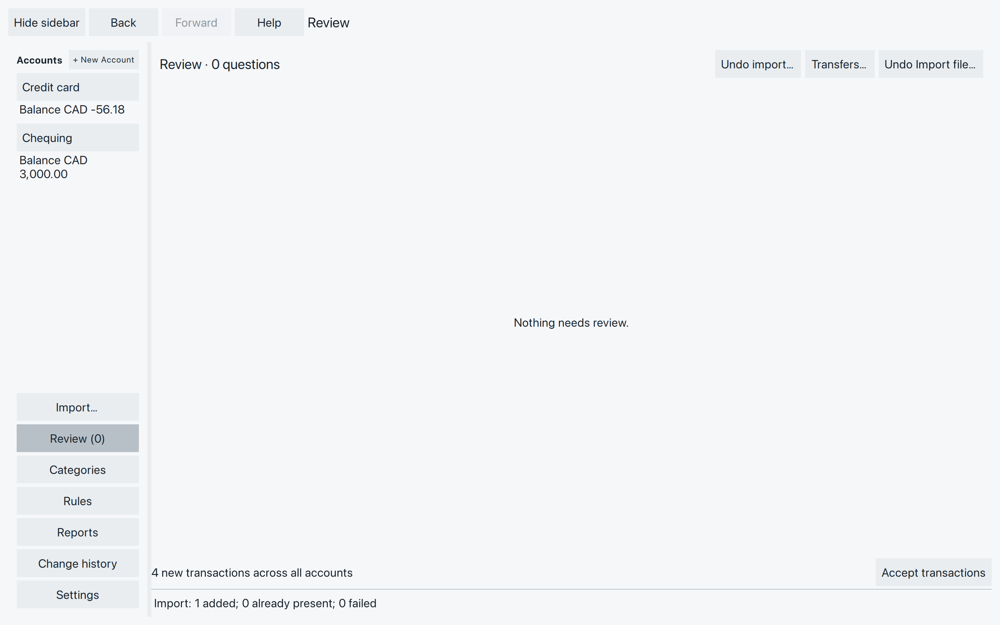
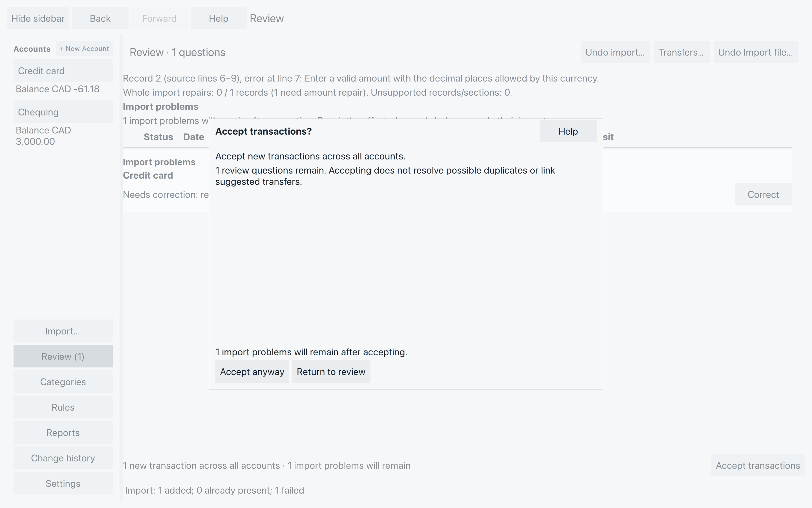
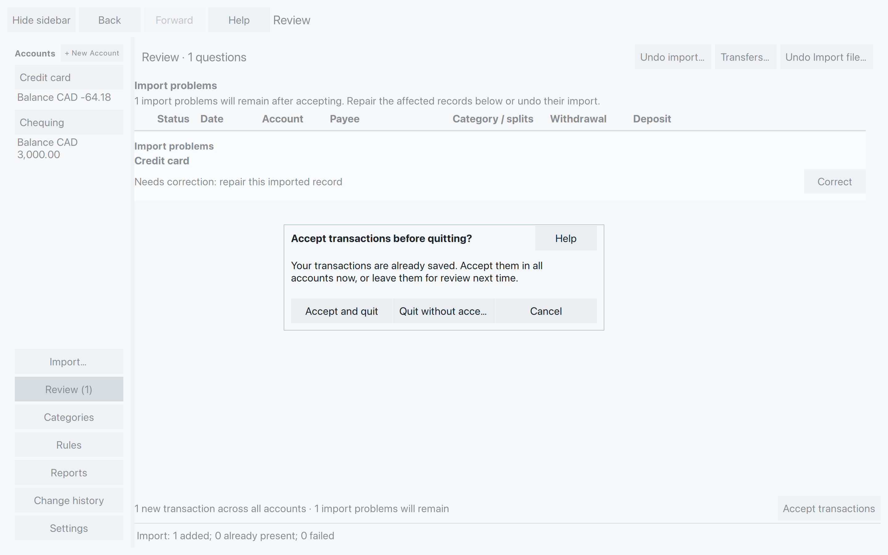

# Accept transactions — now or later

You’ve checked the purchases, sorted out duplicates and given your spending
useful categories. **Accept transactions** marks the new entries as accepted.
It applies to **all accounts in your file**, not just the account or rows
currently selected, including linked transfer postings.

There’s no hurry. Saved new transactions already stay in your file and count
in balances and reports. Accepting marks them as checked; it isn’t needed to save them.

## Accept the transactions you’ve checked

Open **Review** in the sidebar. Look through any remaining questions, then
choose **Accept transactions** at the bottom.

*Accept transactions covers the new entries in both Chequing and Credit card.*

These screenshots show the purchases and refund before recording the card payment.
The Market purchase, refund and Corner shop split leave the
card balance at **-56.18**. Accepting them leaves that balance unchanged.
The example file also contains a **2,000.00** payday in Chequing; that entry is accepted
at the same time.

Wait for the status line to confirm acceptance. It tells you how many new
transactions were accepted across all accounts and whether import problems
remain. If there are no new transactions, Accept transactions is disabled.
It is also unavailable while SpentIt is busy.

Accepted transactions can still be [corrected](add-correct-transactions.md).
However, an import containing accepted transactions can no longer be undone
with **Undo import…**. Check the imported account and amounts before accepting.

## When Review still has questions {#when-review-still-has-questions}

A remaining Review item does not always prevent acceptance. Read the question
and decide whether to resolve it now or leave the transactions new.
Choosing **Accept transactions** while questions or warnings remain opens
**Accept transactions?**

- **Possible duplicates or transfers:** use the
  [Review choices](review-duplicates-transfers.md) to say which entries belong
  together. You can also answer a duplicate from the rose bar in its ledger.
  Acceptance does not merge duplicates or link transfers for you.
- **Warnings you may proceed with:** **Accept anyway** is available when
  there is no problem that must be fixed first. Use it only if you understand
  the warnings. Suspected duplicates are kept as separate transactions.
- **Problems that must be resolved first:** the warning says **Must be fixed
  before accepting**. An unresolved account or transfer destination, or a
  missing imported-category choice, can prevent acceptance. Complete the
  offered choices. **Accept anyway** cannot bypass them.
- **Failed imported records:** **Accept anyway** accepts the usable new
  transactions and leaves the failed records in Review. It does not repair
  those records.

**Return to review** closes the question without accepting.

*Accept anyway accepts the usable new entries. The amount that still needs repair stays in Review.*

This later export contains a **5.00** Coffee purchase and an unreadable amount.
Accepting the Coffee purchase leaves the card balance at **-61.18**.

For a repairable record, choose **Correct** and enter the missing or corrected
value from your statement. If the import itself was a mistake, check whether
[Undo import…](import-transactions.md#undo-a-mistaken-import) is still available
before accepting any of it.

If acceptance fails, read the message before trying again. When SpentIt cannot
confirm whether the change was saved, reopen the file and check the transactions
first. Do the same if acceptance succeeded but the screen could not update.

## Leave them new and return later {#leave-them-new-and-return-later}

You can keep working, close the file or quit without accepting. Saved new
transactions remain available next time. An unfinished edit still needs its
own **Save**, **Discard** or **Stay** decision.

When you quit with new transactions, SpentIt asks **Accept transactions before
quitting?**

*Leaving transactions new does not remove them.*

- **Accept and quit** starts acceptance across all accounts. If Review needs
  a decision or acceptance fails, SpentIt stays open so you can deal with it.
- **Quit without accepting** leaves the saved transactions new for next time.
- **Cancel** returns to SpentIt without quitting.

After you choose to quit, wait for **Closing SpentIt…** to finish. If it
cannot, the window stays open. See
[Checking could not finish on quit](backup-recovery.md#checking-could-not-finish-on-quit).

Undoing **Accept transactions** returns those transactions to New. See
[Undo a saved change](add-correct-transactions.md#undo-a-saved-change).

## Choose the action you mean {#choose-the-action-you-mean}

| Action | What it does |
| --- | --- |
| Save or Enter in a transaction editor | Saves a validated edit. It does not accept all new transactions. |
| Accept transactions | Marks valid new transactions across all accounts as accepted. |
| Undo import… | Reverses one eligible file import, including its other accounts. Check the preview; accepted transactions make the import ineligible. |
| Delete selected… | Removes the selected transactions after confirmation. Check any transfer consequences shown. |
| Discard new transactions… | Removes eligible new work across imports in the selected account. The confirmation lists affected accounts; accepted transactions remain. |

Use [Undo import or Discard](import-transactions.md#undo-a-mistaken-import)
only when you want to remove work. Neither is needed to leave transactions
for another day.

With the entries checked and categorized, you’re ready to explore what your
spending adds up to in Reports.
