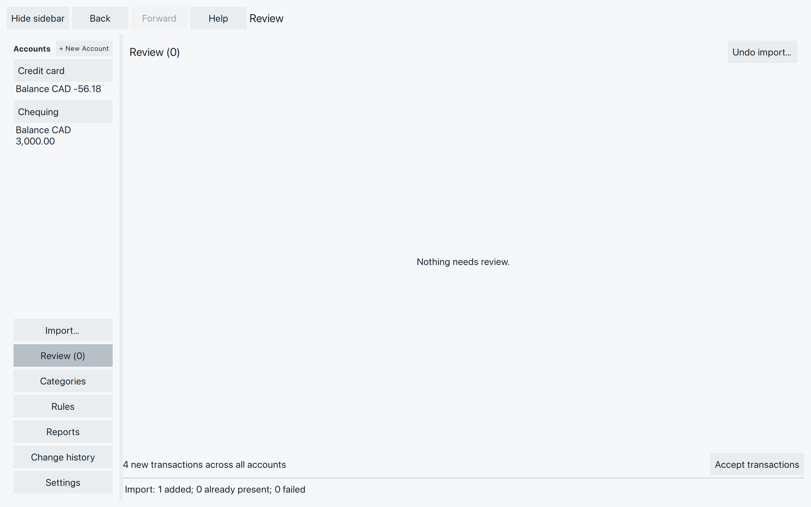
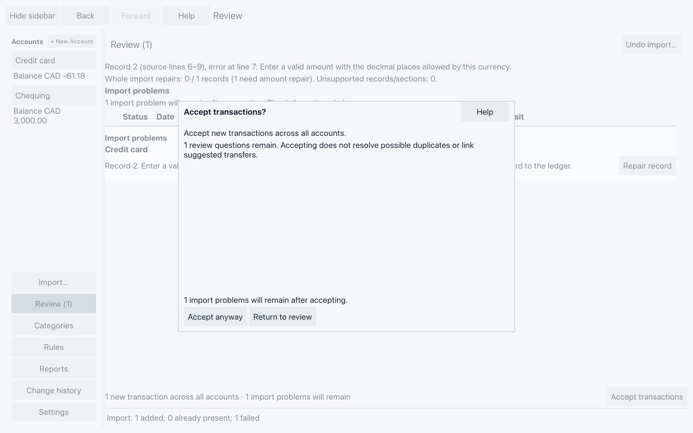
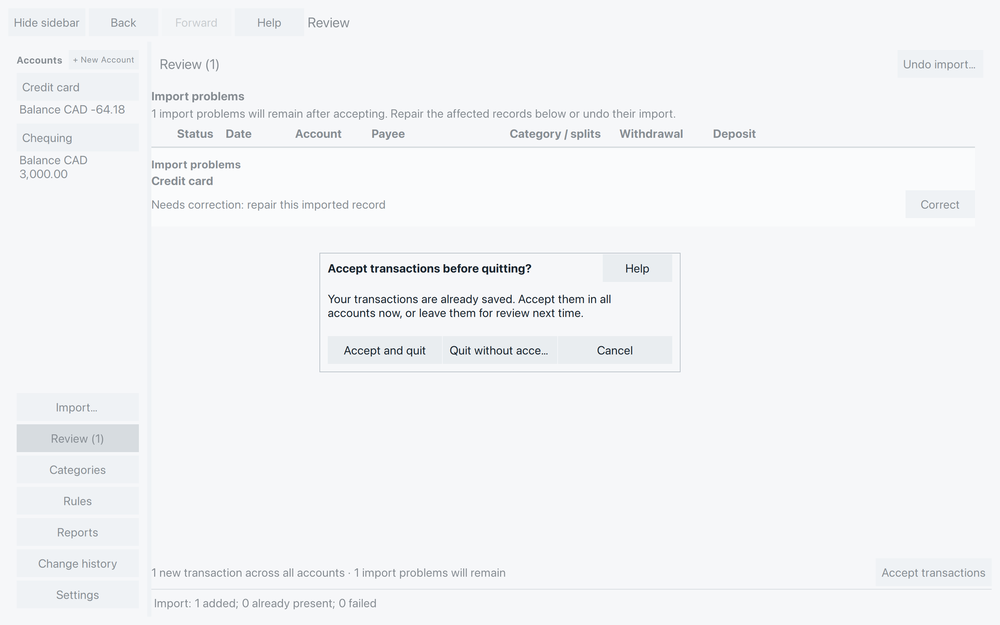

# Accept transactions — now or later

You’ve checked the purchases, sorted out duplicates and given your spending
useful categories. **Accept transactions** marks the new entries as accepted.
It applies to **all accounts in your file**, not just the account or rows
currently selected, including linked transfer postings.

There’s no hurry. Saved new transactions already stay in your file and count
in balances and reports. Accepting marks them as checked; it isn’t needed to save them.

## Accept the transactions you’ve checked

Open **Review** in the sidebar and look through any remaining questions.
When you’re ready, choose **Accept transactions** at the bottom.

*Accept transactions covers the new entries in both Chequing and Credit card.*

In our example, that means the card purchases and refund, plus a
**2,000.00** payday in Chequing. The card balance is already **-56.18**.

Wait for the status line to confirm acceptance. It tells you how many new
transactions were accepted across all accounts and whether import problems
remain. Accept also clears the indigo Merge and green Link marks, including
automatic results on already accepted transactions.

Accepted transactions can still be [corrected](add-correct-transactions.md).
However, an import containing accepted transactions can no longer be undone
with **Undo import…**. Check the imported account and amounts before accepting.

## When Review still has questions {#when-review-still-has-questions}

A remaining Review item does not always prevent acceptance. Read the question
and decide whether to resolve it now or leave the transactions new.
Choosing **Accept transactions** while questions or warnings remain opens
**Accept transactions?**

- **Possible duplicates or transfers:** use the
  [Review choices](review-duplicates-transfers.md) to say which entries belong
  together. You can also answer a duplicate from the rose bar in its ledger.
  Acceptance does not merge duplicates or link transfers for you.
- **Warnings you may proceed with:** **Accept anyway** is available when
  there is no problem that must be fixed first. If a transfer has no
  matching transaction from the bank, the question names the account and
  the count. Check the account before choosing **Accept anyway**.
  Suspected duplicates count as separate transactions. An entry that
  might already be imported still needs its own Review answer.
- **Problems that must be resolved first:** the warning says **Must be fixed
  before accepting**. When a transfer names an account that is not in the
  file, Review lists it beside **Accept transactions** as **Warnings [n]**.
  The line names the account, the date, the payee when there is one, and
  says that destination is not an account. Choose the line to open the
  transaction. Create the account and link the transfer, or
  [correct the split’s category](add-correct-transactions.md#divide-a-purchase-into-splits)
  if it should be ordinary spending. A missing
  imported-category choice can also prevent acceptance. Complete the
  offered choices. **Accept anyway** cannot bypass them.
- **Failed imported records:** **Accept anyway** accepts the usable new
  transactions and leaves the failed records in Review. It does not repair
  those records.

For accounts listed in **Settings → Accounts that don’t need bank
matches**, **Accept transactions** accepts the waiting entries SpentIt
created and records that they have no bank match. Possible matches still
appear in Review. See [how to add or remove an account](review-duplicates-transfers.md#if-spentit-created-the-other-side).

**Return to review** closes the question without accepting.

*Accept anyway accepts the usable new entries. The amount that still needs repair stays in Review.*

This later export contains a **5.00** Coffee purchase and an unreadable amount.
Accepting the Coffee purchase leaves the card balance at **-61.18**.

For a repairable record, choose **Repair record** and enter the missing or corrected
value from your statement. If the import itself was a mistake, check whether
[Undo import…](import-transactions.md#undo-a-mistaken-import) is still available
before accepting any of it.

If SpentIt reports a save or display problem, [check the result before
trying again](backup-recovery.md#a-change-failed-or-its-result-is-unclear).

## Leave them new and return later {#leave-them-new-and-return-later}

You can keep working, close the file or quit without accepting. Saved new
transactions remain available next time. An unfinished edit still needs its
own **Save**, **Discard** or **Stay** decision.

When you quit with new transactions, SpentIt asks **Accept transactions before
quitting?**

*Leaving transactions new does not remove them.*

- **Accept and quit** starts acceptance across all accounts. If Review needs
  a decision or acceptance fails, SpentIt stays open so you can deal with it.
- **Quit without accepting** leaves the saved transactions new for next time.
- **Cancel** returns to SpentIt without quitting.

After you choose to quit, wait for **Closing SpentIt…** to finish. If it
cannot, the window stays open. See
[Checking could not finish on quit](backup-recovery.md#checking-could-not-finish-on-quit).

Undoing **Accept transactions** returns those transactions to New. See
[Undo a saved change](add-correct-transactions.md#undo-a-saved-change).

## Choose the action you mean {#choose-the-action-you-mean}

| Action | What it does |
| --- | --- |
| Save or Enter in a transaction editor | Saves a validated edit. It does not accept all new transactions. |
| Accept transactions | Marks valid new transactions across all accounts as accepted. |
| [Undo a mistaken import](import-transactions.md#undo-a-mistaken-import) | Reverses one eligible file import, including its other accounts. |
| [Delete selected…](add-correct-transactions.md#change-a-selection-or-delete-entries) | Removes the selected entries that can be deleted. |
| [Discard new transactions…](import-transactions.md#undo-a-mistaken-import) | Removes eligible new work across imports in the selected account. |

With the entries checked and categorized, you’re ready to explore what your
spending adds up to in Reports.
