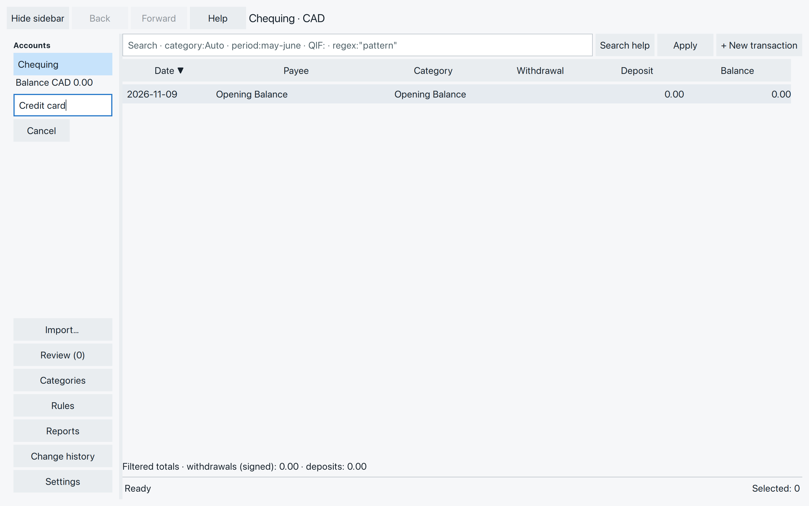
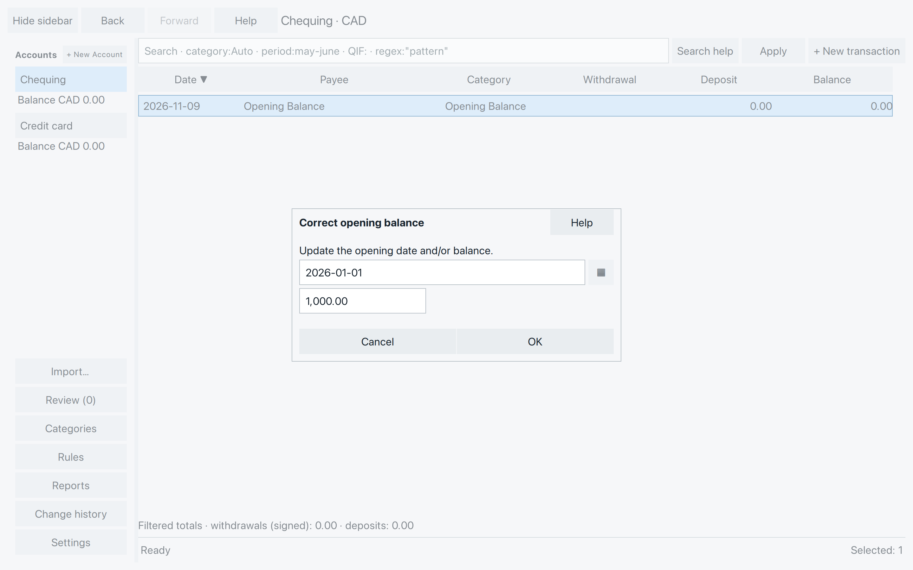
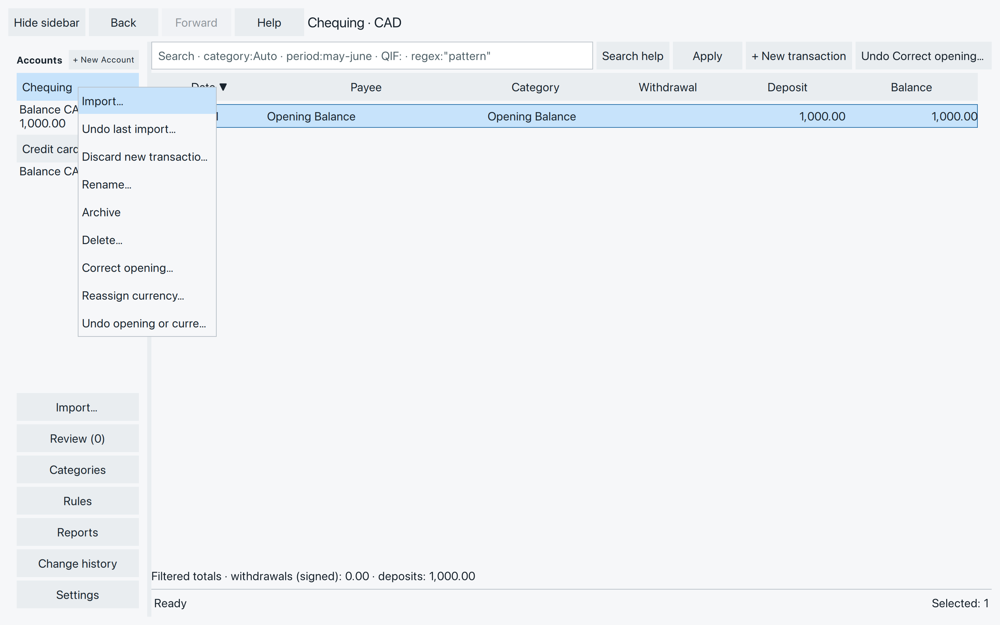

# Set up your accounts

Give each bank account, credit card, or cash pot its own account in
SpentIt. Our household starts with Chequing and adds Credit card
and Cash. Keeping them separate helps you check each balance against
what you have—or owe.

## Add an account {#add-an-account}

Choose **+ New Account** beside Accounts in the left sidebar. Type a
name, such as Credit card, and press **Enter**. **Escape** or **Cancel**
leaves without creating it.

*Press Enter to create the named account.*

The new account opens with a zero **Opening Balance**, dated today.
It uses the home currency you chose when creating the file. To use
another currency, [change it](#choose-the-currency) before adding transactions.

An import can also create accounts. You don’t need to create them
all in advance.

### If the name is taken

Choose a name that differs from your other accounts and categories.
Names differing only in capital letters count as the same name.
SpentIt also remembers accounts’ earlier names and confirmed import
names, so renaming an account does not free its old name for reuse.

## Set the starting balance {#set-the-starting-balance}

An opening balance is what you had, or owed, before the transactions
you’re bringing into SpentIt. It is not income or a purchase.

Suppose Chequing held **1,000.00** at the start of 2026-01-01, before
your first recorded transaction. Use that date and amount as its
opening. A later payment of 36.18 would leave **963.82**, if nothing
else had changed.

For a credit card, enter money you already owe as a negative amount:
**-200.00** means you owe 200.00. If there was nothing owing before
the first purchase, leave the opening at zero. Zero needs no confirmation.

1. Select the account, then double-click its **Opening Balance** row.
2. Enter the starting date and amount in your file’s date and amount formats.
3. Choose **OK** or press **Enter**.

*Use the balance before your recorded transactions begin.*

You can correct these values later in the same way, or use
**Correct opening…** in the account’s right-click menu. The opening
date must be on or before the earliest accepted transaction. Use a
valid date and an amount with the decimal places your currency supports.

A statement’s reported balance might be its closing balance, after
all the listed transactions. Don’t use it as the opening as well:
those transactions would be counted twice. When an import offers a
reported amount, you choose it while matching accounts. Check what it
represents before choosing it.

## Read and switch accounts

Click an account name in the sidebar to open its transactions.
The highlighted account is the one you’re viewing. Its balance includes
the opening and saved transactions, even those not yet accepted.
Check the currency code beside the balance too.

Use **Back** and **Forward** to return to places you’ve visited. They
are dimmed when there is nowhere to go. If you have an unfinished edit,
answer the prompt before leaving it.

## Later: manage your accounts

Right-click an account name for its actions. To change the order of
active accounts, drag one above or below another; the line shows
where it will go.

*Account actions apply to the account you right-click.*

### Rename or put an account aside {#rename-or-put-an-account-aside}

Choose **Rename…**, enter the new name, and choose **OK**. Earlier
names still identify the account when matching imports.

Choose **Archive** when you no longer use an account. It moves under
**Archived**, where you can still read it. Right-click it and choose
**Reactivate** before adding or editing transactions again.

If SpentIt asks you to finish or discard a pending import first,
review the new transactions and use **Accept transactions** when
ready. Acceptance covers new transactions across your accounts.
Discard only if you intend to remove the new transactions.

### Delete an unused account {#delete-an-unused-account}

**Delete…** is for an unused account created by mistake. It must have
no transactions, imports, or transfers, an unchanged zero opening and date,
and another account must remain. A zero current balance alone is
not enough; restoring an edited opening to zero does not make the
account unused again.

Choose **Delete…**, then **OK** to remove it. If it is ineligible,
use **Archive** to put it aside instead.

### Choose the currency {#choose-the-currency}

Use **Reassign currency…**, type the currency code, then choose
**Reassign**. For example, type CAD for Canadian dollars.

This changes the currency without converting the amounts:
**CAD 20 becomes GBP 20**. Use it to correct the currency assigned
to an account, not to exchange money. If the new currency cannot
represent an existing amount exactly, SpentIt refuses the change.

When **Undo opening or currency…** appears in the account menu, it
undoes that correction. A later saved action replaces it.

Account actions may be unavailable while SpentIt is busy. Reactivate
an archived account before correcting its opening or currency.

Your accounts are ready. Next, bring in transactions from your bank
or credit-card export.
