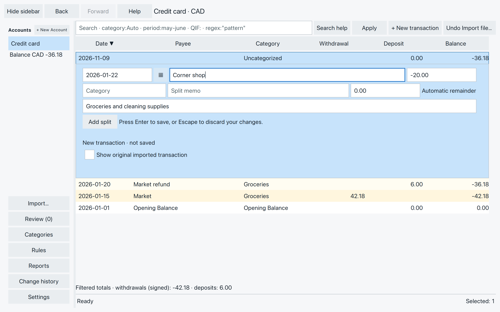
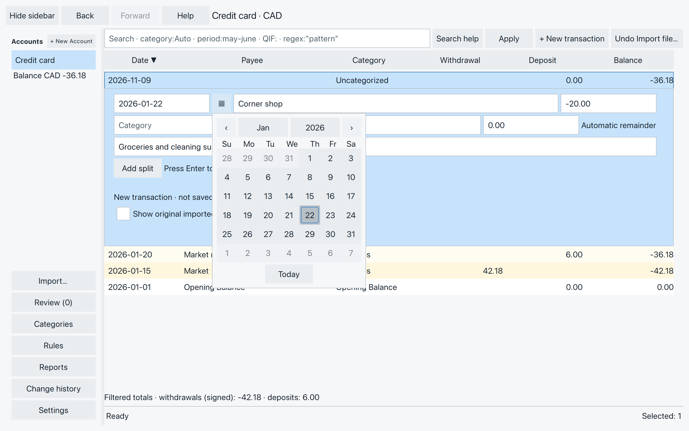
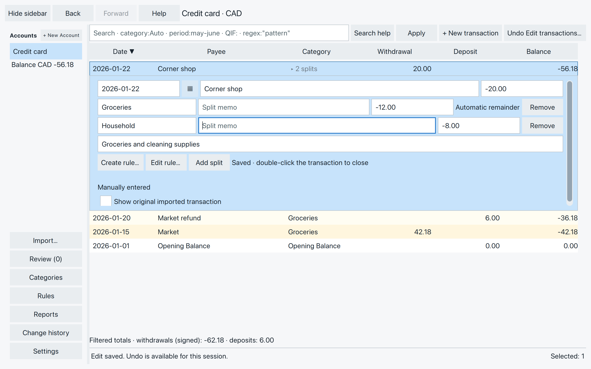
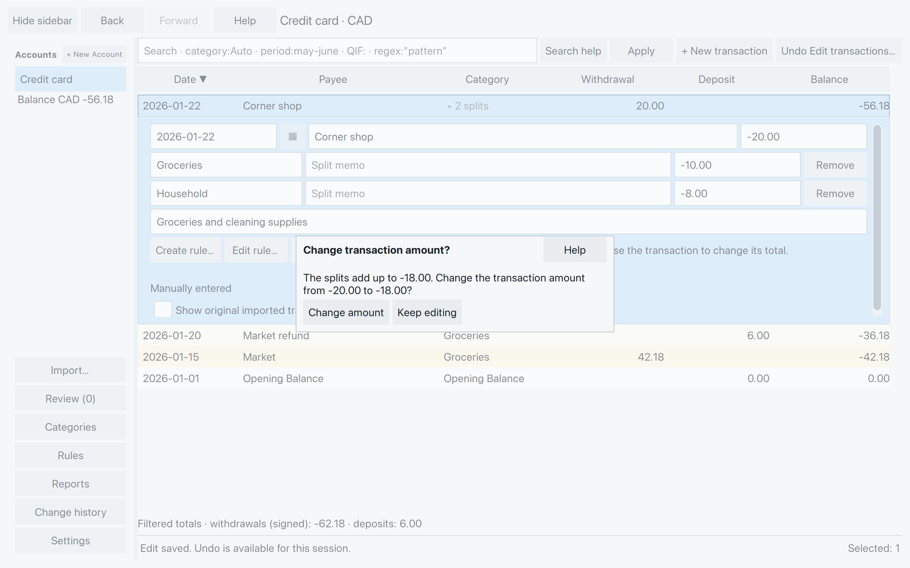
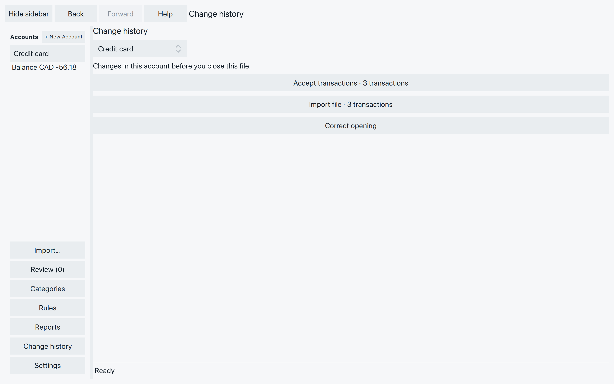

# Add and correct transactions

A receipt may reach you before the bank export does. Or a purchase may
need a clearer name or two categories. You can add and correct entries
right in the transaction list, including transactions already accepted.

## Add a missing purchase

Choose the account that paid, then **+ New transaction** beside search
**Apply**. You can also right-click the list and choose **Add transaction…**.

The new editor starts with a zero amount and blank text. Its date comes
from the focused transaction, or today if there isn’t one. Check it before
saving.

For our example, add a **Corner shop** purchase to **Credit card** on
**2026-01-22**, for **-20.00**. This is the same purchase used in chapter 5;
add it only if it isn’t already in your file. Money leaving an account is
negative; money coming in, including a refund, is positive.

*Fill in the purchase before saving. The editor still says New transaction · not saved.*

Enter the date, payee, amount and any memo you want. Press **Enter** in
one of those fields to save. The entry now counts in the balance and
reports; you can accept it later. **Escape** cancels an unsaved new entry.

You can choose an existing category by typing part of its name, then
clicking a suggestion or using **Up/Down** and **Enter** or **Tab**.
For a new entry, press Enter in the date, payee, amount or memo to save.
On an existing transaction, choosing a category also saves the complete
valid edit, so fill in the other fields first. A blank category means **Uncategorized**. Typing a
name with no matches does not create a category.

If a later import contains this purchase too, use
[Review Merge](review-duplicates-transfers.md#is-it-the-same-purchase)
to keep one transaction. SpentIt does not silently remove your manual entry.

## Correct an entry {#correct-an-entry}

Double-click the transaction to open its editor. Change the date, payee,
amount, category or memo, then press **Enter** to save the complete edit.
Double-click the same transaction again to close the editor. A single
click selects a row without moving the open editor to it.

**Escape** discards changes made since the last save. If a category
suggestion list is open, the first Escape closes that list.

When you leave an unfinished edit, **Save** keeps it and continues,
**Discard** abandons the unsaved changes and continues, and **Stay**
returns you to the editor. None of these choices reverses an earlier save.

### Choose a date

Type the date in your file’s chosen format, or select the calendar button
beside it. Choose a day, use the arrows to browse months, or select the
month or year heading to jump further. **Today** chooses today’s date.
Choosing a date changes the field; press Enter in the editor to save it.

*The calendar uses the date already in the field. Correct an invalid date before opening it.*

### Enter an amount or a calculation

Use your file’s amount style. Our examples use `1,234.56`; your file may
use a different grouping or decimal mark. With amount formatting off,
use ungrouped numbers with a decimal point.

Amount fields also accept `+`, `-`, `*`, `/` and parentheses. For example,
`-12-8` gives `-20.00`. SpentIt saves the answer, not the calculation.

The answer must fit the currency exactly. In CAD, `10/3` cannot be saved
because it gives a fraction of a cent. Check the calculation rather than
expecting SpentIt to round it. Invalid dates, grouping or amounts stay in
the editor for correction and do not replace the saved transaction.

## Divide a purchase into splits {#divide-a-purchase-into-splits}

Suppose the Corner shop receipt has **12.00** of groceries and **8.00**
of cleaning supplies. Keep the transaction total at **-20.00**.

1. Choose **Add split** in the editor.
2. Enter **-8.00** in the new split’s amount. The split marked
   **Automatic remainder** takes **-12.00**.
3. Choose **Groceries** for the first split and **Household** for the
   second. Each category choice saves the complete edit when it balances.
   You can also press Enter to save your amount or memo changes.

*The two splits explain the purchase while the account total stays -20.00.*

You can give each split its own memo. **Remove** beside a split removes
that split from the edit, not the whole transaction. Transfer splits cannot
be removed with this button. Save the balanced
result when you’re finished.

SpentIt initially chooses the largest eligible split for the remainder,
preferring one with the same sign as the total. That split stays chosen
even if another becomes larger. Transfer splits are not used for this.

Typing an amount into the automatic split, or removing that split,
switches off adjustment. You
then control every split amount, including in later edits. All splits
must add up exactly to the transaction total before they can save.

*If you try to leave with different totals, decide which amount is correct.*

**Change amount** replaces the transaction total with the sum of the
splits and saves. Use it only if that sum is the correct transaction
amount. **Keep editing** leaves the saved transaction alone so you can
correct the split amounts.

A receipt can mix purchases and returns. Buying **20.00** of groceries
and returning **5.00** of household goods gives splits of **-20.00** and
**+5.00**, for a total of **-15.00**. The signs describe what happened;
they do not all have to match.

## Compare with the imported transaction {#compare-with-the-imported-transaction}

In an imported entry’s editor, check **Show original imported transaction**
to compare it with the current values. **Restore imported values** in
that panel fills the editor; inspect the result and press Enter to save.

To restore one or more selected imported entries together, right-click
and choose **Restore imported values…**. Read the confirmation before
continuing: this replaces their current dates, payees, memos, amounts
and splits with the imported values.

Manually entered transactions cannot use Restore, even if Review later
attached an imported transaction to them. Transfer relationships can also
prevent restoration. Use **Rename payee…** if that is all you need to change.

## Change a selection or delete entries {#change-a-selection-or-delete-entries}

Select the rows you want, then right-click **Rename payee…** to give them
the same payee. This changes all selected entries together. Use the
selection methods in [Find your way around transactions](find-transactions.md).

**Set memo…** sets the memo on the selected transactions. Memos on
individual splits stay as they are.

The question says how many selected transactions already have a memo.
Leave **Overwrite N existing memos** unchecked to fill only the blank
ones. Check it to replace memos that are already there. Leave the field
blank with that box checked to clear them. The button then says
**Clear memo** or **Clear memos**. **Cancel** leaves every memo unchanged.

A memo you enter here stays when rules run later.

For a transaction that should not be in the account, choose **Delete selected…**.
The question shows how many transactions you selected and each account’s
balance change.

If a selected transaction is linked to another account, choose:

- **Delete selected only**, which breaks those links and keeps the other
  account’s entries. Their linked parts become Uncategorized. A draft
  SpentIt created for the link is removed.
- **Delete linked entries too**, which removes the linked parts from the
  other account. Its other parts stay. If nothing remains, that
  transaction is deleted too.

Choose **Delete** to continue, or **Cancel** to keep the transactions.
One Undo reverses the whole deletion. An unresolved import match can
refuse it; settle that match, then try again.

For an entire mistaken import, use
[Undo last import…](import-transactions.md#undo-a-mistaken-import)
instead of deleting its rows one by one.

### Take care with transfers

A linked new transaction may be read-only. An accepted, independently
entered or imported posting can be corrected, but changing its amount
or transfer category, or deleting it, ends the link. Changing only its
date keeps the link.

The other account’s independently entered or imported posting remains.
An entry generated by SpentIt may be removed as part of the change.
Check both accounts afterward; see [Review and linking](review-duplicates-transfers.md).

## Undo a saved change {#undo-a-saved-change}

The **Undo** button beside search undoes the latest saved action in
the file. Its name follows that action, such as **Undo edit…** or
**Undo payee rename…**. **Command+Z** on macOS, or **Ctrl+Z**, does
the same when you are not typing. While typing, the shortcut undoes
the text instead.

SpentIt asks before it undoes. The question names the action, how many
transactions it covers, and which accounts. Choose **Undo**, or
**Cancel** to leave it.

The same Undo covers an edit, a selection change, a category change, a
rule application, an opening or currency correction, accepting
transactions, and a whole import. There is no Redo. The next saved
action replaces it. Selecting rows or searching does not.

One import is one action, including rules that ran during the import.
Undoing it removes those transaction changes. Accounts, categories and
opening balances created for the import stay. A rule you run yourself
later is its own action, and undoing it keeps the saved rule. Undoing
**Accept transactions** returns those transactions to New.

### Change history

Choose **Change history** in the sidebar, or **History** on an accepted
transaction. The page lists saved changes since you opened the file,
for the account in the heading, one row for each action. The account
name is a menu. It starts as the account you came from. Choose another
account to see its changes.

Closing the file clears the list. The changes stay in the file until
you undo them. An empty page has no **Back to account** button. Use
the window **Back** button to leave.

*Each row is one saved action. Open it to read the transactions it changed.*

Open a row to read the transactions. Each one is a line: date, payee,
category, amount, and New, Accepted or Removed. A memo or further
splits appear under that line. Another account is named only when the
action touched it too. A balance line appears when the money changed.

**Show in ledger** opens the highlighted transaction. A removed
transaction has no ledger button. **Undo** is on every open action.
When nothing later changed those transactions, confirm **Undo**. When
later changes share a transaction, the question is **To undo, these
changes also need to be undone**. Those changes are listed newest
first. **Yes, undo all** undoes the whole list. **Cancel** leaves them.
Changes that do not share those transactions stay.

The Undo button beside search undoes only the newest action in the file.

### When Undo is no longer offered

A successful **File → Close file**, switching files, or quit clears
Undo. Transactions you left new are still there. **Undo last import…**
can still be available.

If closing fails or you cancel it, or SpentIt stops unexpectedly, Undo
is still there when you return. **Check file** in Settings does not
clear Undo.

**Discard new transactions…**, and undoing an import that is not the
latest action, wait until Undo is empty. The message is **Undo the
current actions, or close and reopen the file first.** Undo the actions
beside search, or close the file successfully, then try again. If that
import is the latest action, the Undo button beside search undoes it.

If SpentIt cannot confirm that a change was saved, reopen the file and
check the transaction before trying again.
