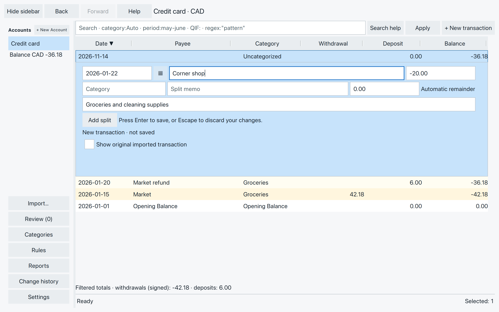
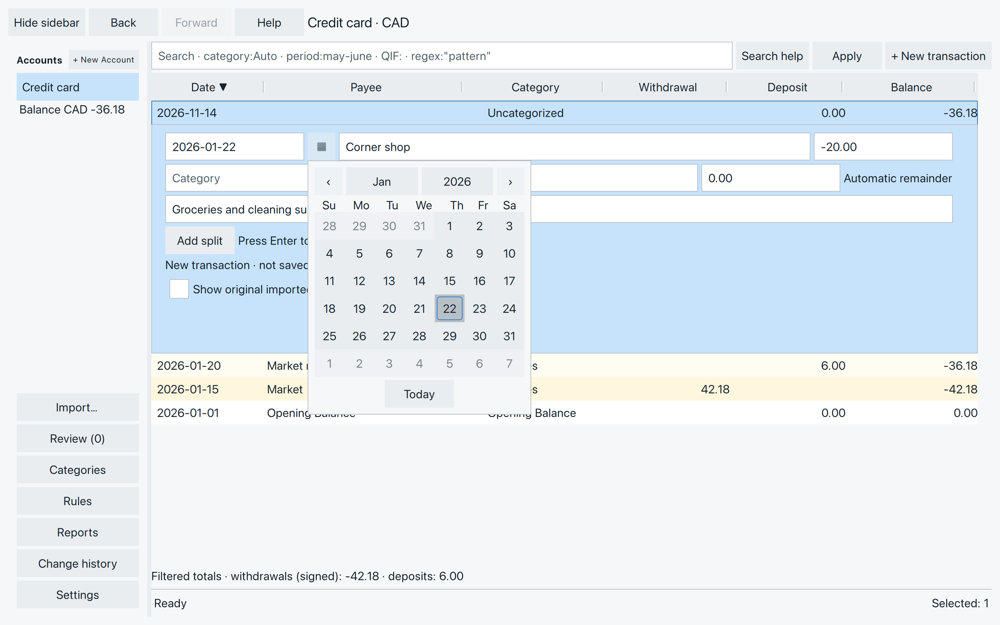
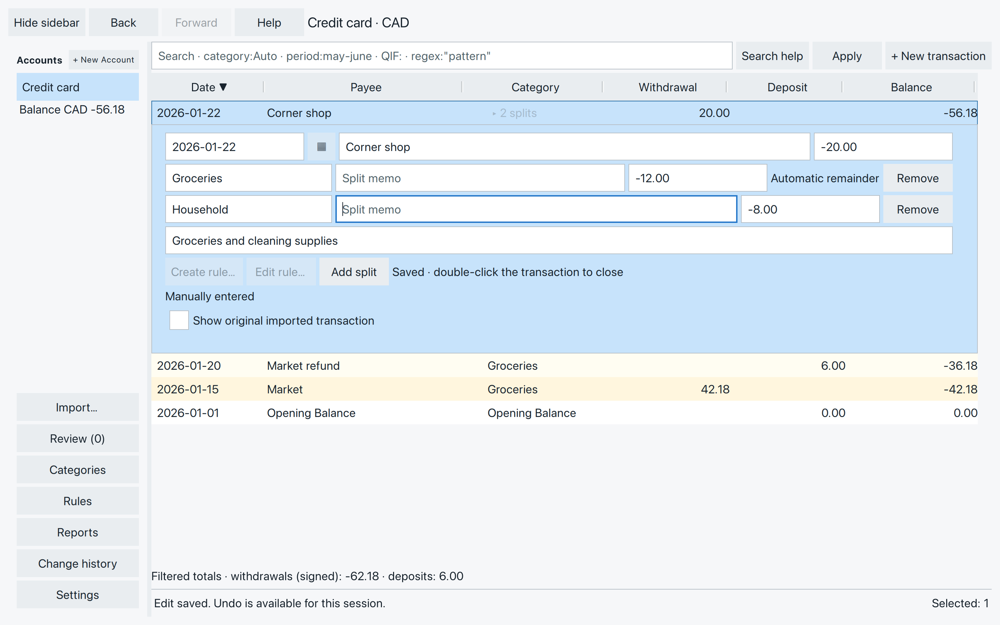
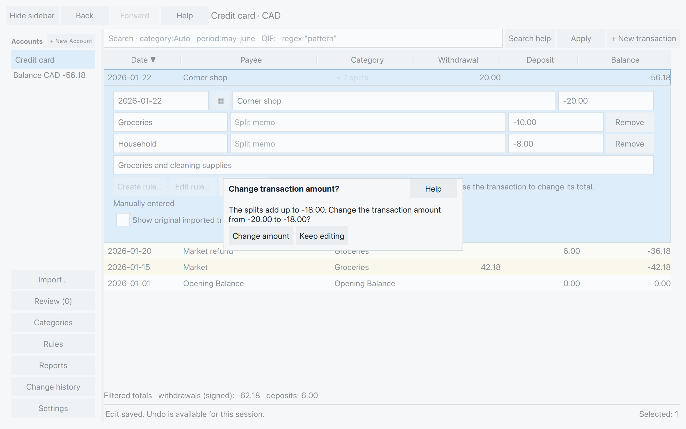
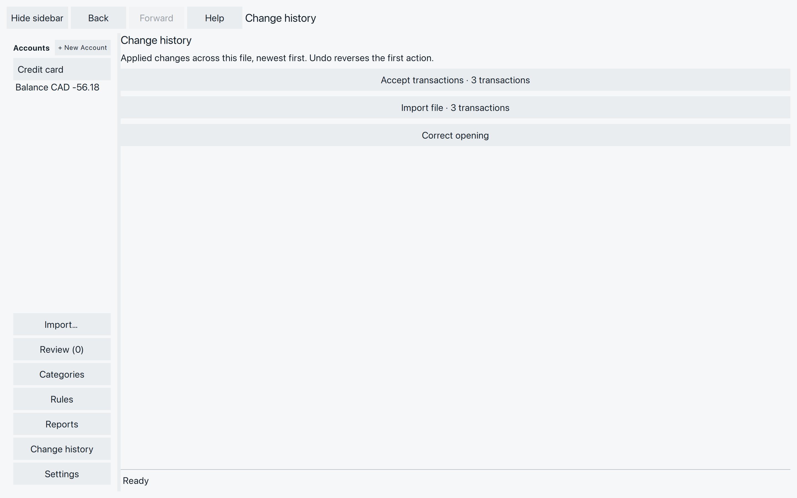

# Add and correct transactions

A receipt may reach you before the bank export does. Or a purchase may
need a clearer name or two categories. You can add and correct entries
right in the transaction list, including transactions already accepted.

## Add a missing purchase

Choose the account that paid, then **+ New transaction** beside search
**Apply**. You can also right-click the list and choose **Add transaction…**.

The new editor starts with a zero amount and blank text. Its date comes
from the focused transaction, or today if there isn’t one. Check it before
saving.

For our example, add a **Corner shop** purchase to **Credit card** on
**2026-01-22**, for **-20.00**. This is the same purchase used in chapter 5;
add it only if it isn’t already in your file. Money leaving an account is
negative; money coming in, including a refund, is positive.

*Fill in the purchase before saving. The editor still says New transaction · not saved.*

Enter the date, payee, amount and any memo you want. Press **Enter** in
one of those fields to save. The entry now counts in the balance and
reports; you can accept it later. **Escape** cancels an unsaved new entry.

You can choose an existing category by typing part of its name, then
clicking a suggestion or using **Up/Down** and **Enter** or **Tab**.
For a new entry, press Enter in the date, payee, amount or memo to save.
On an existing transaction, choosing a category also saves the complete
valid edit, so fill in the other fields first. A blank category means **Uncategorized**. Typing a
name with no matches does not create a category.

If a later import contains this purchase too, use
[Review Merge](review-duplicates-transfers.md#is-it-the-same-purchase)
to keep one transaction. SpentIt does not silently remove your manual entry.

## Correct an entry {#correct-an-entry}

Double-click the transaction to open its editor. Change the date, payee,
amount, category or memo, then press **Enter** to save the complete edit.
Double-click the same transaction again to close the editor. A single
click selects a row without moving the open editor to it.

**Escape** discards changes made since the last save. If a category
suggestion list is open, the first Escape closes that list.

When you leave an unfinished edit, **Save** keeps it and continues,
**Discard** abandons the unsaved changes and continues, and **Stay**
returns you to the editor. None of these choices reverses an earlier save.

### Choose a date

Type the date in your file’s chosen format, or select the calendar button
beside it. Choose a day, use the arrows to browse months, or select the
month or year heading to jump further. **Today** chooses today’s date.
Choosing a date changes the field; press Enter in the editor to save it.

*The calendar uses the date already in the field. Correct an invalid date before opening it.*

### Enter an amount or a calculation

Use your file’s amount style. Our examples use `1,234.56`; your file may
use a different grouping or decimal mark. With amount formatting off,
use ungrouped numbers with a decimal point.

Amount fields also accept `+`, `-`, `*`, `/` and parentheses. For example,
`-12-8` gives `-20.00`. SpentIt saves the answer, not the calculation.

The answer must fit the currency exactly. In CAD, `10/3` cannot be saved
because it gives a fraction of a cent. Check the calculation rather than
expecting SpentIt to round it. Invalid dates, grouping or amounts stay in
the editor for correction and do not replace the saved transaction.

## Divide a purchase into splits {#divide-a-purchase-into-splits}

Suppose the Corner shop receipt has **12.00** of groceries and **8.00**
of cleaning supplies. Keep the transaction total at **-20.00**.

1. Choose **Add split** in the editor.
2. Enter **-8.00** in the new split’s amount. The split marked
   **Automatic remainder** takes **-12.00**.
3. Choose **Groceries** for the first split and **Household** for the
   second. Each category choice saves the complete edit when it balances.
   You can also press Enter to save your amount or memo changes.

*The two splits explain the purchase while the account total stays -20.00.*

You can give each split its own memo. **Remove** beside a split removes
that split from the edit, not the whole transaction. Transfer splits cannot
be removed with this button. Save the balanced
result when you’re finished.

SpentIt initially chooses the largest eligible split for the remainder,
preferring one with the same sign as the total. That split stays chosen
even if another becomes larger. Transfer splits are not used for this.

Typing an amount into the automatic split, or removing that split,
switches off adjustment. You
then control every split amount, including in later edits. All splits
must add up exactly to the transaction total before they can save.

*If you try to leave with different totals, decide which amount is correct.*

**Change amount** replaces the transaction total with the sum of the
splits and saves. Use it only if that sum is the correct transaction
amount. **Keep editing** leaves the saved transaction alone so you can
correct the split amounts.

A receipt can mix purchases and returns. Buying **20.00** of groceries
and returning **5.00** of household goods gives splits of **-20.00** and
**+5.00**, for a total of **-15.00**. The signs describe what happened;
they do not all have to match.

## Compare with the imported transaction {#compare-with-the-imported-transaction}

In an imported entry’s editor, check **Show original imported transaction**
to compare it with the current values. **Restore imported values** in
that panel fills the editor; inspect the result and press Enter to save.

To restore one or more selected imported entries together, right-click
and choose **Restore imported values…**. Read the confirmation before
continuing: this replaces their current dates, payees, memos, amounts
and splits with the imported values.

Manually entered transactions cannot use Restore, even if Review later
attached an imported transaction to them. Transfer relationships can also
prevent restoration. Use **Rename payee…** if that is all you need to change.

## Change a selection or delete entries {#change-a-selection-or-delete-entries}

Select the rows you want, then right-click **Rename payee…** to give them
the same payee. This changes all selected entries together. Use the
selection methods in [Find your way around transactions](find-transactions.md).

**Set memo…** sets the memo on the selected transactions. Memos on
individual splits stay as they are.

The question says how many selected transactions already have a memo.
Leave **Overwrite N existing memos** unchecked to fill only the blank
ones. Check it to replace memos that are already there. Leave the field
blank with that box checked to clear them. The button then says
**Clear memo** or **Clear memos**. **Cancel** leaves every memo unchanged.

A memo you enter here stays when rules run later.

For a transaction that should not be in the account, choose **Delete selected…**.
The question shows how many transactions will be deleted, how many linked
transactions will stay, and each affected account’s balance change.

Linked transactions are left in place, along with their links and the entries
in the other account. If every selected transaction is linked, nothing is
deleted. To separate a mistaken link, see
[Unmerge](review-duplicates-transfers.md#undo-a-mistaken-answer) first.

Choose **Delete** to continue, or **Cancel** to keep the transactions.
One Undo reverses the whole deletion. An unresolved import match can
refuse it; settle that match, then try again.

For an entire mistaken import, use
[Undo last import…](import-transactions.md#undo-a-mistaken-import)
instead of deleting its rows one by one.

### Take care with transfers

A linked new transaction may be read-only. An accepted, independently
entered or imported posting can be corrected, but changing its amount
or transfer category ends the link. Changing only its date keeps the link.
**Delete selected…** leaves linked transactions in place.

The other account’s independently entered or imported posting remains.
An entry generated by SpentIt may be removed as part of the change.
Check both accounts afterward; see [Review and linking](review-duplicates-transfers.md).

## Undo a saved change {#undo-a-saved-change}

Choose **Edit → Undo**, or press **Command+Z** on a Mac or **Ctrl+Z** on
Windows and Linux, to undo the newest saved action in your file. While you
are typing in a text field, the shortcut undoes the text instead.

Undo works across accounts, so check the action named in the Edit menu.
An edit, a selection-wide change, a rule application, an opening or currency
correction, and accepting transactions can each be one step. Ordinary Undo
runs straight away. Undoing an import asks you to confirm the removal first.

To put an undone change back, choose **Edit → Redo**. The menu shows your
platform’s shortcut. You can undo several actions and redo them in order.
Saving a new change clears the waiting Redo actions. Saving a rule, category,
report or setting clears Redo too, though those saves are not Undo steps. Selecting rows, searching and previewing a rule leave
Redo available.

One import is one action, including rules that ran during the import.
Undoing it removes those transaction changes. Accounts, categories and
opening balances created for the import stay. **Import Undo cannot be
redone**, and it clears any waiting Redo actions. Import the original file
again if you need those transactions back.

A rule you run yourself later is its own action. Undo reverses its changes
across the chosen accounts and keeps the saved rule. Undoing **Accept
transactions** returns the transactions it accepted to New and restores any
Merge or Link marks it cleared.

### Change history

Choose **Change history** in the sidebar to see saved actions across all
accounts, newest first. Open a row to read the transactions it changed.
Only the newest action offers **Undo**. To reach an earlier action, undo
the newer ones first. Waiting **Redo** actions appear separately, with the
next one first.

*Use History to check what the next Undo will change, including work in other accounts.*

Transaction details include the date, payee, category, amount and whether
the entry is New, Accepted or Removed. **Show in ledger** opens the selected
transaction if it is still there.

A **Merge** row describes the transaction kept and the one removed. Undo
brings the removed entry back; for a merged payment, it also restores the
extra transfer entries and separates the link. A **Link** that kept both
transactions has its own row; Undo separates them and leaves both in place.

### When Undo is no longer offered

A successful **File → Close file**, switching files, or quit clears both
Undo and Redo. Your saved changes stay, including transactions left new.
**Undo last import…** and [Unmerge](review-duplicates-transfers.md#undo-a-mistaken-answer)
may still be available after reopening.

If closing fails or you cancel it, both Undo and Redo remain available.
If SpentIt stops unexpectedly, Undo is recovered when you reopen the file,
but Redo is lost.

**Discard new transactions…**, and undoing an import that is not the
newest action, wait until Undo is empty. If you see **Undo the current
actions, or close and reopen the file first**, either undo those actions
or close successfully and reopen to keep the changes and clear Undo.
Then try again.

If SpentIt cannot confirm that a change was saved, reopen the file and
check the transaction before trying again.
