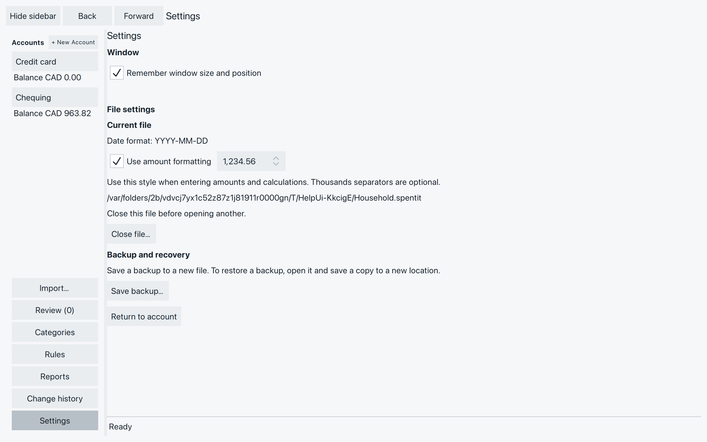
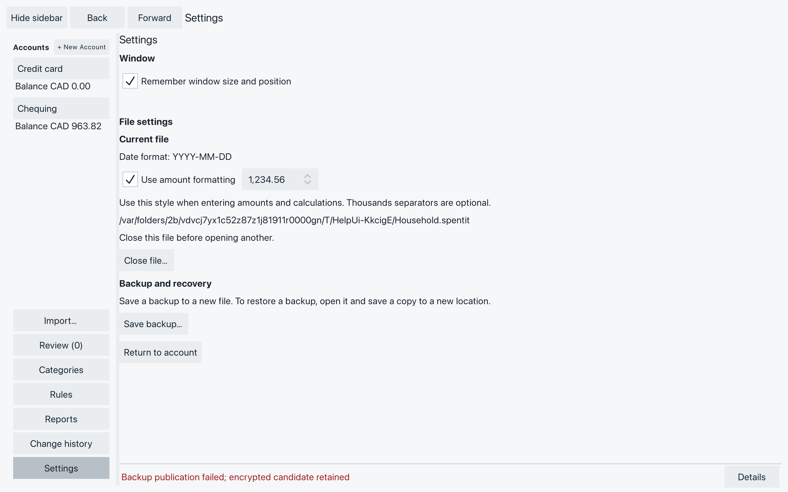

# Look after your work and resolve remaining problems

Once you’ve brought your accounts together, keep a backup you can return to.
It holds your saved work at that point, including transactions you haven’t
accepted yet. Finish any edit with **Save** or **Enter** first.

## Save a backup

1. Open **Settings** in the left sidebar. Check the path under **Current file**
   so you know which file you’re copying.
2. Choose **Save backup…**. Choose a folder and a new filename, such as
   `Household-backup-2026-02-28.spentit`. Use a different name for each backup.
3. Wait for the operation to finish. The bottom status line returns to
   **Ready** on success; there is no separate completion dialog.

*Save backup makes a separate copy. The Current file path still names the file you are working in.*

Keep a copy on another drive if you want protection against losing the drive
that holds your working file. A backup only contains work saved before it was
made; later changes need another backup.

A password-protected backup needs the same password as its source file.
A backup made without password protection can be read by anyone who has it.

### If the backup does not finish

- **The filename already exists:** choose a new name. Save backup does not
  replace an existing file, even if the file picker offers to replace it.
  The message may only say “Backup publication failed; encrypted candidate retained”.
- **The location is unavailable or full:** check the drive, free space and
  permission to save there, then choose a new filename.
- **You cancelled:** wait for cancellation to finish. An unfinished `.partial`
  file may remain; it is not a completed backup. Use a new name when retrying.

*Here, an existing destination is refused. Choose another name; use Details to read a long message.*

## Check a backup or recover your work

Open a backup to check that it contains what you expect. If you need to recover,
make a new working copy from it so you can keep the backup for another attempt.

1. In Settings, choose **Close file…**. Resolve any unfinished edits first.
2. On the welcome screen, use **Browse…** to select the backup, enter its
   password if asked, and choose **Open file**.
3. Check the accounts, balances and recent transactions. Open a saved report
   if it helps you check the period you need.
4. To recover, open Settings and use **Save backup…** again, this time with
   a new working name such as `Household-recovered.spentit`.
5. After it finishes, close the backup and open that new working copy.
   Check **Current file** before entering more transactions.

Saving the copy does not switch to it. If you were only checking a backup,
close it and reopen your usual working file instead.

Work added after the backup was made will not be in the recovered copy.
Check what is missing before importing or entering it again.

## Adjust how you read and enter amounts

Settings shows the file’s **Date format**. That format was chosen when the
file was created; there is no control here to change it.

With **Use amount formatting** checked, choose `1,234.56`, `1.234,56`, or
`1 234,56`. The choice is saved for this file and applies to amounts and
calculations you type as well as amounts you read. Thousands separators are
optional, but any you use must be grouped correctly.

Uncheck it for ungrouped numbers with a decimal point, such as `1234.56`.
Changing presentation does not change the amounts or convert currencies.
See [Enter an amount or a calculation](add-correct-transactions.md#enter-an-amount-or-a-calculation)
for examples.

**Remember window size and position** controls how the application window
opens next time. Settings has no control to change a password or turn password
protection on or off for an existing file. There is no forgotten-password
recovery for the file or its backups.

## When a file or change needs attention

### The file will not open

First check the [opening checks](create-open-file.md#if-it-won-t-open): the
selected file, password, drive and whether another SpentIt window has it open.
Do not delete lock files to get around an “already open” message.

Older experimental files may be refused as an unsupported format. This version
has no upgrade or conversion command. Keep the old file; do not overwrite it
with a new empty one. A backup in the same old format will have the same limit.

If the message says the file failed verification or is damaged, do not keep
trying to change it. Try opening a separate backup and checking it as described
above. SpentIt has no general repair button.

### A change failed, or its result is unclear

Read the message before trying again. Choose **Details** if the bottom line
cuts it short.

- **The change was saved, but the screen could not update:** reopen the file
  and inspect the affected transactions, account or rule. Do not repeat the
  change just to refresh the screen.
- **SpentIt could not confirm whether the change was saved:** reopen and check
  the result before retrying. It may already have completed.
- **A write failed:** check available space, drive connection and permission
  to write. Reopen and inspect the affected work before deciding what to repeat.

After an interruption, reopen the file and check Review. If SpentIt says an
incomplete import was removed, you can import that export again. Completed
imports and saved new transactions do not need accepting merely to survive
closing the app. See [Check the result](import-transactions.md#check-the-result)
for records that still need attention.

### Checking could not finish on quit

If **Couldn’t finish checking the file** appears, **Return** brings you back
to the app. **Quit anyway** closes it; SpentIt will check the file again the
next time you open it. Neither choice repairs a damaged file.

### If you still need help

Note the exact message, the action you took, your operating system and the
SpentIt version or build you are using. A small made-up example can help explain
the problem. Remove names, account details and amounts from screenshots you
share; do not send passwords, your financial file or bank exports.

## Find a particular problem

- [Missing transaction or unexpected balance](find-transactions.md#if-something-looks-missing-or-wrong)
- [Unreadable imported dates or amounts](import-transactions.md#when-something-needs-attention)
- [Undo a mistaken import](import-transactions.md#undo-a-mistaken-import)
- [Duplicate purchase or transfer question](review-duplicates-transfers.md#is-it-the-same-purchase)
- [Splits do not add up](add-correct-transactions.md#divide-a-purchase-into-splits)
- [Undo an edit or deletion](add-correct-transactions.md#undo-a-saved-change)
- [Category name refused](categories.md#if-a-name-is-refused)
- [Rule matches are not what you expected](rules.md#if-the-matches-aren-t-what-you-expected)
- [Transactions cannot all be accepted](accept-transactions.md#when-review-still-has-questions)
- [Empty, unexpected or out-of-date report](reports.md#if-the-result-needs-attention)
