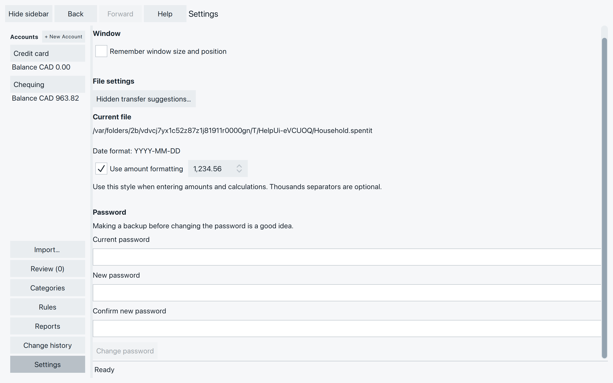

# Look after your work and resolve remaining problems

Once you’ve brought your accounts together, keep a backup copy of the file you
can return to.

## Keep a copy of the file {#keep-a-copy}

Quit SpentIt after the file has closed successfully. Then copy the file
while SpentIt is not running. A copy made after a crash, or while SpentIt
is still open, can leave out the last saved work.

1. Finish any edit with **Save** or **Enter**.
2. Choose **File → Close file**. Wait until SpentIt has closed the file,
   then quit.
3. Copy the file in its folder. Give the copy its own name, such as
   `Household-backup-2026-02-28.spentit`.

The copy uses the same password as the file you copied. A copy of a file
made without password protection can be read by anyone who has it.

Keep a copy on another drive if you want protection against losing the
drive that holds the working file. Make these backup copies regularly to
avoid losing work.

To look at a copy, start SpentIt and use **Browse…** on the welcome
screen. Select the copy and enter its password if asked. Check the
accounts, balances and recent transactions.

Work added after the copy was made will not be in it.

## Adjust how you read and enter amounts {#adjust-how-you-read-and-enter-amounts}

Settings shows the file’s **Date format**. That format was chosen when the
file was created; there is no control here to change it.

With **Use amount formatting** checked, choose `1,234.56`, `1.234,56`, or
`1 234,56`. The choice is saved for this file and applies to amounts and
calculations you type as well as amounts you read. Thousands separators are
optional, but any you use must be grouped correctly.

Uncheck it for ungrouped numbers with a decimal point, such as `1234.56`.
Changing presentation does not change the amounts or convert currencies.
See [Enter an amount or a calculation](add-correct-transactions.md#enter-an-amount-or-a-calculation)
for examples.

**Remember window size and position** controls how the application window
opens next time. If SpentIt stops unexpectedly, it checks the file when
you open it again. That check tells you what it found. It does not repair
the file.

### Change or remove the password {#change-or-remove-the-password}

If you want a copy of your file that still opens with the password you
use today, copy the file before you change the password, while SpentIt
is **not** running. A copy keeps the password it had when you made it.
There is no way to open a file whose password you have forgotten.

Open **Settings** while the file is open. To change the password, enter
the current password, then type the new password twice, and choose
**Change password**. The next time you open this file, use the new
password.

A file with no password says **This file has no password.** Type the new
password twice and choose **Change password** to start protecting it.

To remove password protection, leave both new-password fields empty and
choose **Change password**. Confirm **Remove password protection**.
After that, anyone who has the file can open it.

The status line tells you what happened. **Password changed** means the
next time you open this file, use the new password. **Password protection
removed** means the file no longer asks for one. If SpentIt could not
confirm the change, close the file and open it with the new password
before you do anything else. If it says the password was not changed,
the file still uses the password it had.

*Copy the file first if you want that copy to keep the password it has now.*

## Copy transactions or saved definitions {#copy-transactions-or-saved-definitions}

The File menu Export commands write ordinary text. If you have an
unfinished edit, SpentIt asks you to save or discard it first before
using these commands.

**QIF Export…** copies transactions. The accounts start checked, including
archived ones. Set **From** and **To** for each account you want. Both
dates are included. Leave **Include categories** checked to keep ordinary
categories. Leave **Include opening balance** checked to include an opening.
A range that covers the whole account uses the stored opening. A range that
starts later adds the earlier transactions into the opening, so the balance
still matches. Uncheck it for no opening line. Transfers are included either
way. Choose **Export…**, then a new filename. Line breaks in the export
become spaces. Your transactions in SpentIt stay as they are. The file is
plain text. Anyone who has it can read it. When you import it again, each
account still needs its currency. SpentIt does not convert amounts.

**SpentIt Export…** copies saved **Rules**, **Reports** and **Categories**.
They start checked. It does not copy transactions, or edits you have not
saved. Choose **Export…** and a new filename. The file is unencrypted text.
If the export fails or you cancel it, an existing file is left as it was.

**SpentIt Import…** reads that file into the open SpentIt file. Each section
starts with its items selected. **All** selects or clears that section.
Rules and reports are added as new items, even when a name matches one you
already have. The imported rules are not applied. Categories merge by name.
If the Income setting differs, choose **Keep existing** or **Use imported**.
A missing category must be selected so SpentIt can create it, or mapped to
a category you already have. A missing account must be mapped to an account
with the same currency. Choose **Import** when the choices are complete.
**Cancel** stops the step while that is still possible.

## When a file or change needs attention

### The file will not open

First check the [opening checks](create-open-file.md#if-it-won-t-open): the
selected file, password, drive and whether another SpentIt window has it open.
Do not delete lock files to get around an “already open” message.

Older experimental files may be refused as an unsupported format. This version
of SpentIt has no upgrade or conversion command.

If the message says the file failed verification or is damaged, do not keep
trying to change it. Open a separate copy made after a successful close, as
described in [Keep a copy of the file](#keep-a-copy). SpentIt has no general
repair button.

### A change failed, or its result is unclear

Read the message before trying again. Choose **Details** if the bottom line
cuts it short.

- **The change was saved, but the screen could not update:** reopen the file
  and inspect the affected transactions, account or rule. Do not repeat the
  change just to refresh the screen.
- **SpentIt could not confirm whether the change was saved:** reopen and check
  the result before retrying. It may already have completed.
- **A write failed:** check available space, drive connection and permission
  to write. Reopen and inspect the affected work before deciding what to repeat.

After an interruption, reopen the file and check Review. If SpentIt says an
incomplete import was removed, you can import that export again. Completed
imports and saved new transactions do not need accepting merely to survive
closing the app. See [Check the result](import-transactions.md#check-the-result)
for records that still need attention.

### Checking could not finish on quit {#checking-could-not-finish-on-quit}

While SpentIt is closing, wait for **Closing SpentIt…** to finish.

If **Couldn’t finish checking the file** appears, **Return** brings you back
to the app. **Quit anyway** closes it; SpentIt will check the file again the
next time you open it. Neither choice repairs a damaged file.

If closing itself cannot finish, the title is **Couldn’t close the file**.
**Return** brings you back so you can try again. **Quit anyway** closes
SpentIt and checks the file the next time you open it. Neither repairs
damage. Undo remains until a close succeeds. See
[When Undo is no longer offered](add-correct-transactions.md#undo-a-saved-change).

### If you still need help

Note the exact message, the action you took, and your operating system.
On a Mac, choose **About SpentIt** in the application menu. On Windows and
Linux, choose **Help → About SpentIt**. **Copy version information** copies
the version and build. **License and terms…** and **Third-party software…**
open in that window, without a network connection. **Back** returns from
those pages. **Close** leaves About. **Provided as is, without warranty**
is not a promise that a file cannot be damaged. Make and keep a backup copy
of the file after a successful close.

A small made-up example can help explain
the problem. Remove names, account details and amounts from screenshots you
share; do not send passwords, your financial file or bank exports.

## Find a particular problem

For an error or status message, see [Messages and problems](messages-problems.md).

- [Missing transaction or unexpected balance](find-transactions.md#if-something-looks-missing-or-wrong)
- [Unreadable imported dates or amounts](import-transactions.md#when-something-needs-attention)
- [Undo a mistaken import](import-transactions.md#undo-a-mistaken-import)
- [Duplicate purchase or transfer question](review-duplicates-transfers.md#is-it-the-same-purchase)
- [Splits do not add up](add-correct-transactions.md#divide-a-purchase-into-splits)
- [Undo an edit or deletion](add-correct-transactions.md#undo-a-saved-change)
- [Category name refused](categories.md#if-a-name-is-refused)
- [Rule matches are not what you expected](rules.md#if-the-matches-aren-t-what-you-expected)
- [Transactions cannot all be accepted](accept-transactions.md#when-review-still-has-questions)
- [Empty, unexpected or out-of-date report](reports.md#if-the-result-needs-attention)
