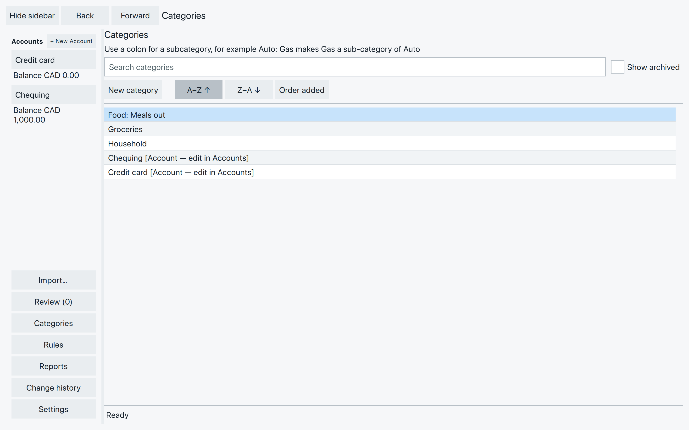
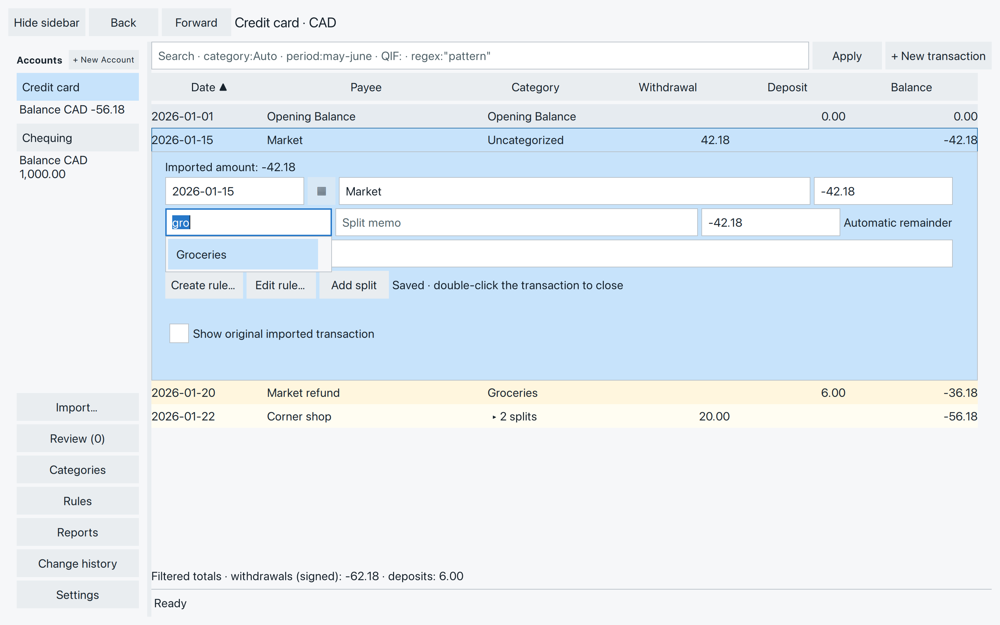
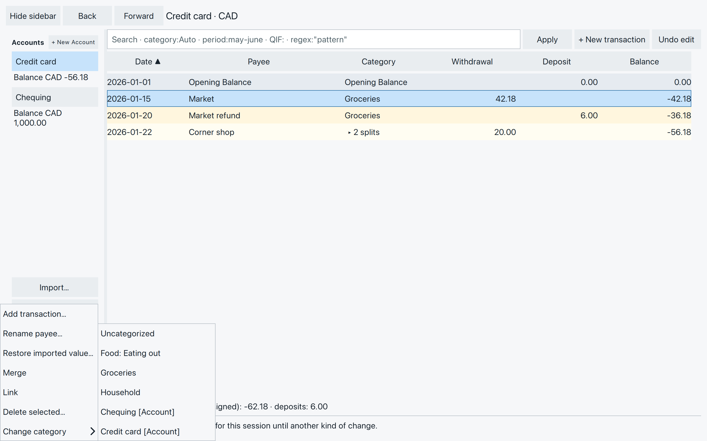
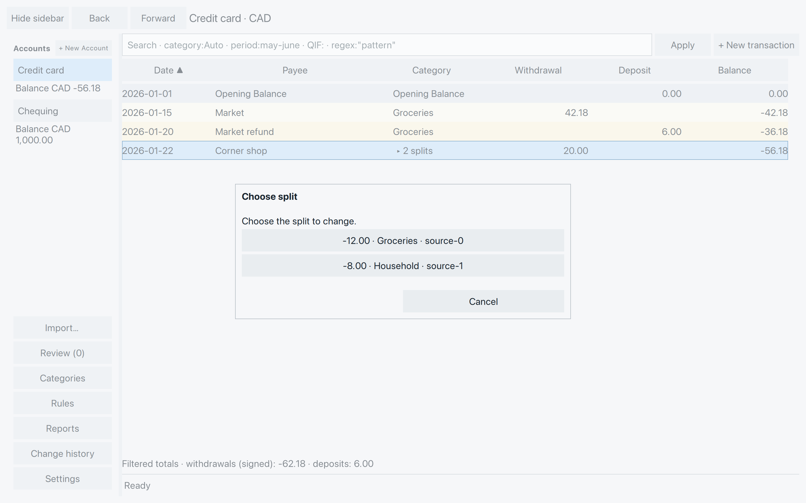

# Organize spending with categories

A category says what a transaction was for. Give the Market purchase
and its refund **Groceries**, and you can see their net cost together.
The same category works across your accounts.

Start with the categories supplied when you created your file, or make
a few of your own. You don’t need to organize everything at once.
**Uncategorized** is a useful place to leave something you haven’t decided.

## Create a category

Choose **Categories** in the sidebar, then **New category**. Type a
name in the new row at the bottom and press **Enter**. Moving focus
away also saves a valid name; **Escape** cancels the unfinished edit.

For example, add **Food: Meals out** for restaurant purchases. A colon
can help you keep related names together. You can use one colon, with
text on both sides.

*Ordinary categories come first. Account rows are shown separately and are managed in Accounts.*

Despite the workspace’s “subcategory” description, **Food** and
**Food: Meals out** are separate categories. Creating one does not
create the other. Renaming or archiving Food does not change
Food: Meals out.

### If a name is refused

Use a name that is different from existing categories and account names
or aliases. Changing capitalization does not make a name different,
and archived categories still reserve their names.

Avoid `[` and `]`, the `|` character, extra colons, and spaces at the
start or end. If the name is invalid, correct the text that remains
in the row and press Enter again.

## Choose a category for a transaction

Double-click the transaction. In its category field, type part of a
name, such as **gro**. Choose **Groceries** from the suggestions, or
use **Up/Down** and **Enter** or **Tab**.

*Choose a suggestion to use that category. Typing a name alone does not create one.*

For an existing transaction, choosing a category saves the complete
valid edit, including other fields you changed. For an unsaved new
entry, finish it and press Enter in the date, payee, amount or memo.
See [Add and correct transactions](add-correct-transactions.md).

To remove a category, clear the field and choose **Uncategorized**
from the suggestions. Simply leaving an unchosen search restores the
previous category. If no suggestion fits, create the category in
Categories first, then return to the transaction.

## Change selected transactions

Select one or more rows, right-click, and open **Change category**.
Choose a category from the scrollable submenu. For ordinary entries
with one split each, the change saves immediately for the whole selection.
New and accepted transactions can be selected together.

*An ordinary category describes spending. A choice marked [Account] makes a transfer—check the destination before choosing it.*

For a single split transaction, SpentIt asks **Choose split**. Pick the
part you want to change. For example, keep the Corner shop’s **-12.00**
in Groceries while changing only its **-8.00** household portion.

*Choose the split, not the whole purchase, when only part needs a new category.*

If a multiple-row selection contains split transactions, handle one
split transaction at a time. SpentIt does not guess which parts you meant.

**Undo category change** reverses an eligible category-menu change.
It remains available after reopening until a later change makes it
unavailable. Check the result before continuing. An assignment made in the inline editor uses
**Undo edit** instead.

## An account destination makes a transfer

The category choices also include your other accounts, marked
**[Account]**. Choose one only when money moved between your own accounts,
such as a payment from Chequing to Credit card.

Choosing an account creates a linked posting in that account with the
opposite amount, or redirects an existing transfer. It changes the
destination account’s balance. It does
not search for an existing imported payment to use instead. If both
postings are already present, use [Review Link](review-duplicates-transfers.md#is-it-a-payment-between-accounts).

The accounts must use the same currency, and you cannot transfer an
entry to the account it is already in. Save a newly typed transaction
before choosing an account destination.

Changing a transfer back to an ordinary category ends its link. An
independently entered or imported posting in the other account stays;
a disposable new posting generated by SpentIt is removed. Check both
accounts before continuing. **Undo category change**, while available,
restores the category and the affected relationship together.

## Keep your category list useful

Use **Search categories** to find a name. **A–Z ↑**, **Z–A ↓** and
**Order added** change the list’s order. Each visit starts A–Z; new
categories stay at the bottom until you sort or leave.

Right-click an ordinary category for these actions:

- **Rename:** edit its name and press Enter—for example, change
  Food: Meals out to Food: Eating out. Transactions using that
  category show the new name; you don’t need to assign them again.
- **Archive:** stop offering the category for new assignments while
  keeping it on transactions that already use it.
- **Unarchive:** check **Show archived**, right-click the archived
  category, and choose Unarchive to make it available again.
- **Delete unused category:** remove a category you don’t need.
  If SpentIt refuses because it is still referenced, use Archive instead.

Archive, Unarchive and an allowed deletion take effect when chosen.
Account rows cannot be renamed or removed here; use their account menu.
There is no category-manager Undo button. You can rename again or
unarchive, so use those actions when you want to keep the category.

Category names do not set an income or expense type. The transaction’s
amount and the report’s choices determine how it contributes. A clear
name is enough—you don’t need a special category type for a refund.
