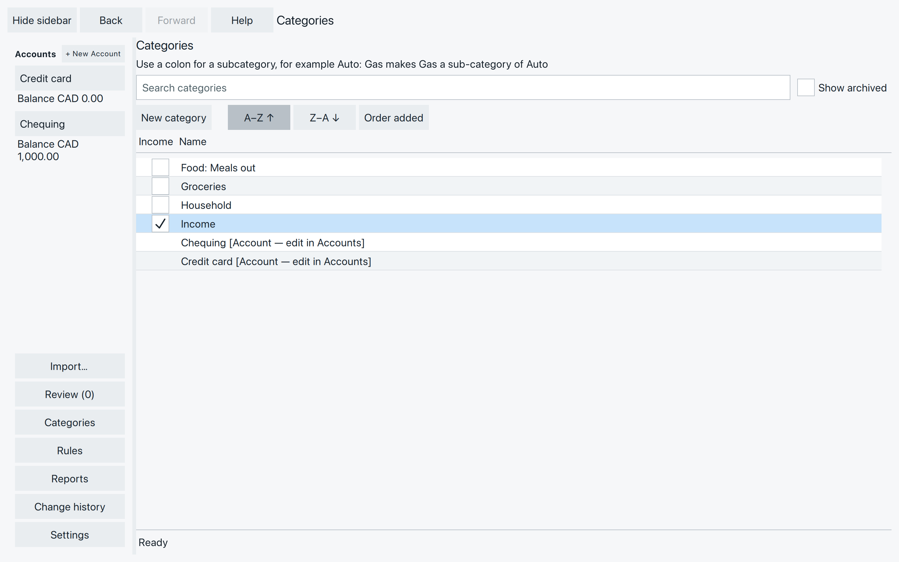
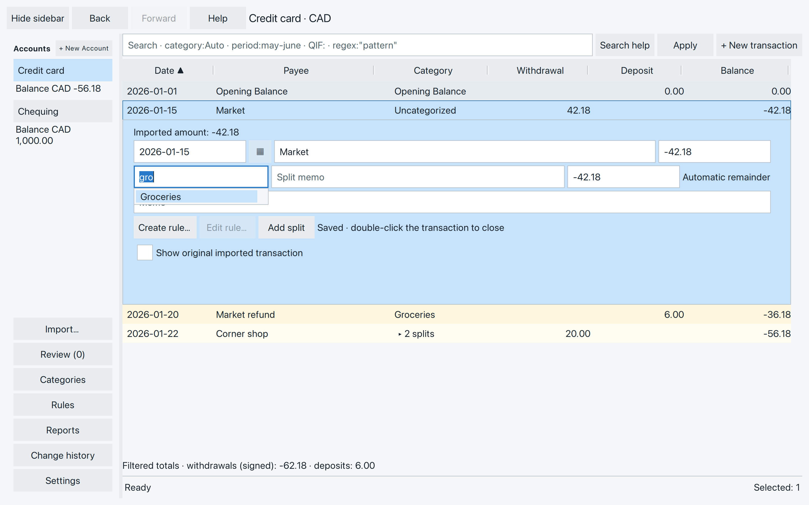
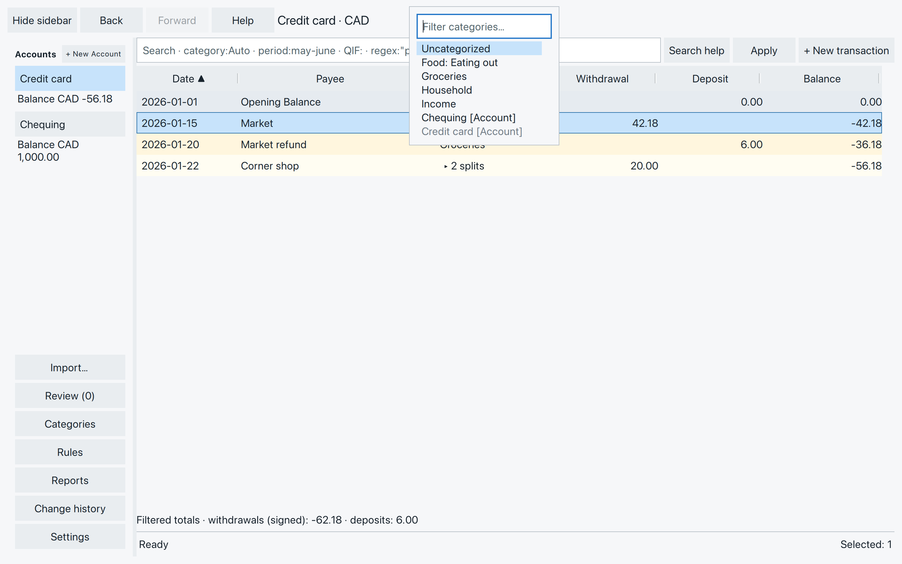
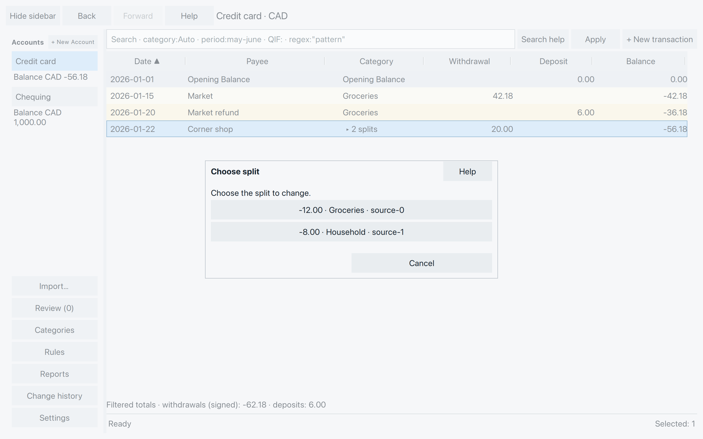
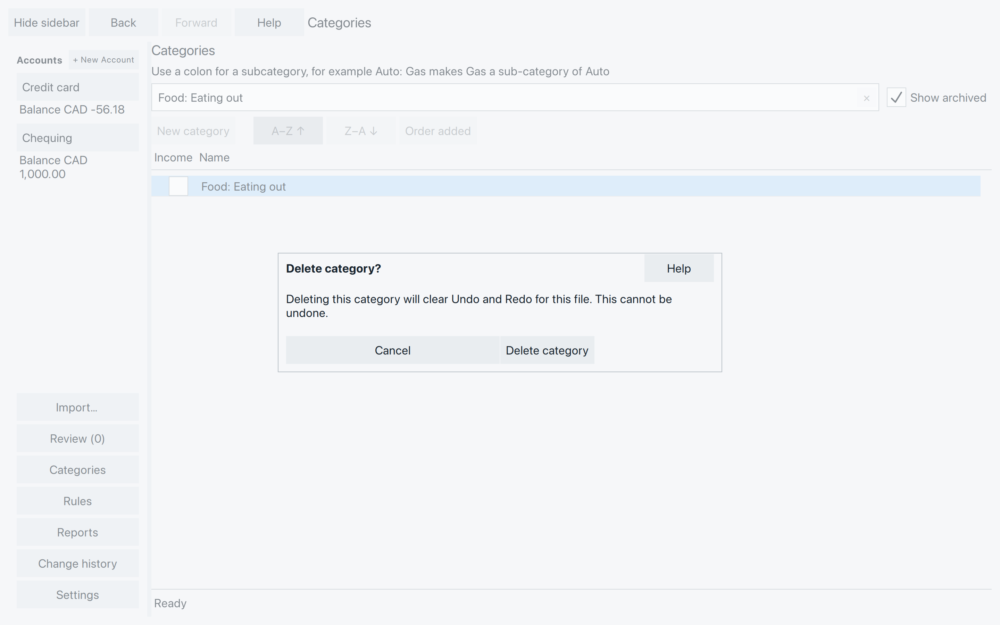

# Organize spending with categories

A category says what a transaction was for. Give the Market purchase
and its refund **Groceries**, and you can see their net cost together.
The same category works across your accounts.

Start with the categories supplied when you created your file, or make
a few of your own. You don’t need to organize everything at once.
**Uncategorized** is a useful place to leave something you haven’t decided.

## Create a category

Choose **Categories** in the sidebar, then **New category**. Type a
name in the new row at the bottom and press **Enter**. Moving focus
away also saves a valid name; **Escape** cancels the unfinished edit.

For example, add **Food: Meals out** for restaurant purchases. A colon
can help you keep related names together. You can use one colon, with
text on both sides.

*Each ordinary category has an Income checkbox. Checked ones are grouped after expenses.*

Despite the workspace’s “subcategory” description, **Food** and
**Food: Meals out** are separate categories. Creating one does not
create the other. Renaming or archiving Food does not change
Food: Meals out.

### If a name is refused

Use a name that is different from existing categories and account names
or aliases. Changing capitalization does not make a name different,
and archived categories still reserve their names.

Avoid `[` and `]`, the `|` character, extra colons, and spaces at the
start or end. If the name is invalid, correct the text that remains
in the row and press Enter again.

## Choose a category for a transaction {#choose-a-category-for-a-transaction}

Double-click the transaction. In its category field, type part of a
name, such as **gro**. Choose **Groceries** from the suggestions, or
use **Up/Down** and **Enter** or **Tab**. Tab moves straight to
**Memo** if you haven’t typed or moved through the suggestions.
With several splits it moves to that split’s memo. Tab with no match
restores the category and moves on. Enter with no match stays in the
field. Shift+Tab moves back.

*Choose a suggestion to use that category. Typing a name alone does not create one.*

For an existing transaction, choosing a category saves the complete
valid edit, including other fields you changed. For an unsaved new
entry, finish it and press Enter in the date, payee, amount or memo.
See [Add and correct transactions](add-correct-transactions.md).

To remove a category, clear the field and choose **Uncategorized**
from the suggestions. Simply leaving an unchosen search restores the
previous category. If no suggestion fits, create the category in
Categories first, then return to the transaction.

## Change selected transactions {#change-selected-transactions}

Select one or more rows, right-click, and choose **Change category**.
The filter is ready for typing. Type any part of a name, using upper-
or lowercase, or leave it empty to see the whole list. Click a choice
or use **Up/Down** and **Enter**. If there are no matches, nothing is
assigned. Press **Escape** or click outside to close the picker.

For ordinary entries with one split each, the change saves for the
whole selection. New and accepted transactions can be selected together.

*Check the destination before choosing an item marked [Account].*

For a single split transaction, SpentIt asks **Choose split**. Pick the
part you want to change. For example, keep the Corner shop’s **-12.00**
in Groceries while changing only its **-8.00** household portion.

*Choose the split, not the whole purchase, when only part needs a new category.*

If a multiple-row selection contains split transactions, handle one
split transaction at a time. SpentIt does not guess which parts you meant.

Press **Command+Z** on a Mac, or **Ctrl+Z** on Windows and Linux, to
undo a category change from this menu while it is the newest saved
action. Undo newer actions first if you need to reach an earlier change.
Check the result before you continue. A category chosen in the
transaction editor is part of that edit, so the same shortcut undoes
the whole edit.

## An account destination makes a transfer

The category choices also include your other accounts, marked
**[Account]**. Choose one only when money moved between your own accounts,
such as a payment from Chequing to Credit card.

Choosing an account creates a linked posting in that account with the
opposite amount, or redirects an existing transfer. It changes the
destination account’s balance. It does
not search for an existing imported payment to use instead. If both
postings are already present, use [Review Link](review-duplicates-transfers.md#is-it-a-payment-between-accounts).

Choosing an account here creates the other posting, so the two accounts
need the same currency. You cannot send the entry to the account it is
already in. Save a newly typed transaction before you choose an account.

If the other posting is already there, and especially if that account
uses a different currency, do not pick the account from this list. Link
the two postings by hand. See
[If there is no suitable question](review-duplicates-transfers.md#if-there-is-no-suitable-question).

To change the category on an entry SpentIt created in another
account, go to the original transaction and change it there. Choosing
an ordinary category on the created entry leaves it as it is.

On the original transaction, choose an ordinary category or
**Uncategorized** to release the transfer. An
independently entered or imported posting in the other account stays;
a disposable new posting generated by SpentIt is removed. Check both
accounts before continuing. Press **Command+Z** on a Mac, or
**Ctrl+Z** on Windows and Linux, while that change is the newest saved
action. That restores the category and the link together.

## Keep your category list useful

Use **Search categories** to find a name. **A–Z ↑**, **Z–A ↓** and
**Order added** change the order within Expenses and Income. Each visit
starts with Expenses A–Z, then Income A–Z, then Accounts A–Z. New
categories stay at the bottom until you sort, leave, or change their Income checkbox.

Check **Income** beside a category to move it into the income group;
uncheck it to move it back to expenses. The change saves immediately.
While it saves, the box is partly checked and **Saving…** appears
beside the name. That is not the partial check in Reports. A category
you add, and a category created from an import, starts unchecked.
When you create a file with **Use default categories** checked, these
start with Income checked and appear in the Income group: Income:
Business / Self-Employment, Income: Investment & Interest, Income:
Other, Income: Pension & Retirement, and Income: Salary & Wages.
Taxes: Income is an expense. Every other starter category starts
unchecked. Category pickers use the same grouped A–Z order.

**File → SpentIt Export…** can copy the category list, including the
Income check. See [Copy transactions or saved definitions](backup-recovery.md#copy-transactions-or-saved-definitions).

Right-click an ordinary category for these actions:

- **Rename:** edit its name and press Enter—for example, change
  Food: Meals out to Food: Eating out. Transactions using that
  category show the new name; you don’t need to assign them again.
- **Archive:** stop offering the category for new assignments while
  keeping it on transactions that already use it.
- **Unarchive:** check **Show archived**, right-click the archived
  category, and choose Unarchive to make it available again.
- **Delete unused category:** remove a category with no current
  transactions, rules or saved reports using it. Check archived accounts
  and disabled rules too. Past use alone is fine.
  If it’s still in use, you can archive it instead.

If a saved action needs the category for Undo or Redo, SpentIt asks
before it clears both for the whole file. Choose **Cancel** to keep
the category and your history. If SpentIt doesn’t need to clear your history,
it deletes the category as soon as you choose the action.

*Delete only when you’re ready to clear Undo and Redo for this file.*

Archive and Unarchive take effect when you choose them.
Account rows cannot be renamed or removed here; use their account menu.
There is no category-manager Undo button. You can rename again or
unarchive, so use those actions when you want to keep the category.

The Income checkbox helps you find and select categories in reports.
The transaction’s amount still determines how it contributes. Keep a
Groceries refund in Groceries so it reduces that category’s spending.
