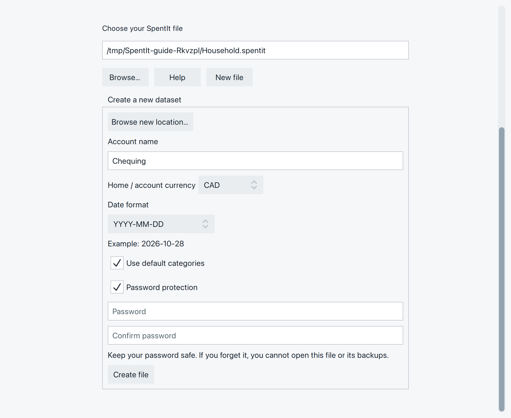
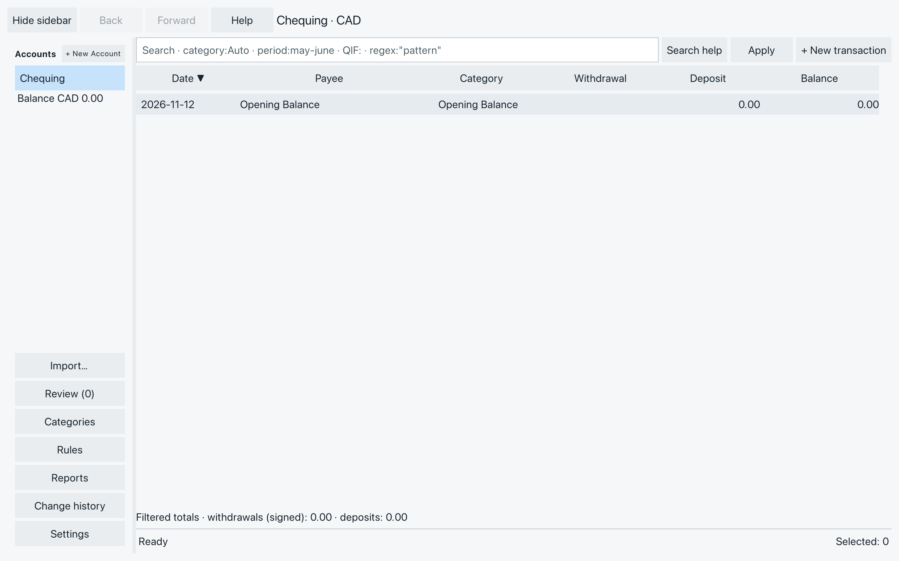
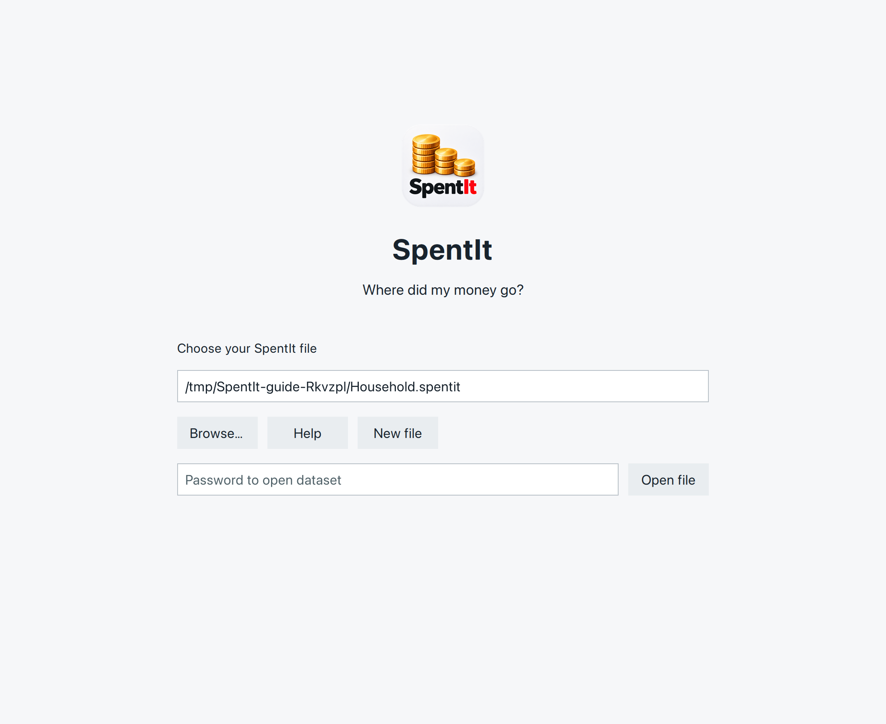

# Create or open your file

Start by giving your accounts a home. One SpentIt file can hold your
bank accounts, credit cards, and cash together.

Already have a file? Skip to [Open your file](#open-your-file).

## Create a file

Choose **New file** on the welcome screen. If a file is already open,
choose **File → Close file** first.

### Choose a name and place {#choose-a-name-and-place}

Use **Browse new location…** to choose a folder and name your file.
Something like `Household.spentit` will be easy to recognize later.

If that name is already taken, SpentIt asks whether to **Overwrite**.
This replaces the existing file and its contents. Choose **Cancel**
and use another name if you want to keep it.

### Set up your first account

- **Account name:** give it a name you recognize, such as Chequing.
  You can add your other accounts later.
- **Home / account currency:** choose this account’s currency.
  Our example uses CAD (Canadian dollars).
- **Date format:** choose how you want to read and enter dates.
  The example beneath the control shows your choice.
- **Use default categories:** leave this checked for a starting set
  of categories. You can add or rename categories later.

### Choose password protection

With **Password protection** checked, enter your password twice.
Keep it somewhere safe: there is no password reset, and your backups
need the same password.

If you uncheck it, anyone who has the file or a backup can read your
financial information.

*The setup choices for our example. Select any picture to enlarge it.*

Scroll down if you cannot see **Create file**.

Choose **Create file** when you’re ready. Your first account opens.

## Find your bearings

*Your first account starts with an Opening Balance row and no purchases yet.*

The **left sidebar** holds your accounts and balances. Below them are
**Import…**, **Review**, **Categories**, **Rules**, **Reports**, and
**Settings**. You’ll meet these as you need them.

The **transaction list** on the right belongs to the selected account.
**Back** and **Forward** return to places you’ve visited.

Some actions take a little time. A spinning arc at the top right shows
when SpentIt is busy. The status line at the bottom tells you what it’s
doing. Wait for the action to finish before trying it again.

## Open your file

On the welcome screen, choose **Browse…** and select your `.spentit`
file. If the right file is already shown, you can leave it selected.

Enter the password if asked, then choose **Open file**. A file without
a password may open automatically when you next start SpentIt.

*Check the selected file, enter its password, and choose Open file.*

### If it won’t open

- **Password not accepted:** check that you chose the right file and
  try typing the password again. A damaged file can also fail to unlock;
  the message alone does not prove the password is wrong.
- **File missing or unavailable:** use **Browse…** to find it. If it’s
  on an external drive, make sure the drive is connected.
- **File already open elsewhere:** close it in the other SpentIt
  window before trying again.

## Close or switch files

Choose **File → Close file** to return to the welcome screen. From
there, open another file or create a new one. If an unfinished edit
needs a decision, SpentIt asks before leaving.

Saved transactions stay in your file, including those you haven’t
accepted yet. An edit still waiting for **Save** or **Enter** is not
saved yet.

You now have a place for your transactions. Next comes setting up
your accounts and their starting balances.
