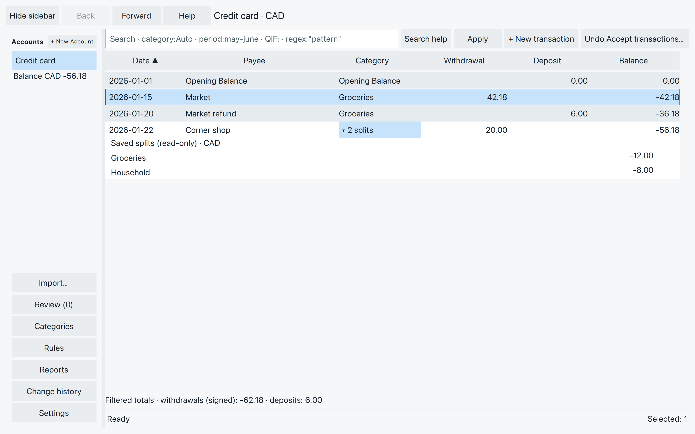
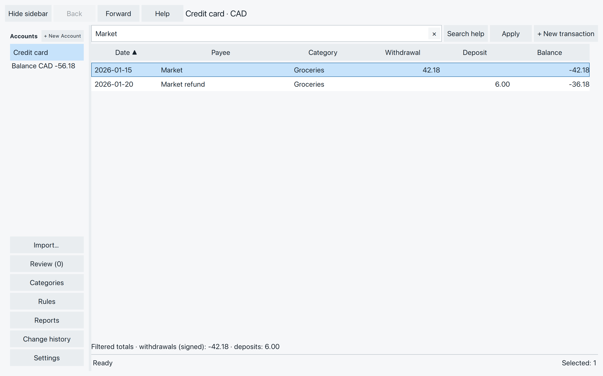
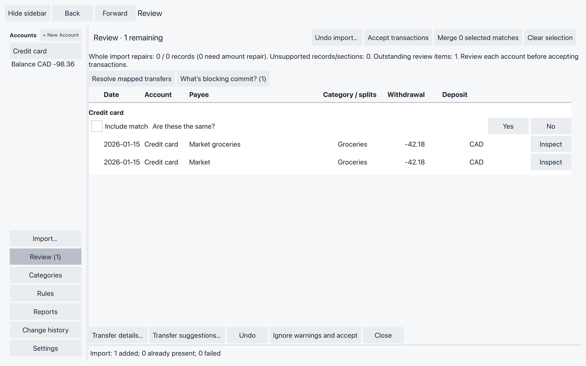

# Find your way around transactions

You’ve brought in your transactions. Now you want to find a purchase,
check a balance, or see what needs attention.

Choose an account in the sidebar. Its name and currency appear above
the transaction list, also called the **ledger**.

## Read a transaction

The columns show **Date**, **Payee**, **Category**, **Withdrawal**,
**Deposit**, and **Balance**. A withdrawal takes money out; a deposit
puts money in. To show or hide a transaction’s details, double-click
its row.

On Credit card, our Market purchase appears as a **42.18 withdrawal**.
The **6.00 deposit** is the refund. Starting from zero, the balance
is then **-36.18**: that is what we owe. In the editor, the purchase’s
total has a minus sign; the Withdrawal column shows its size without
that sign.

**Balance** is the account balance after that transaction in date
order. Sorting or searching does not recalculate it from the rows
currently on screen. The sidebar shows the account’s current balance,
including saved transactions you haven’t accepted yet.

*Another purchase, 20.00 at Corner shop, is split between Groceries and Household. The card balance is now -56.18.*

### Look inside a row

A category marked **2 splits**, or another count, means the transaction
is divided into parts. Click that label to show their categories,
memos and amounts; click it again to hide them. Close the row’s editor
first if the split label is unavailable.

An arrow beside a transfer category takes you to its transaction in
the other account. For a split transfer, expand the splits to find
the arrow for the part you want.

### Is it accepted?

Row shading distinguishes new transactions, but selection can cover
that shading. Double-click a row to show or hide its details.

Both kinds already count in the account balance. You do not need to
accept a transaction just to keep it when you close the file.

## Select without editing

Click once to select a row. Double-click to open or close its editor.
Selecting another row leaves an open editor where it is; check which
transaction you are editing before typing.

- **Shift-click** selects a range of rows in the displayed order.
- **Command-click** on macOS, or **Ctrl-click**, adds or removes an
  individual row from the selection.
- With the ledger focused, **Up/Down** moves the selection and
  **Home/End** moves to the first or last row. **Enter** opens the
  focused transaction.
- With the transaction list focused, **Command+A** on macOS, or
  **Ctrl+A**, selects every transaction in the current list, including
  rows that are off screen. The Opening Balance row is left out.
  **Command+Shift+A**, or **Ctrl+Shift+A**, clears the selection.
  In a text field those shortcuts act on the text.

The bottom status line shows **Selected: n**. Right-click a selection
to see its actions. One action covers the whole selection, and one
Undo reverses it. Check the rows before you continue.

## Find a purchase

Type `Market` into the search box and choose **Apply**, or press
**Enter**. The list shows matches in this account. Search includes
payees, memos and categories, including the parts of a split.

*Searching hides the Corner shop purchase; it does not remove it or change the account balance.*

Capitalization does not matter. Words separated by spaces must all
match, though they can match different fields. Put a phrase in double
quotes to find those words together.

For a more focused search, try:

- `category:Groceries` for transactions assigned to Groceries.
- `period:2026-01-01..2026-01-31 Market` for Market entries in January.
  Use your file’s date format when entering full dates.

A category search also includes names beginning with that category
and a colon. Use `category-exact:Groceries` for only that exact category.
A matching split brings in its whole transaction; the totals below
the list include the whole amount, not just that split.

Choose the search box’s **× (Clear search)** button to show all entries
again. If you did not select a search result, clearing restores the
selection from before the search. If you did, your result selection stays.

If a search reports an error, the previous results stay on screen.
Correct the search and apply it again; an error does not mean there
were no matches.

## Sort, scroll and come back

Click a column heading to sort by it. Click it again to reverse the
order; the heading’s arrow shows the direction. **Date** returns you
to date order. Balance values still belong to their original dates.

Scroll to reach more rows. In a narrow window, use the horizontal
scrollbar to reach the columns on the right.

**Back** and **Forward** return to visited accounts and workspaces.
You can also choose the account again in the sidebar. SpentIt keeps
your place in each account during the session; if that row is no
longer visible, it returns nearby.

## See what needs attention

A rose mark on a row means this account has a possible duplicate.
Above the list, **Possible duplicate** names the entries and whether
each is **New** or **Accepted**. When more than one match is offered,
choose it, then use **Merge**, **Keep this pair separate**, or
**None of these match**. **Show match** finds the other entry. If a
search is hiding it, the button says **Reveal hidden match (clear
filter)**. **Next possible duplicate** moves to another marked row.
**Undo review** reverses the latest review answer while it is available.
You can answer the same questions in Review. Selecting a row does not
answer them.

Choose **Review** in the sidebar. Its count is the number of outstanding
review items, not the number of new transactions. Items are grouped by
account and can include possible duplicates, transfer matches, and
records that need correcting.

Here, another import added a possible repeat of the Market purchase.
Both entries currently count, making the card balance -98.36 while
both remain.

*These entries might describe the same purchase. Review presents the question; opening a row does not answer it.*

Read the question and compare the entries before choosing **Merge** or
**Keep separate**. **Show in ledger** opens a duplicate in its account.
**Correct** opens a repairable record. Duplicate and transfer decisions
come next in the guide.

The bottom status line reports activity and outcomes. **Nothing left
to review.** means there are no outstanding review items; it does not
mean all transactions have been accepted. Use **Back** or select an
account to return to its ledger.

## If something looks missing or wrong

First check the selected account, clear the search, and sort by Date.
A filtered list can hide entries that still contribute to the balance.

For an unexpected balance, check the
[opening balance](accounts.md#set-the-starting-balance), then compare
the ledger with your statement for missing entries. Check Review for
possible duplicates. Don’t change
the opening just to cancel an unexplained difference.

If an action is unavailable, check the selection and wait for any
operation to finish. Some actions need a particular kind of transaction.
If you have an unfinished edit, answer its Save / Discard / Stay prompt
before leaving.
