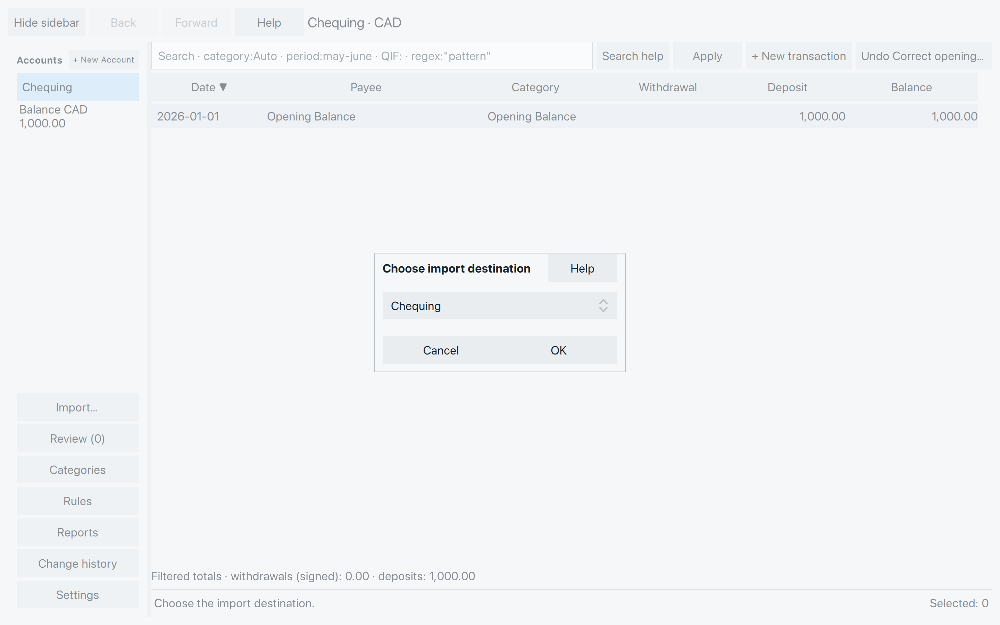
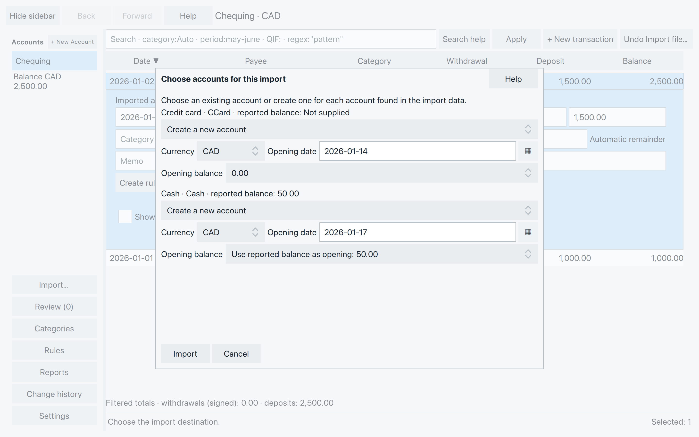
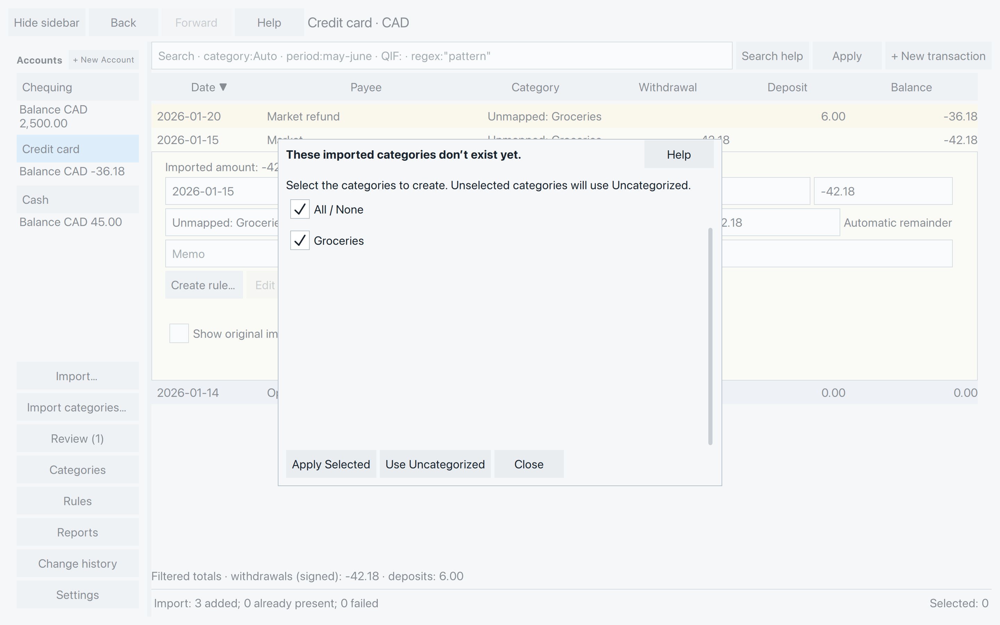
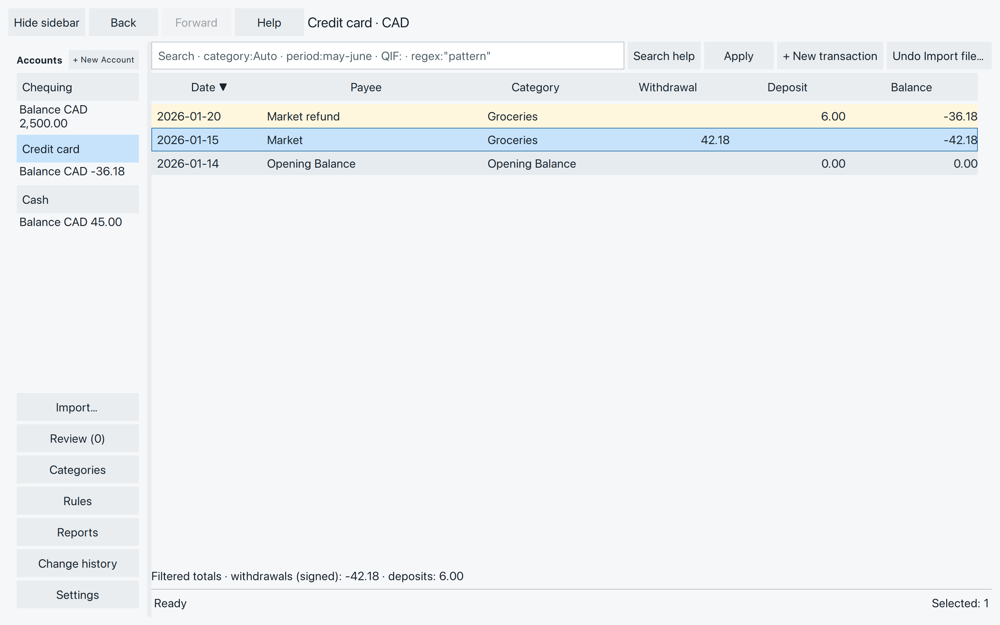
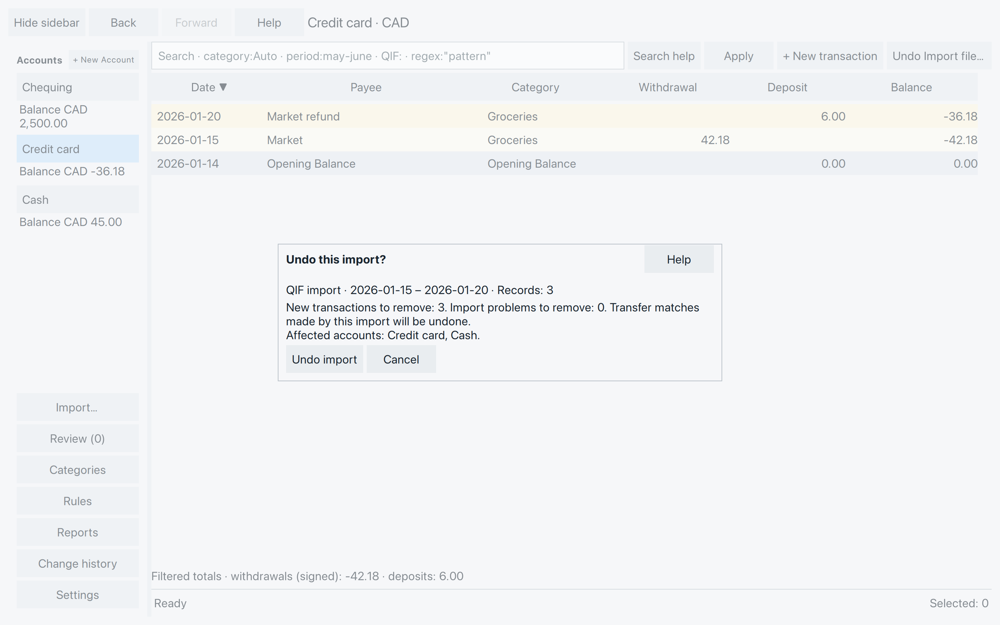

# Bring in transactions

An export from your bank or credit-card provider saves you typing
purchases one by one. Start with a period you can easily check,
such as one month.

## Choose an export

Download your transactions in QIF, OFX, QFX, QBO, or ASO format.
These files include the account type (such as bank, cash, or credit
card). SpentIt can import bank, cash, and credit-card accounts from
QIF files. From the other formats SpentIt can import bank and
credit-card accounts. PDF, CSV, and investment exports are not supported.

Choose **Import…** in the sidebar, then select the downloaded file.
If you know which account it belongs to, you can instead right-click
that account and choose **Import…**.

SpentIt uses a recognized account when it can. If the file does not
identify an account, the sidebar route asks you to choose a destination.
Select it and choose **OK**. Importing from an account’s right-click
menu supplies that account as destination for an unnamed file.

*Choose the account whose transactions you downloaded.*

### If the dates could mean two things {#if-the-dates-could-mean-two-things}

A QIF date such as 01/02/2026 could mean January 2 or February 1.
When asked, compare the examples with your statement, choose
**Day / Month / Year** or **Month / Day / Year**, then **Continue**.
Use **Cancel import** if you cannot establish the order.

## Match the accounts {#match-the-accounts}

An unfamiliar account name, a different account from the one you
chose, or a file containing several accounts opens **Choose accounts
for this import**.

For each listed account, choose its existing SpentIt account or
**Create a new account**. Scroll to check them all. You cannot combine
different source accounts into one destination in this dialog.

For a new account, check:

- **Currency:** the currency of its transactions. Importing does not
  convert money, and a statement’s currency must match its destination.
- **Opening date:** the suggestion is the day before the earliest
  transaction SpentIt could read in that account, so the opening comes
  before that day’s purchases. You can change the date. An account with
  no readable dates may show 1900-01-01.
- **Opening balance:** leave **0.00**, or choose **Use reported balance
  as opening** when offered and appropriate. This uses the reported
  amount exactly. It does not work backward from a closing balance.

New accounts take their names from the export. Existing accounts
keep their openings. To change an opening later, use
[Correct opening](accounts.md#set-the-starting-balance).
The calendar beside **Opening date** fills that date.

*Our Cash example uses a known opening of 50.00. Credit card starts at zero. You can change either date.*

Choose **Import** after every account has a destination. **Cancel**
leaves the mapping without importing.

While the import runs, **Importing transactions…** replaces the mapping.
**Applying imported categories…** does the same for a category choice.
**Cancel** is there only while the step can still be cancelled. If you
cancel or the step fails, choices that are still pending come back.
Cancelling a category choice does not undo transactions already saved.
A finished import stays until you undo it.

## Choose which categories to keep {#choose-which-categories-to-keep}

A category describes what a transaction was for: Groceries, for
example. If the export uses categories your file does not yet have,
SpentIt asks which to create.

*Keep Groceries checked to create it and use it for these purchases and refunds.*

- **Apply Selected** creates the checked categories. Transactions
  using unchecked missing categories become **Uncategorized**.
- **Use Uncategorized** creates none of the missing categories and
  leaves their transactions Uncategorized.
- **Close** leaves this choice for later. When there are categories
  available to import, **Import categories…** appears in the sidebar
  (below **Import…**). You can use it then, even after reopening your
  file.

Existing categories keep their assignments. Acceptance and automatic
rules for these imported rows wait until you finish the category choice.

### Transfers - a name means another account

When an imported transaction refers to another account, such as
Chequing making a payment to Credit card, it is a transfer, not an
ordinary spending category.

For an unresolved transfer, open **Review**, choose **Correct**, and
select the destination account in the transaction’s category field.
For a split transaction, choose the field for the affected split.
The destination must be another active account in the same currency.
Create or reactivate it first if needed. Selecting an account creates
the transfer posting in that account.

For mapped imports, **Set up imported transfers?** can use the account
names you confirmed. **Set up transfers** links matching postings and
can create the other side of an explicit transfer. It can change
balances in those accounts. It is not a search for similar payments.
**Cancel** leaves them for Review. Matching the two sides of a payment
is covered later in the guide.

## Check the result

The bottom status line reports how many records were **added**,
**already present**, or **failed**. Select each affected account and
check its transactions and balance. A category choice may replace
the completion message with “Imported categories applied.”

*The purchase and refund are saved. The opening sorts ahead of that day’s transactions. They do not need accepting before you leave.*

Saved new transactions stay when you close the file and already
count in balances and reports. You can review them at your own pace.

### When something needs attention

Open **Review** for failed records and unresolved choices. Use
**Correct** to open a repairable record, check it against the statement,
and enter the missing or corrected values. **Enter** saves a valid edit.
Some unsupported records cannot be fixed by editing a date or amount.
Follow the message rather than guessing a value to make it pass.

A completed import can contain both successful rows and failures.
Do not import it again just because some rows need attention.

If the whole export is unsupported, obtain a supported transaction
export. If its currency differs from the account, choose the correct
account; changing a currency label does not convert the money.

If an OFX, QFX, QBO or ASO statement repeats a field with conflicting
values, SpentIt says **Statement contains conflicting fields; no import
was saved. Obtain a corrected export and try again.** If the statement’s
balance cannot be read, it says **The statement balance could not be
read; no import was saved. Obtain a corrected export and try again.**
Get a corrected export. A statement that simply has no balance can
still be imported. A new account then starts at zero unless a reported
opening is offered.

After an interrupted import, SpentIt may report that the incomplete
import was removed and can be imported again.

If a message says SpentIt could not confirm whether the import was
saved, reopen the file and check the transactions before trying again.

## Import another period

Use **Import…** again for the next export. SpentIt recognizes transactions
that are already in the same account.
Possible duplicates appear in **Review** and are highlighted in rose in
the account’s ledger. Two purchases with the same date and amount are not
necessarily duplicates; they are left for you to review.
If a download has a purchase one day earlier or later than it appeared
before, SpentIt still flags it if the payee and amount match a
transaction already in the account.

## Undo a mistaken import {#undo-a-mistaken-import}

For an import into the wrong account, undo it first, then import the
file into the correct account.

If that import is the latest saved action in the file, the **Undo**
button beside search can undo it. Right-click an account and choose
**Undo last import…** for its newest eligible import. To choose one,
open **Review → Undo import…**, select the account, then the import.
The list is newest first and uses file type, dates, and record counts
to help identify it. An older import waits until Undo is empty. The
message is **Undo the current actions, or close and reopen the file
first.**

*Check the removal counts and affected accounts before choosing Undo import.*

Undo applies to the **whole selected file import**, including its other
accounts, transfer matches, and any rules that ran while it was
importing. Earlier imports remain. Transactions also kept by another
import may remain. Accounts, categories and opening balances created
for the import stay, including a new account’s chosen opening.

Check the preview, then choose **Undo import**, or **Cancel** to keep it.
An import containing accepted transactions is not eligible. Later
conflicting edits or links can also prevent Undo.

**Discard new transactions…** is broader: it removes eligible new
work across imports in the selected account, not just one file import.
Its confirmation lists affected accounts, including generated matching
transactions that may also be removed. Accepted transactions remain.
It also waits until Undo is empty, with the same message.
Use it only when you intend that wider removal. There is no Undo for
the removal itself.

To copy transactions out of SpentIt, or to copy rules, reports and
categories without the transactions, see
[Copy transactions or saved definitions](backup-recovery.md#copy-transactions-or-saved-definitions).

Next, get familiar with the transaction list and find the entries
you want to check.
