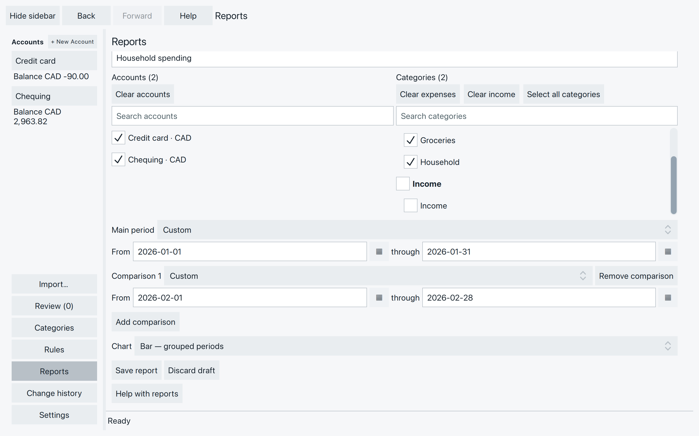
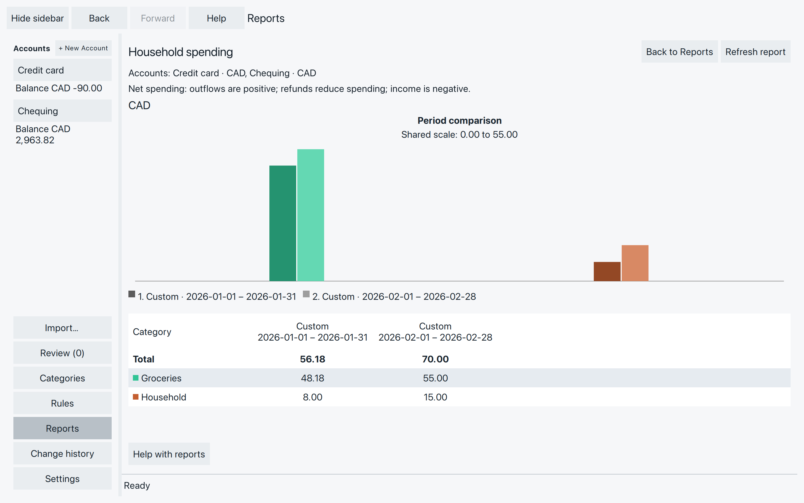
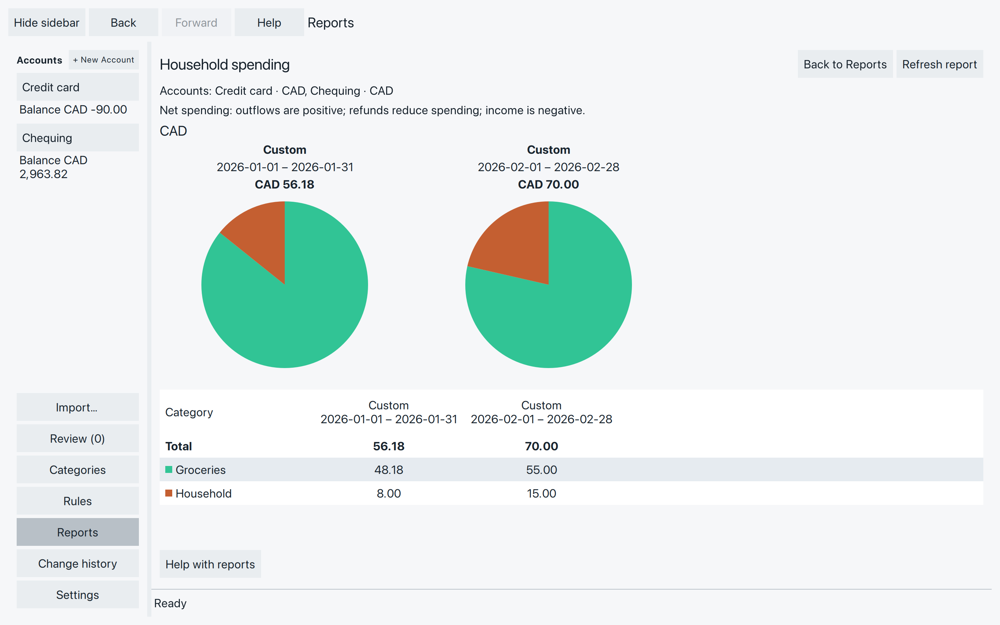
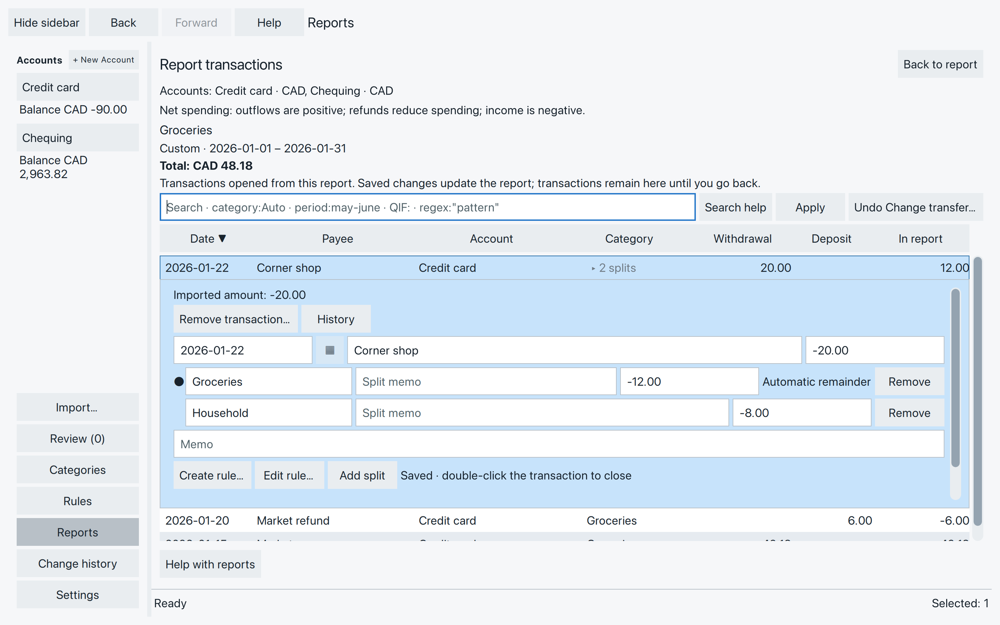

# Answer questions with reports

How much went on groceries? Did February cost more than January?
A report brings together the relevant parts of your transactions, across
the accounts you choose. Start with one question, then open the amounts
behind the answer.

## Make your first report

Choose **Reports** in the sidebar, then **New report**.

1. Give it a name, such as **Household spending**.
2. Check the **Accounts** you want to include. For our example, keep
   Chequing and Credit card checked.
3. Under **Categories**, keep **Groceries** and **Household** checked.
   Uncheck Income, Uncategorized and any other categories for this example.
4. Under **Chart**, choose **Bar — grouped periods**.
5. Set the **Main period** From **2026-01-01** through **2026-01-31**.
6. Choose **Add comparison** and set its dates to **2026-02-01** through
   **2026-02-28**.
7. On the report’s row, choose **Save and show**.

*The Income checkbox above the list selects that group.*

The screenshots use the earlier Market purchase and refund, plus Corner shop’s
12.00 Groceries / 8.00 Household split. To try the February comparison,
[add](add-correct-transactions.md#add-a-missing-purchase) or import a **Market**
purchase on **2026-02-15** for **-55.00** in Groceries and **Home supplies**
on **2026-02-22** for **-15.00** in Household, both in Credit card. Add each
only if it is not already there. Other transactions can stay in your file;
only the chosen categories and periods enter this report.

### Choose what belongs

A new report selects all current accounts and categories, including
**Uncategorized**. Keep Uncategorized checked when you want spending without
a category to count. Uncheck income categories for a spending-only view.
Category names do not decide whether an amount is spending or income.

Check or clear the **Expenses** or **Income** group checkbox to select or clear
that whole group. A partial check means some categories are selected. Group
actions include categories hidden by search; Uncategorized stays separate.
Set each category’s Income checkbox in **Categories** to choose its group.
Changing that flag leaves saved reports’ selections as you chose them.

Search a checklist to find a name. The **X** in that search clears it.
**Clear expenses** and **Clear income** clear those groups, including
categories the search is hiding. **Select all categories** selects every
category, including hidden ones. Accounts use **Select all accounts** and
**Clear accounts**. Saved reports do not automatically include accounts
or categories you create later; edit their selections when needed.

Checking a category such as Auto also checks matching names such as Auto: Gas.
You can uncheck each separately. Results give each category its own row;
Auto is not an extra subtotal of all the Auto: categories.

## Choose dates and comparisons

Both dates are included. Typing either date changes that period to **Custom**,
which keeps those exact dates when you show the report again.

Presets move with the date when you show or refresh the report:

- **Year to date** means January 1 through today.
- **This year**, **This quarter** and **This month** cover the whole current
  calendar period. **Last year**, **Last quarter** and **Previous calendar
  month** cover the previous complete period.
- **Last 6 complete months** leaves out the current partial month.
- **Same period last year**, available for a comparison, follows the main
  range one year earlier. February 29 becomes February 28 when necessary.

Check the resolved dates in the results, especially when using a preset.
Comparisons appear in the order you added them. Use **Remove** beside a
comparison to drop it. Periods may overlap: they are separate comparisons,
so adding their totals together would count shared transactions twice.

Use the calendar icon beside a date to pick it. The month and year headings
let you browse; choosing a day or **Today** sets the date. Browsing alone
leaves it unchanged. Escape returns from the month/year choices to days;
Escape again closes without selecting a date.

## Read the answer

*January’s Groceries total is 42.18 − 6.00 + 12.00 = 48.18. Household adds 8.00, for 56.18.*

Reports show **net spending**:

- Purchases are positive amounts.
- Refunds reduce spending in their category.
- Income is negative. Including a 2,000.00 payday alongside January’s
  56.18 spending would give **-1,943.82**: more came in than went out.

That is why a purchase shown as a withdrawal in the ledger becomes a positive
report amount. A refund greater than the spending can make a category negative.

The table shows the main period first, followed by comparisons. Categories
are ordered by their main-period amount, largest first. Scroll sideways for more periods,
and down for more categories. Accounts in different currencies get separate
tables and charts; there is no combined or converted total.

### Why this is not your account balance

Reports use the **current edited** dates, categories and amounts, including
both new and accepted transactions. They leave out opening balances and
transfer amounts, even if you selected only one side of the transfer.
An ordinary fee split still counts when its category is selected.

Paying the credit card therefore does not count the groceries again. Your
account balance includes that payment and its opening balance; this spending
report does not.

Failed imported records have no reportable amount. If the report says records
need repair, open **Review** to deal with them before treating the result as
complete.

## Choose a chart

Use **Back to Reports** to change **Chart**, then **Save and show**.

- **None** shows just the table.
- **Bar — separate periods** gives each period its own chart. Periods in the
  same currency share a scale so their heights are comparable.
- **Bar — grouped periods** places the periods side by side within each
  category. Category colours match the table; shades and numbered date labels
  distinguish the periods. Hover over a bar for its category, period and amount.
- **Pie** shows each period’s category shares in a separate circle. Compare
  the displayed totals too: equal-sized circles need not mean equal spending.

*The pies show proportions; the totals show how much was spent.*

A pie cannot represent negative category totals. If you see **This period has
negative amounts. Choose Bar to display them.**, the table still gives the
amounts. Choose a Bar graph to see them. **No amounts in this period.** means
there are no nonzero category amounts to draw.

## Open the transactions behind an amount {#open-the-transactions-behind-an-amount}

Double-click a **category amount** in the period you want to inspect.
Double-click a **Total amount** for all selected categories in that period.

*Corner shop’s full withdrawal is 20.00, but only its 12.00 Groceries split belongs in this cell.*

Each transaction appears once. **Withdrawal** and **Deposit** describe the
whole transaction; **In report** shows its contribution to this result, with
the report’s spending signs. Included splits have a dot beside them; hover
for **Included in this report cell**. This list has no running account balance
or Opening Balance row.

You can [edit a transaction](add-correct-transactions.md) here. Saved changes
and available Undo actions update the report. If you move a transaction outside
the selected dates or categories, it stays in this opened list as **No longer
included**, so you can check your change. Deleted transactions disappear unless
restored with Undo.

Choose **Back to report** to return to the results. Opening an amount again
uses its updated transaction list. An unfinished edit asks for Save, Discard
or Stay before you leave.

Search here only narrows the transactions you opened. Group edits must concern
one account at a time. To add transactions, Merge duplicates or Link transfers,
return to an ordinary account ledger.

## Keep and change your reports {#keep-and-change-your-reports}

**New report** is at the top of the list. It stays unavailable while a new
report is still unfinished. An empty list says **No reports yet.**

Each report’s row has **Show report**. While that report has unsaved
changes, the button reads **Save and show**. It saves that report and
opens it. Other unfinished reports stay unfinished.

**Save report** keeps the selected report without opening it. **Discard
changes** drops that report’s unsaved edits. A new report uses **Discard
draft**. **Duplicate report** starts a copy of the selected report,
including edits you have not saved yet. Save or discard that new draft
before starting another.

Select a report to rename it in **Report details**, then **Save report**.

**Delete report…** asks **Delete report “name”?** **Delete report** removes
the saved report now and does not change transactions. **Cancel** keeps
the report. There is no Undo for removing the report. If a new draft is
still open, that draft is selected afterward.

When leaving with unfinished report changes, the question is **Save
changes before leaving Reports?** **Save all changes** saves every
unfinished report. **Discard all changes** restores the saved reports.
**Cancel**, and Escape, keep you in Reports. Use the selected report’s
own **Discard changes** or **Discard draft** to drop only its edits.

Printing a report is not available. **File → SpentIt Export…** can copy
the saved report. It does not copy the transactions.

### If the result needs attention {#if-the-result-needs-attention}

- **Transactions changed. Refresh the report to see current amounts.**
  Choose **Refresh report** before opening another amount.
- **No accounts selected. Edit the report to choose accounts.** Return to
  the report’s settings and check at least one account.
- **A saved edit could not refresh the report:** return to the report and choose
  **Refresh report**. Do not repeat the financial edit just to refresh the screen.
- **A selected account or category is no longer available:** return to the
  report’s settings and correct the selection.
- **An empty or unexpected result:** check accounts, categories, currency and
  the resolved dates. Open an amount to see which parts of which transactions
  count. Check Review for imported records needing repair.

The result names the accounts it used.
