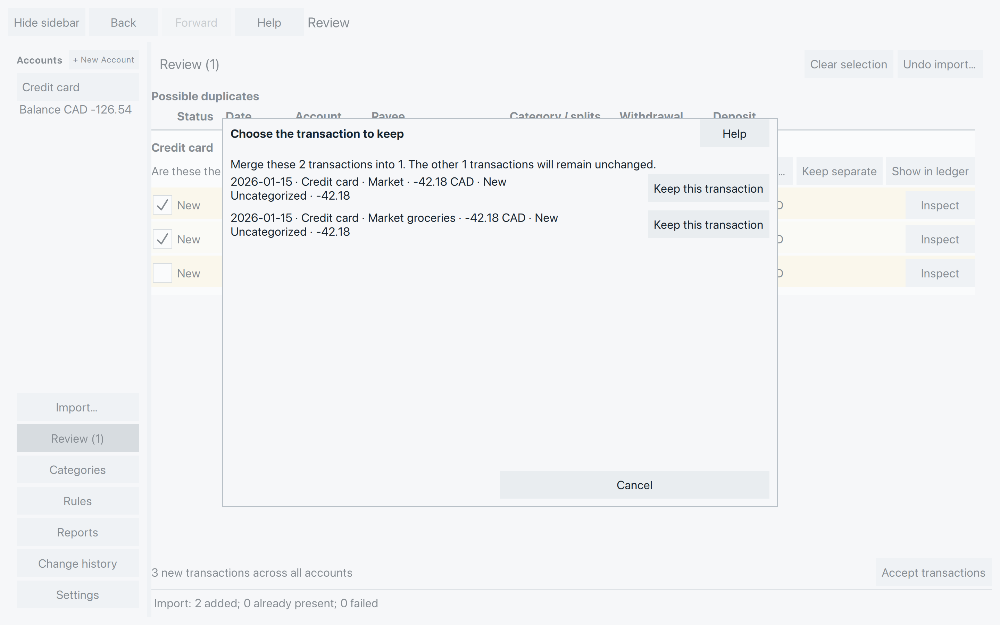
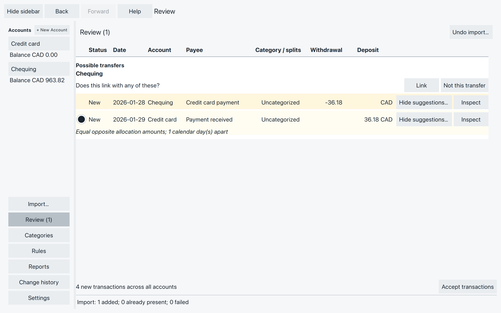
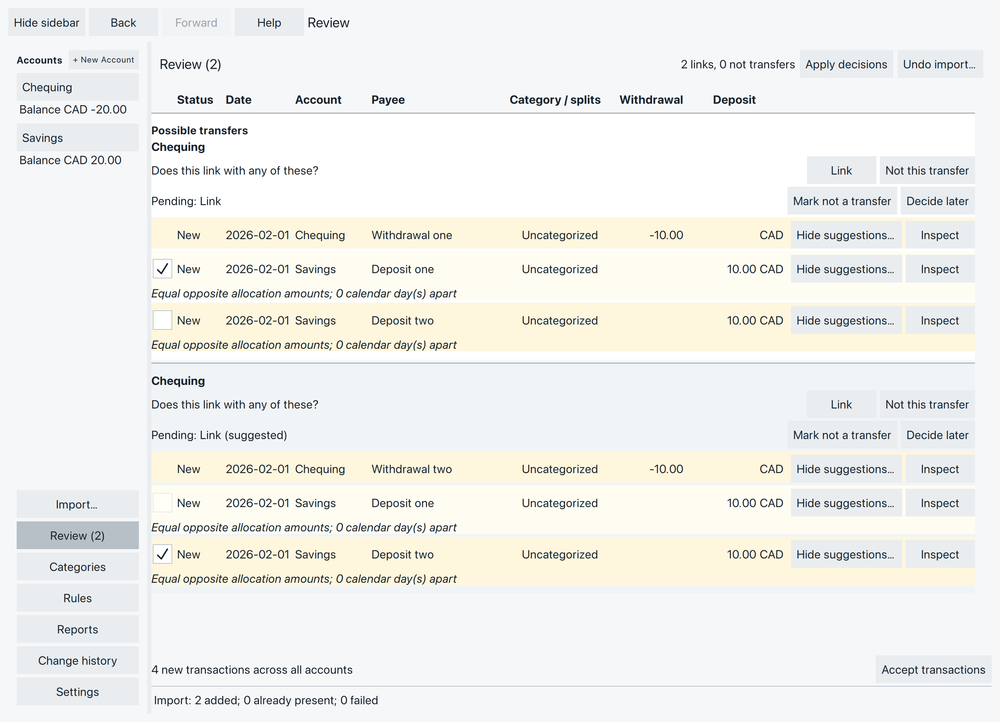
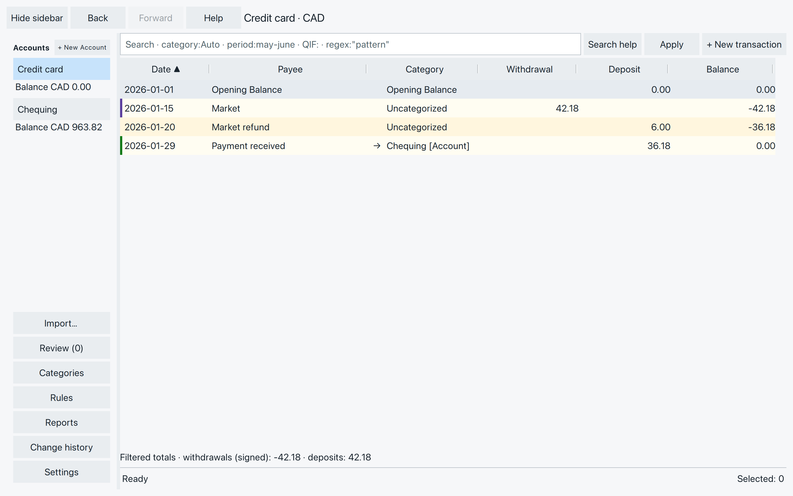
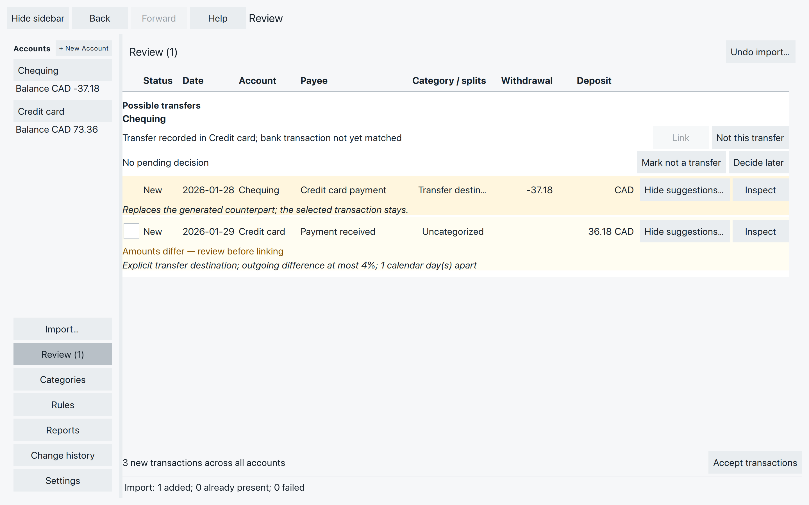
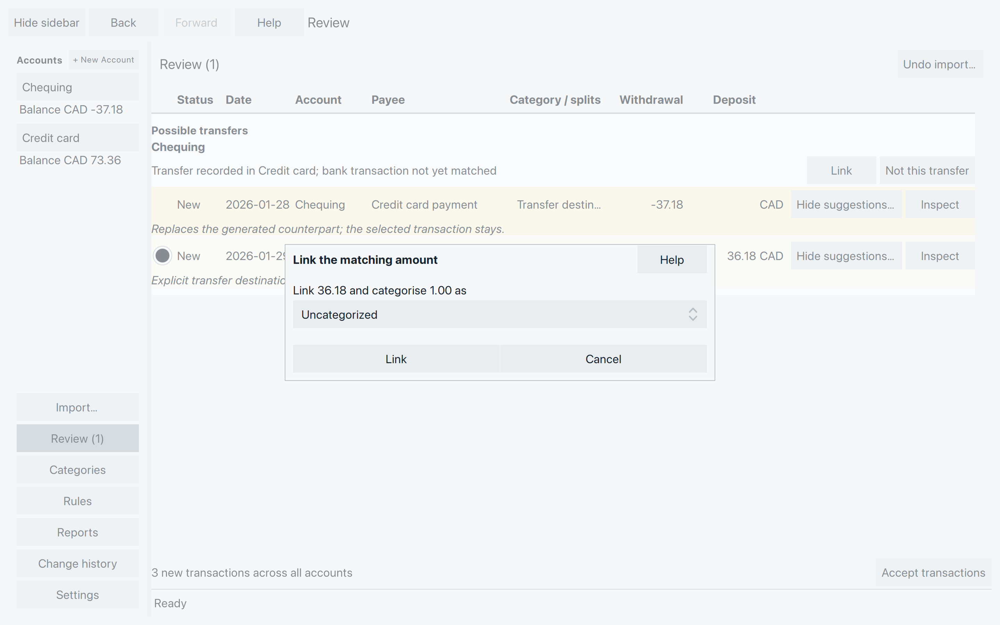
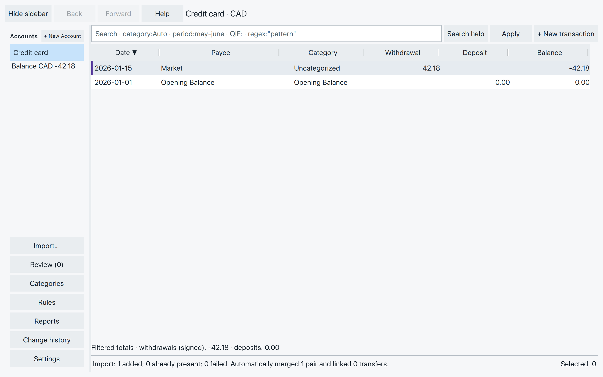

# Review duplicates and link transfers

Two entries can mean two very different things. Two imports of your
Market purchase may describe one purchase. A payment from Chequing
to Credit card belongs in both accounts.

**Merge** keeps one transaction for the same event in one account.
**Link** connects the two sides of a transfer between accounts.

Open **Review** in the sidebar. Read the question above each group
before you answer it. **Accept transactions** is at the bottom and
covers every account.

A recognized repeat of an accepted import does not need another Review
answer, even after you edit the transaction. If the matched entry was
removed or its original details no longer agree, answer the question about
whether it is already imported or a separate transaction. **Accept anyway**
does not add that unresolved entry again.

## Is it the same purchase? {#is-it-the-same-purchase}

Under **Possible duplicates**, compare the date, amount and payee
with your statement. Each row is marked **New** or **Accepted**.
Expand the category’s split count to see its parts and memos. Two
purchases with the same date and amount can still be separate purchases.

A later download can date the same purchase one day earlier or later.
If that date is earlier than the newest accepted transaction in the
account, Review may ask **Are these the same? Dates differ.** You may
see both dates in one group, with the day between them. Compare the
dates. Two purchases on neighboring days can still be separate.
**Select all merges** skips a group whose dates differ.

- **Merge 2 rows** keeps one transaction for a pair that describes
  the same event.
- **Keep separate** remembers that they are different.
- For more than two entries, there is no **Include match**. Check the
  two rows that belong together. Until two are checked, the button says
  **Select rows to merge**. With two checked, it says **Merge 2 selected
  rows** when one of them is kept for you, or **Merge 2 selected rows…**
  when you still need to choose which one to keep. Three or more checks
  in that group are left as they are.
- **Show in ledger** opens one of the entries in its account.
- **Inspect** opens the entry in its account ledger, among the
  surrounding transactions. Use **Back** to return to the same question
  with your choices still in place.

If asked **Choose the transaction to keep**, choose the entry whose
current details you want to retain. Its payee, memo, categories and
splits stay; Merge does not combine everyone’s edited fields.

*Here both copies are new, so you choose which one to keep. Cancel leaves them separate.*

With one accepted entry, SpentIt normally keeps that entry without
asking. A manually entered transaction takes priority when matching
it to an import: the manual entry stays and gains its imported original.
Without automatic Merge enabled, you still choose whether to merge the pair.

For these examples, we return to the original Market purchase and
refund, without the extra Corner shop purchase from the previous
chapter. Keeping one 42.18 purchase and the 6.00 refund leaves the
card balance at **-36.18**. If you kept Corner shop too, the balance is
**-56.18** before the payment and **-20.00** afterward. Keep that purchase;
these pictures show only the Market example.

### Merge several matches

**Select all merges** marks every ready pair that shares a date.
Check **Include match** beside a pair you have compared. Choose the
entry to keep if asked. The label changes to **Selected match** with
a number. A group of more than two has no **Include match**; check
its rows instead, as described above.

**Merge pairs** merges every two-row question you marked, and any larger
question where you checked exactly two rows and one of them is already
the one to keep. A group that still needs a choice waits for its own
button. One **Undo** reverses that whole batch. **Clear merge selection**
drops the **Include match** marks without merging.

Two rows left afterwards come back as an ordinary pair, with **Include
match**. One row left leaves Review and stays in the account. Leaving
Review, or a change to the file’s transactions, clears these choices.
Reading a row does not. If a selected match is no longer valid, the
batch is refused and nothing in it is merged.

## Is it a payment between accounts? {#is-it-a-payment-between-accounts}

Our card payment is **-36.18 in Chequing** and **+36.18 in Credit card**.
The bank might date it January 28 and the card provider January 29.
These are two postings of one transfer, not a duplicate purchase.

When that payment is in both imported files, Review asks once. The
question starts from the withdrawal, and the deposit is the other line.
The number in **Review (n)** includes it once. A different payment has
its own section in Review.

In a transfer question, check both account names, the signs and the dates.
Straightforward pairs with equal amounts start checked at the top.
Other cards start undecided. Check the partner that belongs with the
payment. If another pending link already uses that entry, its checkbox
is dimmed. You can still read the details or use **Inspect**. Release
the other choice to make the entry available again.

*Check the pending decisions before saving them.*

- Uncheck the selected partner to set **Not this transfer**. Use
  **Mark not a transfer** to set that answer for every partner on the card.
- Choose **Decide later** to leave the card out. Unchecking, rejecting,
  or setting a card aside can clear checks that depended on that choice.
  Choosing a partner can suggest new checks on related cards. Review
  those changes before saving. Your own rejections and deferrals stay
  in place.
- To save the displayed counts of links and rejections together, choose
  **Apply decisions** beside **Undo import**. One **Undo** reverses the
  batch. Cards that still need a split or amount choice wait for you.
- To save just one card, use its **Link** or **Not this transfer** button.
  Your other pending choices stay. If a choice is flagged after a change,
  check the card and choose again.

*The second card suggests Deposit two. To make Deposit one available there, release it on the first card.*

An unanswered card stays out of the batch. **Inspect** and **Back** keep
pending choices. Leaving Review by another route clears them.

If either transaction has several splits, use **Split to link** where
shown. Check the parts before linking. A rejected pair stays in its two
accounts, with neither line treated as ordinary spending.

Suggestions use the same currency, opposite signs, and dates no more
than seven calendar days apart. Ordinary spending categories can
prevent a transfer suggestion. Don’t remove a valid category merely
to make a suggestion appear.

After linking, the category names the other account. Click its arrow
to visit the related posting, then use **Back** to return.

*The payment clears the 36.18 card debt. Chequing still contains its withdrawal.*

### If SpentIt created the other side {#if-spentit-created-the-other-side}

An imported transfer can name another account before that account’s
bank posting arrives. SpentIt creates the corresponding entry there.
Review may ask you to find its bank match.

When the real posting arrives, linking it replaces the extra generated
entry where eligible. Read the question’s explanation before confirming;
this is why an account balance may change when a generated duplicate
is removed.

If you have checked the transfer and the bank posting has not arrived,
choose **Accept without bank match** when the card shows only the
transfer. That records the missing match. It is separate from
**Accept transactions**. You can match an imported posting later.
Don’t add another transfer just to clear the question.

When the other imported line is already on the card, **Accept without
bank match** is not offered. Use **Link** or **Not this transfer** for
that pair.

## When the amounts differ {#when-the-amounts-differ}

Suppose Chequing shows **37.18 paid** but Credit card received **36.18**.
If the extra **1.00** is a real fee, it belongs in an ordinary category,
not in the amount transferred.

The partner starts unchecked and may say **Amounts differ — review before
linking**.

*Check the partner you want to review before choosing Link.*

Check it and choose the card’s **Link** button.
In **Link the matching amount**, choose a category for the difference,
then choose **Link** to save. **Cancel** leaves the question open.

*Choose a suitable fee category if the statement confirms a fee. Uncategorized leaves it to categorize later.*

SpentIt splits the larger amount: 36.18 becomes the transfer and 1.00
gets your chosen category. The two imported transaction totals stay unchanged.
Check the statement before treating a difference as a fee.

These suggestions require an explicit outgoing transfer destination,
an outgoing amount larger than the incoming amount, and a difference
no greater than 4% of the outgoing amount. They do not convert currencies.
If no suitable suggestion appears, check the accounts, dates, amounts
and categories rather than changing accurate values to force a match.

## If there is no suitable question

For a duplicate you have identified yourself, select the entries in
one account’s ledger, right-click and choose **Merge**. You can also
use the duplicate line above the ledger, described in
[Find your way around transactions](find-transactions.md#see-what-needs-attention).
Check which entry will be kept, just as in Review.

For a transfer whose two entries each have just one split, select
the first entry, right-click and choose **Link to other account…**. Switch
accounts, select the other entry, then choose **Link to other account…** again.
The same steps work when the accounts use different currencies. One
amount should be money going out and the other money coming in.
SpentIt keeps both amounts. It does not look up a rate or change
either posting. If a fee should stay visible on its own, give it a
split before you link, then link the transfer amount rather than the
whole purchase. If you see **Choose which split to transfer**, the
entry has more than one part and Link could not tell which one you
meant. In a Review question, use **Split to link** when it is offered.
Read the confirmation before you apply the link. The command still
checks whether the two postings can be linked.

If Review shows **Import problems**, choose **Review…** on that line.
A line that names a transaction opens it. A line that does not opens
that account’s ledger.

With automatic linking on, confirming **Merge this payment?** in the
ledger can also link remaining pairs that have just one clear match
in the same group. Check the summary for any additional pairs.
The links save together and one Undo reverses them. Cancelling while
the links are being prepared leaves the whole group as it was.
Redo puts back the same pairs. Any ambiguous pairs still need your
attention, and you still choose when to accept transactions.

For suggestions you do not want to see again, choose **Hide suggestions…**
on a transfer row. **Don’t suggest links** asks for payee or memo text.
By default that text must match the whole field, ignoring capitalization
but keeping spaces and punctuation. You can limit it to that account.
Choose **Preview** before **Save**. It affects later suggestions.
The matches you have hidden are listed in **Settings → Hidden transfer
matches…**.

## Let SpentIt handle straightforward matches

SpentIt checks for straightforward matches after an import finishes
its category choices and rules. Both settings start checked. In
**Settings**, above **Hidden transfer matches…**, you can turn off either
one for later imports:

- **Automatically merge one-to-one duplicate suggestions**
- **Automatically link one-to-one transfer suggestions**

SpentIt remembers these choices for this file’s location. A copy opened
from another location starts with both checked.

SpentIt looks for clear same-day pairs involving the new import
first. Then it checks the remaining pairs. A duplicate can be a day apart if each entry has
only the other as a match, their amounts agree, and SpentIt can
tell which entry to keep. Transfers can be up to seven calendar days
apart. One pair of equal and opposite splits in the same currency can
link while other splits stay as they are. When more than one pair of
splits fits, or the amounts differ, choose what to do in Review.

While this runs you’ll see **Checking duplicate and transfer
suggestions**, followed by counts as SpentIt merges or links them.

Check the import summary for how many pairs were merged or linked, then
look over the marked transactions. An indigo edge means Merged; a green edge
means linked to another account. These marks can appear on accepted entries
too, and stay if you close and reopen the file.

*The accepted purchase stays, with a mark to help you check the automatic result.*

You still choose **Accept transactions** when you are ready. It clears those
marks, even when there are no new transactions left. If automatic
matching is cancelled or fails, the import stays and none of those
pairs are saved. The summary
asks you to review the remaining matches.

## Undo a mistaken answer

If Merge or Link was your latest saved action, choose **Edit → Undo**, or
press **Command+Z** on a Mac or **Ctrl+Z** on Windows and Linux. A batch of
decisions is one step. Matches made during import are saved with that
import. **Undo import** removes them together with the imported entries.
Use **Unmerge** to break one link or merge on its own.
To undo an earlier answer, undo the newer actions first. You can inspect
that order in **Change history** and put an undone answer back with **Redo**.
See [Undo a saved change](add-correct-transactions.md#undo-a-saved-change).

For a joined transaction, you can also select its row in the account ledger,
right-click and choose **Unmerge**. This can remain available after acceptance
and after closing the file. It is unavailable on an ordinary transaction or
one that belongs to more than one join.

For a duplicate merge, Unmerge restores the removed transaction and keeps any
later edits to the entry you retained. For a linked payment, read the
confirmation: it names the accounts where extra entries will return. If the
link kept both transactions, Unmerge leaves both in place and separates them.

Accepted payments stay accepted. Restored extra transfer entries return as
new transactions, with blue marks where the payment is shown twice again.
You can use Merge to join the payment again, or answer its Link question in
Review. If the imported destination was wrong, open the original
transaction and choose a category or **Uncategorized**. Choose
**Correct** on a Review problem to open the transaction editor, even
if you previously closed it. An independent posting in the other
account stays. After cleanup, you can [delete an empty account](accounts.md#delete-an-unused-account)
if it meets the deletion requirements.

If a later transfer correction, including a date change, prevents
Unmerge, undo that correction first.

A refused Merge or Link leaves a message explaining what needs attention.
Different current totals or existing transfer relationships can prevent
a merge. Refresh your comparison and correct only values you know are
wrong. If SpentIt cannot confirm whether an operation was saved, reopen
the file and inspect the result before trying again.
