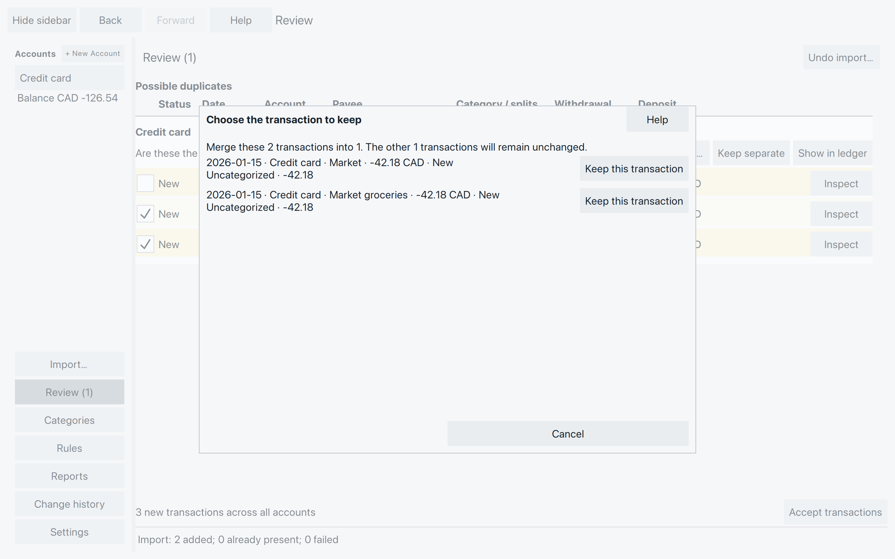
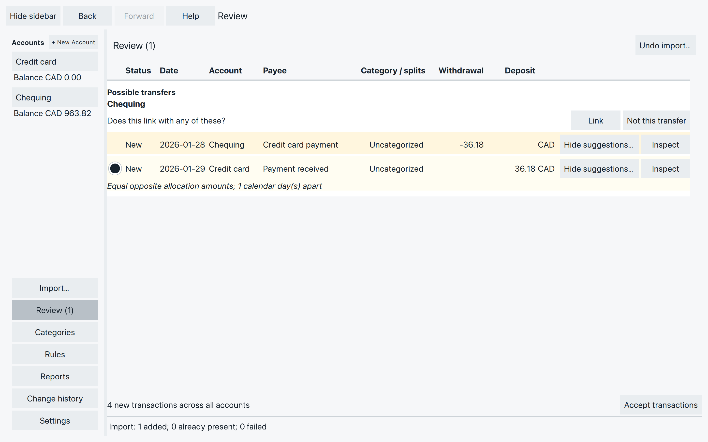
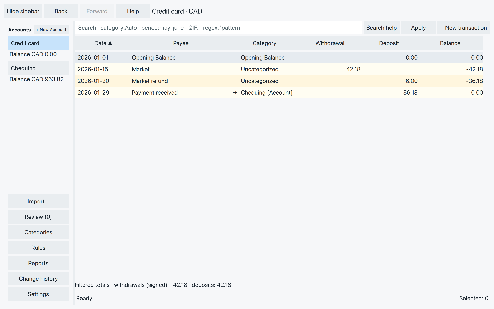
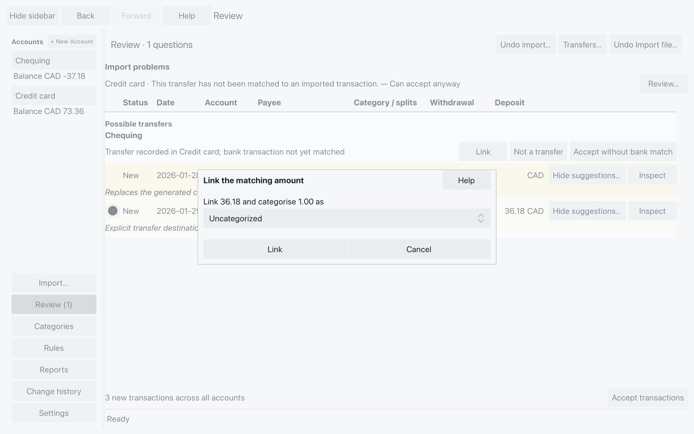

# Review duplicates and link transfers

Two entries can mean two very different things. Two imports of your
Market purchase may describe one purchase. A payment from Chequing
to Credit card belongs in both accounts.

**Merge** keeps one transaction for the same event in one account.
**Link** connects the two sides of a transfer between accounts.

Open **Review** in the sidebar. Read the question above each group
before you answer it. **Accept transactions** is at the bottom and
covers every account.

## Is it the same purchase? {#is-it-the-same-purchase}

Under **Possible duplicates**, compare the date, amount and payee
with your statement. Each row is marked **New** or **Accepted**.
Expand the category’s split count to see its parts and memos. Two
purchases with the same date and amount can still be separate purchases.

A later download can date the same purchase one day earlier or later.
If that date is earlier than the newest accepted transaction in the
account, Review may ask **Are these the same? Dates differ.** You may
see both dates in one group, with the day between them. Compare the
dates. Two purchases on neighboring days can still be separate.
**Select all merges** skips a group whose dates differ.

- **Merge 2 rows** keeps one transaction for a pair that describes
  the same event.
- **Keep separate** remembers that they are different.
- For more than two entries, check the two rows that belong together.
  **Merge pairs** merges every checked pair. Three or more checks in
  one group are left unchanged. Until two rows are checked, the
  group’s button says **Select rows to merge**.
- **Show in ledger** opens one of the entries in its account.
- **Inspect** opens a row so you can read it. It does not answer the question.

If asked **Choose the transaction to keep**, choose the entry whose
current details you want to retain. Its payee, memo, categories and
splits stay; Merge does not combine everyone’s edited fields.

*Here both copies are new, so you choose which one to keep. Cancel leaves them separate.*

With one accepted entry, SpentIt normally keeps that entry without
asking. A manually entered transaction takes priority when matching
it to an import: the manual entry stays and gains its imported original.
Manual entries are not automatically consumed just because a matching
import arrives.

For these examples, we return to the original Market purchase and
refund, without the extra Corner shop purchase from the previous
chapter. Keeping one 42.18 purchase and the 6.00 refund leaves the
card balance at **-36.18**. If you kept Corner shop too, the balance is
**-56.18** before the payment and **-20.00** afterward. Keep that purchase;
these pictures show only the Market example.

### Merge several matches

**Select all merges** marks every ready pair that shares a date.
Check **Include match** beside a pair you have compared. Choose the
entry to keep if asked. The label changes to **Selected match** with
a number. A group of more than two has no **Include match**; check
its rows instead, as described above.

**Merge pairs** merges them. One **Undo** reverses
that whole batch. **Clear merge selection** drops the **Include
match** marks without merging.

Two rows left after a merge come back as an ordinary pair. One row
left stays in the account. Leaving Review, or a change to the file’s
transactions, clears these choices. Reading a row does not. If a
selected match is no longer valid, the batch is refused and nothing
in it is merged.

## Is it a payment between accounts? {#is-it-a-payment-between-accounts}

Our card payment is **-36.18 in Chequing** and **+36.18 in Credit card**.
The bank might date it January 28 and the card provider January 29.
These are two postings of one transfer, not a duplicate purchase.

In a transfer question, check both account names, the signs and the
dates. Select the matching candidate’s round button if there is more
than one. A preselected candidate is only a suggestion.

*Both accounts need their posting. Link connects the selected pair. It does not merge them into one account.*

Choose **Link** for the selected pair, or **Not a transfer** to reject
the displayed comparisons and keep both transactions. If either
transaction has several splits, use **Split to link** to choose the
relevant part on each side. Check any preselected split before proceeding.

Suggestions use the same currency, opposite signs, and dates no more
than seven calendar days apart. Ordinary spending categories can
prevent a transfer suggestion. Don’t remove a valid category merely
to make a suggestion appear.

After linking, the category names the other account. Click its arrow
to visit the related posting, then use **Back** to return.

*The payment clears the 36.18 card debt. Chequing still contains its withdrawal.*

### If SpentIt created the other side {#if-spentit-created-the-other-side}

An imported transfer can name another account before that account’s
bank posting arrives. SpentIt creates the corresponding entry there.
Review may ask you to find its bank match.

When the real posting arrives, linking it replaces the extra generated
entry where eligible. Read the question’s explanation before confirming;
this is why an account balance may change when a generated duplicate
is removed.

If you have checked the transfer and have no bank posting to match,
use **Accept without bank match** where offered. This acknowledges the
missing match; it is separate from **Accept transactions**. You can
match an imported posting later. Don’t add another transfer simply
to clear the question.

## When the amounts differ {#when-the-amounts-differ}

Suppose Chequing shows **37.18 paid** but Credit card received **36.18**.
If the extra **1.00** is a real fee, it belongs in an ordinary category,
not in the amount transferred.

Choose **Link**. When the amounts differ, **Link the matching amount**
opens. Choose the category for the difference, then **Link**. **Cancel**
leaves the question unanswered.

*Choose a suitable fee category if the statement confirms a fee. Uncategorized leaves it to categorize later.*

SpentIt splits the larger amount: 36.18 becomes the transfer and 1.00
gets your chosen category. The two imported transaction totals stay unchanged.
Check the statement before treating a difference as a fee.

These suggestions require an explicit outgoing transfer destination,
an outgoing amount larger than the incoming amount, and a difference
no greater than 4% of the outgoing amount. They do not convert currencies.
If no suitable suggestion appears, check the accounts, dates, amounts
and categories rather than changing accurate values to force a match.

## If there is no suitable question

For a duplicate you have identified yourself, select the entries in
one account’s ledger, right-click and choose **Merge**. You can also
use the duplicate line above the ledger, described in
[Find your way around transactions](find-transactions.md#see-what-needs-attention).
Check which entry will be kept, just as in Review.

For a transfer whose two entries each have just one split, select
the first entry, right-click and choose **Link**. Switch accounts,
select the other entry, then right-click and choose **Link** again.
Read the confirmation before applying it. The command still checks
whether the two postings can be linked.

For suggestions you do not want to see again, choose **Hide suggestions…**
on a transfer row. **Don’t suggest links** asks for payee or memo text.
By default that text must match the whole field, ignoring capitalization
but keeping spaces and punctuation. You can limit it to that account.
Choose **Preview** before **Save**. It affects later suggestions.
**Transfers…** in Review is where you add a transfer yourself.
Hidden suggestions are listed in **Settings → Hidden transfer suggestions…**.

## Undo a mistaken answer

**Undo** at the top of Review reverses the latest saved action in the
file, including a Merge, a Link or a batch of merges. Confirm it before
continuing. A batch is one step. There is no separate **Unlink** button.

A later saved action replaces that Undo. If a later change shares a
transaction, Change history can still undo the review answer with it.
See [Undo a saved change](add-correct-transactions.md#undo-a-saved-change).
If Undo is unavailable, look at both sides before you delete a posting.
Deletion also changes the account balance.

A refused Merge or Link leaves a message explaining what needs attention.
Different current totals or existing transfer relationships can prevent
a merge. Refresh your comparison and correct only values you know are
wrong. If SpentIt cannot confirm whether an operation was saved, reopen
the file and inspect the result before trying again.
