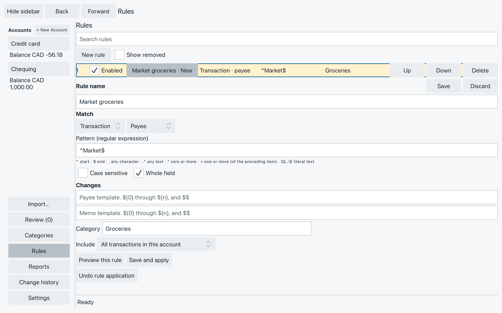
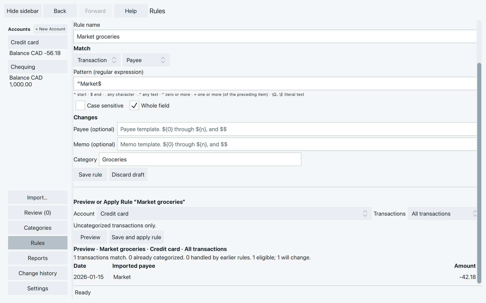
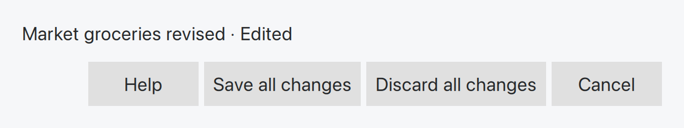

# Use rules for repeated categorization

If you usually give Market purchases the same category, a rule can do
that work for you. You tell SpentIt what to recognize and which category
to use. Start with one familiar payee and check the matches before applying it.

Rules fill **Uncategorized** parts of transactions. They don’t replace
categories you’ve already chosen, and they cannot create transfers.

## Make a Market rule

Select **Credit card**, then **Rules** in the sidebar. Choose **New rule**.

1. Give it a name, such as **Market groceries**.
2. Under **Match**, leave **Transaction** and **Payee** selected.
3. Enter **Market** in **Pattern (regular expression)**.
4. Check **Whole field** to match just Market, rather than any payee
   containing that word. Leave **Case sensitive** off to allow different
   capitalization.
5. Under **Changes**, choose **Groceries** in Category. Leave the payee
   and memo templates empty to keep that text as it is.

*The rule’s name helps you find it later. Its pattern decides what matches.*

Choose an existing ordinary category. If it is missing, create it in
[Categories](categories.md) first. Every rule needs a category, even if
you also want it to tidy a payee or memo.

The screenshots show the Market purchase before it was categorized.
If you followed the earlier category chapter, it already has Groceries
and this rule will correctly leave it alone. There is no need to clear
its category just to try a rule.

You can also select an imported transaction in the ledger and choose
**Create rule…**. With several splits, choose the transaction or the
relevant split when asked. Check the proposed pattern and category.
**Edit rule…** opens an available rule that assigned a value to that entry.
For a manually entered transaction, start with New rule in Rules instead.

## Preview, save and apply {#preview-save-and-apply}

**Include** chooses which transactions to consider in the selected account:

- **All transactions in this account** includes both new and accepted entries.
- **New transactions only** excludes entries you have already accepted.

Choose **Preview this rule**. The list shows eligible matching transactions with
their imported payee, date and amount. A split match still appears as one
transaction row. Preview does not change your transactions.

*The Uncategorized Market purchase matches. The already categorized entries stay as they are.*

Use **Save** to keep the selected rule without applying it to existing
transactions. Use **Save and apply** to save it and apply it to the chosen
account scope. Once saved, that button reads **Apply to this account now**.
You can apply without previewing, but a preview is useful while learning a pattern.

These buttons concern the selected rule. Other unfinished rule edits stay
unfinished. There is no separate all-rules Apply button in this workspace.
Saved enabled rules run during later imports, after any missing-category
choices are resolved. They work across your file’s accounts; the Include choice controls this account application,
not which accounts may use the rule during import.

**Undo rule application** reverses an eligible account application as one
operation. It does not delete the saved rule. Check the result before making
other changes, which can make Undo unavailable. Disabling or deleting a rule
also leaves its earlier assignments in place.

## What a rule reads

For imported transactions, rules match the **original imported** payee,
memo or category. Editing the displayed payee does not change that original
match text. Manually entered transactions use their current text, while
manually edited payees and memos remain protected from rule replacement.

An empty template leaves that field alone. A plain-text payee or memo template
supplies replacement text when the rule is allowed to change it. Rules do not
change dates, amounts or the number of splits.

### Transaction and Split rules {#transaction-and-split-rules}

A **Transaction** rule matches a transaction field and fills its remaining
Uncategorized splits. On a split transaction it assigns categories without
rewriting the shared payee or memo.

A **Split** rule works on individual imported splits. It can match their
**Memo** or **Category**, or the transaction’s **Parent payee**. It can assign
a category and change that split’s memo, but not the transaction’s payee.
A manually added split has no imported split text for this kind of rule.

For the Corner shop purchase, suppose the -12.00 grocery part were
Uncategorized and its imported memo said **groceries**. A Split rule matching
that memo could give it Groceries while leaving the -8.00 Household part alone.
In our earlier example both parts already have categories, so neither needs a rule.

Split rules run first, then Transaction rules fill what is still Uncategorized.
Within each kind, list order matters: the first eligible match assigns the
category. Select a rule and use **Up** and **Down** to put specific rules ahead of
broader ones, then save the change. Applying one selected rule still respects earlier saved
rules: it does not take a match that an earlier rule would categorize.

## Keep and change your rules {#keep-and-change-your-rules}

Use **Search rules** to find a name, pattern or action, then select its row
to edit. **Save** keeps that rule’s changes; **Discard** restores its saved
version or removes an unsaved new rule. Finish or discard the one new rule
before starting another.

Select the rule before changing it. Uncheck **Enabled** to stop using it,
or choose **Delete** to remove it, then Save. **Show removed** lets you find deleted rules and **Copy into new
rule** if you want to start again from one.

If you leave Rules with unfinished changes, SpentIt asks what to do.

*Stay returns to your unfinished edits.*

Here, **Save** validates and saves all outstanding rule edits before leaving;
it does not apply them to transactions. **Discard** drops those unfinished
edits. **Stay** keeps you in Rules. If Save finds a problem, correct the rule
it shows and try again.

## If the matches aren’t what you expected

Check the selected account and Include choice first. Then check whether the
transaction’s relevant parts are already categorized, whether the rule is
Enabled, and whether an earlier rule takes the match. For imported entries,
compare the pattern with the original text, not a renamed payee. Transfers
are not ordinary rule targets.

If there are too many matches, try Whole field or a more specific pattern.
A pattern error needs correcting; it is not the same as no matches.
Choose a valid category if SpentIt asks for one, then preview again.

## Optional: a regular-expression cheat-sheet

Bank descriptions can be untidy, but they often repeat a pattern: a payment
service, a shop name, then a reference number. A **regular expression** (regex)
lets you recognize those pieces. You can keep useful text and leave the rest
out of the displayed payee.

Start with ordinary words. `Market` finds that text anywhere in the field, even inside a longer word;
**Whole field** limits it to the complete field. Matching ignores capitalization
unless you check **Case sensitive**.

### Common pattern pieces

See [Common pattern pieces](search-examples.md#common-pattern-pieces) for the shared
pattern reference. Enter these pieces in **Pattern (regular expression)**;
ledger search uses an extra `regex:"…"` wrapper.

### Keep the useful part of a PayPal description

Suppose the imported payee is **PAYPAL *EBAY Jewellery**. You want it to read
**Jewellery from eBay**, rather than simply PayPal.

Make a **Transaction / Payee** rule and enter:

**Pattern:** `^PAYPAL\s+\*EBAY\s+(.+)$`

**Payee template:** `${1} from eBay`

Choose a suitable category as well—every rule needs one. Here is how the
pattern separates the description:

- `^PAYPAL` starts at PAYPAL.
- `\s+` allows one or more spaces after it.
- `\*EBAY` matches the literal asterisk followed by EBAY.
- The next `\s+` separates EBAY from the purchase description.
- `(.+)` captures the remaining text, **Jewellery**. The `$` takes the match
  to the end of the field.

`${1}` inserts that first captured piece into the replacement payee.
The template supplies the words **from eBay**, producing **Jewellery from eBay**.
With **PAYPAL *EBAY Books**, the same rule produces **Books from eBay**.
Only use one category for these matches if that category fits them all;
otherwise make the pattern more specific or categorize them separately.

Put this specific eBay rule above a broader PayPal rule and save its position.
That lets it take these purchases before the broader rule assigns a category.
Preview checks which entries match; after applying, check the resulting payee
in the ledger. The original imported description remains the text rules match.
Already categorized entries and protected manual text still follow the
restrictions described above.

### Reuse captured text in a template

Parentheses number captures from left to right. These pieces go in a **Payee
template** or **Memo template**:

| Piece | What it inserts |
| --- | --- |
| `${0}` | The whole matched text. |
| `${1}` | The text in the first capture. |
| `${2}` | The text in the second capture, if your pattern has one. |
| `$$` | A literal dollar sign. |

For example, `^(.+)\s+REF\s+([0-9]+)$` captures the shop name and reference
number from **Market REF 1234**. `${1}` keeps **Market**; `${1} (ref ${2})`
produces **Market (ref 1234)**. A template replaces the whole destination
field, so include every piece you want to keep. Use `${1}`, not `$1`.

You don’t need all of this at once. Begin with one description, add one piece,
and preview again. Leave templates empty when you only want a category change.
